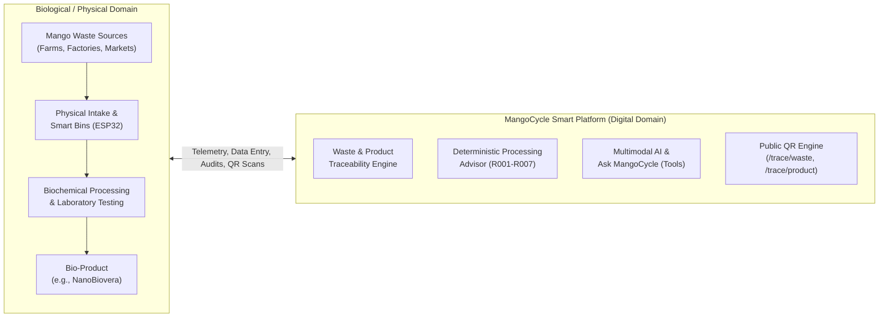
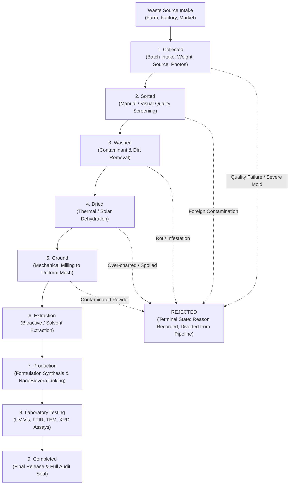
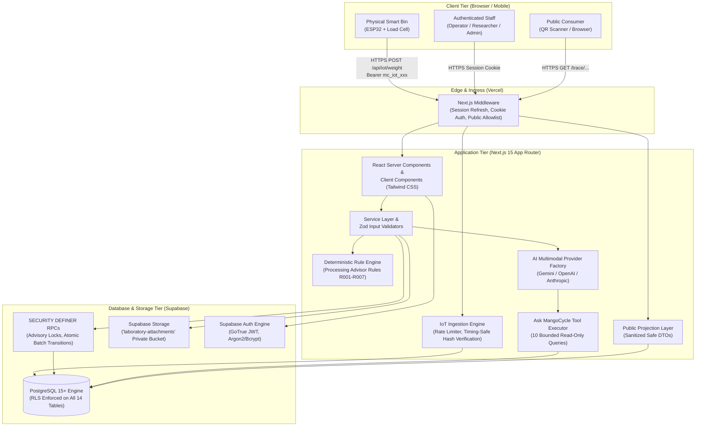
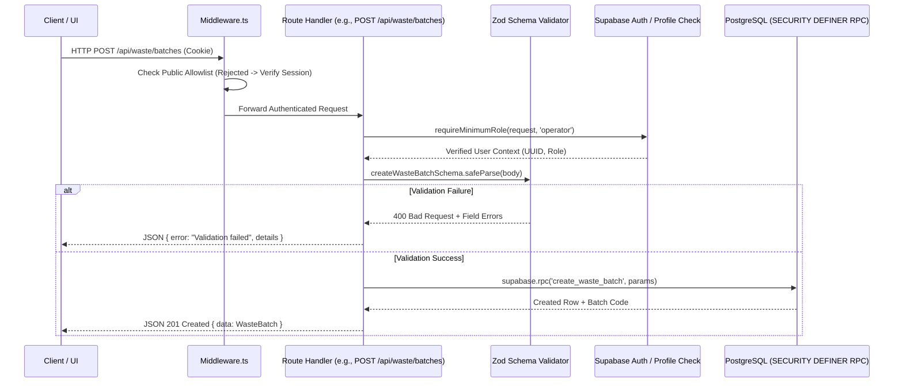
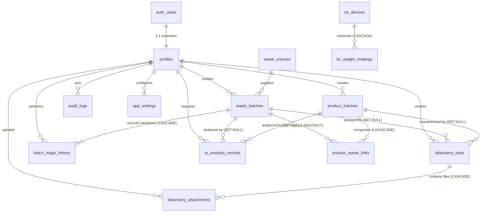
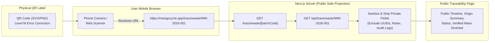
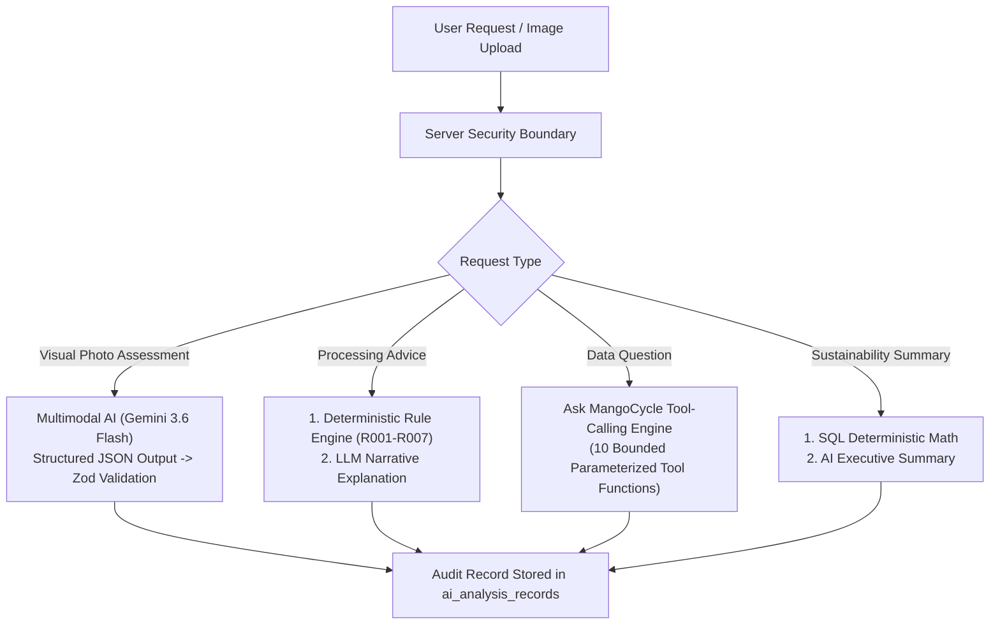
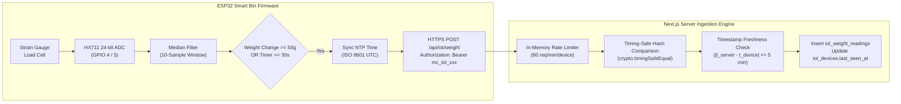
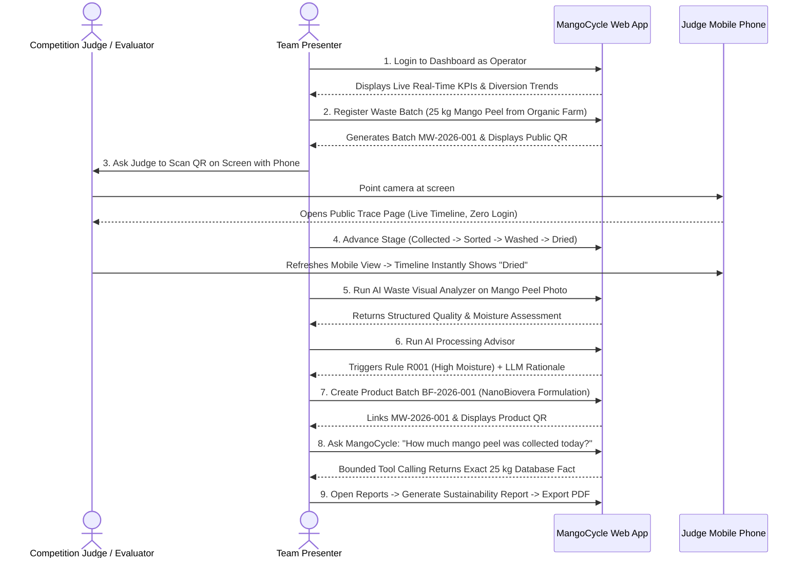

# MangoCycle Smart Platform

> **Master System Architecture, Implementation Guide, and Technical Documentation**  
> **Platform Version:** 0.1.0 (Production-Grade Prototype)  
> **Ecosystem:** MangoCycle Ecosystem | **Concept:** MangoCycle BioFactory | **Formulations:** NanoBiovera / Biofungicide  
> **Target Framework:** Next.js 15 (App Router, React 18, TypeScript 5, Tailwind CSS 3)  
> **Database & Backend Services:** Supabase PostgreSQL, Row Level Security (RLS), Supabase Storage, Supabase Auth  
> **AI Architecture:** Multimodal Provider Factory (Google Gemini primary, Anthropic, OpenAI) with Deterministic Rule Enforcing & Bounded Tool Calling  
> **Hardware / Edge Tier:** ESP32 Microcontroller + HX711 24-bit ADC + Strain Gauge Load Cell (Software Architecture Implemented; Hardware Verified in Simulation / Prototype State)

---

## Table of Contents

1. [Project Overview](#1-project-overview)
2. [Problem Statement](#2-problem-statement)
3. [Project Goals](#3-project-goals)
4. [End-to-End Workflow](#4-end-to-end-workflow)
5. [High-Level Architecture](#5-high-level-architecture)
6. [Technology Stack](#6-technology-stack)
7. [Why This Stack Was Chosen](#7-why-this-stack-was-chosen)
8. [Repository Structure](#8-repository-structure)
9. [Frontend Architecture](#9-frontend-architecture)
10. [Backend Architecture](#10-backend-architecture)
11. [Database Architecture](#11-database-architecture)
12. [Database Relationships](#12-database-relationships)
13. [Public Codes vs Internal IDs](#13-public-codes-vs-internal-ids)
14. [Authentication](#14-authentication)
15. [Authorization & RBAC](#15-authorization--rbac)
16. [First Super Admin Provisioning](#16-first-super-admin-provisioning)
17. [Row Level Security](#17-row-level-security)
18. [SECURITY DEFINER Functions & RPCs](#18-security-definer-functions--rpcs)
19. [Waste Batch Management](#19-waste-batch-management)
20. [Product Batch Management](#20-product-batch-management)
21. [Laboratory Module](#21-laboratory-module)
22. [QR Traceability System](#22-qr-traceability-system)
23. [Public vs Private Data Boundary](#23-public-vs-private-data-boundary)
24. [Dashboard & Metrics](#24-dashboard--metrics)
25. [AI Architecture Overview](#25-ai-architecture-overview)
26. [AI Waste Visual Assessment](#26-ai-waste-visual-assessment)
27. [AI Processing Advisor](#27-ai-processing-advisor)
28. [Ask MangoCycle (Tool-Calling Engine)](#28-ask-mangocycle-tool-calling-engine)
29. [AI Sustainability Insights](#29-ai-sustainability-insights)
30. [Stateless Report Generator](#30-stateless-report-generator)
31. [IoT Smart Bin Architecture](#31-iot-smart-bin-architecture)
32. [Audit Logging System](#32-audit-logging-system)
33. [Security Architecture & Threat Mitigation](#33-security-architecture--threat-mitigation)
34. [Middleware & Route Protection](#34-middleware--route-protection)
35. [Input Validation & Zod Schema Layer](#35-input-validation--zod-schema-layer)
36. [File Upload Security & Storage Policies](#36-file-upload-security--storage-policies)
37. [Environment Variables Specification](#37-environment-variables-specification)
38. [Local Development Setup](#38-local-development-setup)
39. [Supabase Backend Setup & Migration Guide](#39-supabase-backend-setup--migration-guide)
40. [AI Provider Setup & Quota Handling](#40-ai-provider-setup--quota-handling)
41. [Vercel Deployment Guide](#41-vercel-deployment-guide)
42. [Complete Application Route Inventory](#42-complete-application-route-inventory)
43. [API Architecture & Endpoint Specifications](#43-api-architecture--endpoint-specifications)
44. [Error Handling & Resiliency](#44-error-handling--resiliency)
45. [Testing Strategy & Quality Gates](#45-testing-strategy--quality-gates)
46. [Competition & Production Demo Walkthrough](#46-competition--production-demo-walkthrough)
47. [Canonical Example: Waste Batch](#47-canonical-example-waste-batch)
48. [Canonical Example: Product Batch](#48-canonical-example-product-batch)
49. [Data Integrity Rules & Invariants](#49-data-integrity-rules--invariants)
50. [Known Limitations & Technical Debt](#50-known-limitations--technical-debt)
51. [Future Enhancements & Post-MVP Roadmap](#51-future-enhancements--post-mvp-roadmap)
52. [Scientific Integrity & AI Safety Manifesto](#52-scientific-integrity--ai-safety-manifesto)
53. [Documentation Governance & Authority Model](#53-documentation-governance--authority-model)
54. [Important Architectural Decisions (ADR Catalog)](#54-important-architectural-decisions-adr-catalog)
55. [Comprehensive Troubleshooting Manual](#55-comprehensive-troubleshooting-manual)
56. [Production Security Deployment Checklist](#56-production-security-deployment-checklist)
57. [Production Smoke-Test Checklist](#57-production-smoke-test-checklist)
58. [Glossary of Canonical Terminology](#58-glossary-of-canonical-terminology)
59. [License & Academic Project Context](#59-license--academic-project-context)
60. [Final System Architecture Summary](#60-final-system-architecture-summary)

---

## 1. Project Overview

### Plain English Summary
**MangoCycle Smart Platform** is a specialized enterprise web platform and digital nervous system designed to manage, track, analyze, and verify the upcycling of mango agro-industrial waste into high-value biological products. 

Across mango farming, industrial juice processing, and consumer markets, millions of tons of mango peels and seed kernels are discarded annually into landfills or open dumps, releasing greenhouse gases and wasting potent biological compounds. The MangoCycle initiative intercepts this agricultural waste stream and transforms it through precise biochemical extraction and synthesis into sustainable bioproducts (such as biofungicides and nano-biological formulations like *NanoBiovera*).

The digital platform bridges the physical and biological world with transparent digital records: it tracks waste intake from physical origins, enforces strict step-by-step processing lifecycles, logs analytical laboratory measurements, computes auditable sustainability impacts, offers AI-powered decision support, and exposes secure, consumer-facing QR traceability without compromising confidential scientific or operational data.

### Technical Summary
From an engineering standpoint, the MangoCycle Smart Platform is a monolithic full-stack application built on **Next.js 15 App Router** and **TypeScript**, backed by **Supabase (PostgreSQL 15+)**, **Supabase Auth**, and **Supabase Storage**. 

It implements a least-privilege **Role-Based Access Control (RBAC)** model enforced across three independent defensive perimeters:
1. Edge & Next.js Middleware route guards.
2. Server-side service-layer input validation (powered by **Zod** schema compilation).
3. Database-native **Row Level Security (RLS)** policies with transactional **SECURITY DEFINER** Remote Procedure Calls (RPCs) protected by concurrency-safe PostgreSQL advisory locks (`pg_advisory_xact_lock`).



### Critical Boundary: Scientific Process vs. Digital Platform
To maintain absolute scientific and academic integrity, the platform strictly separates physical biotechnology responsibilities from software system duties:

| Biological / Scientific Process (Physical Reality) | Digital Platform Responsibilities (Software System) |
|---|---|
| Physical collection, manual sorting, and washing of peels/seeds. | Registers batch metadata, intake mass, source coordinates, and arrival timestamps. |
| Thermal oven drying, mechanical milling, and solvent extraction. | Tracks sequential stage progression, records operator IDs, and timestamps each transition. |
| Synthesis of bioactive formulations and nanoparticles. | Links upstream waste lots to downstream product batches with cryptographic UUID integrity. |
| Spectrophotometry (UV-Vis, FTIR), microscopy (TEM), and diffraction (XRD). | Securely archives quantitative results, units, status flags, and spectrometer files in private storage. |
| Actual environmental diversion and biological yields. | Computes deterministic mathematical KPI metrics; clearly flags unresolved scientific formulas as `Formula Pending`. |

> [!IMPORTANT]
> The software platform **does not manufacture bioproducts or fabricate scientific conclusions**. It serves as an immutable operational ledger, analytical assistant, and auditable verification layer.

### Naming Hierarchy & Canonical Terminology
The repository and authoritative documentation adhere to the following naming structure:
* **MangoCycle**: The overall university biotechnology initiative, circular bioeconomy project, and ecosystem.
* **MangoCycle Smart Platform**: The digital management, traceability, AI decision-support, and reporting software system.
* **MangoCycle BioFactory**: The biological production, pilot-plant processing, and manufacturing facility concept.
* **NanoBiovera / Biofungicide**: Representative candidate product formulation names produced by the BioFactory. The platform software does not hardcode a single product name; product entities remain dynamically configurable.

---

## 2. Problem Statement

Modern agricultural processing faces deep structural challenges regarding organic waste management and transparent supply chains:

```
[ Fragmented Farm & Factory Waste ] 
               │
               ▼  (No digital tracking, unknown moisture/spoilage, zero traceability)
[ Landfills & Open Dump Sites ] ──────► Methane Emissions & Lost Bio-Value
               ▲
               │  (Lack of unified records, inaccessible lab data, manual spreadsheets)
[ Biotechnology Research Silos ]
```

1. **Severe Biomass Inefficiency & Environmental Impact**: Mango processing generates 35% to 55% byproduct waste (peel, seed kernel, and fibrous pulp). Disposed organically in open environments, it undergoes rapid uncontrolled anaerobic decomposition, causing odor, pest vectors, and greenhouse gas emissions.
2. **Total Lack of Supply Chain Traceability**: Traditional waste collection relies on fragmented paper logs or disconnected spreadsheets. Researchers cannot trace which exact batch of mango peel yielded an extracted batch of polyphenols or biopolymers.
3. **Black-Box Processing Lifecycles**: Operating intermediate stages (sorting, washing, drying, grinding, chemical extraction) without centralized digital state machines leads to unrecorded delays, inconsistent quality, and untracked contamination.
4. **Isolated Laboratory & Analytical Records**: Spectrometric data (FTIR, UV-Vis) and physical characterization tests (TEM, XRD, antimicrobial assays) often live in disconnected laboratory computers, making end-to-end product verification impossible.
5. **Consumer & Stakeholder Transparency Deficit**: Commercial buyers and sustainability auditors require verifiable proof that finished biological products genuinely originate from recycled agricultural waste without exposing proprietary intellectual property or private internal notes.

The **MangoCycle Smart Platform** solves these challenges by providing a unified, secure, cloud-native operational platform linking waste intake, lifecycle stage advancement, laboratory testing, AI visual analysis, and public QR verification.

---

## 3. Project Goals

### Primary Objectives
* **End-to-End Batch Traceability**: Maintain an unbroken digital chain of custody from raw waste collection (`MW-YYYY-NNN`) through multi-stage processing to finished product formulations (`BF-YYYY-NNN`).
* **Deterministic Data Integrity**: Guarantee that all KPI calculations, waste diversion metrics, and lifecycle stage advancements are computed via auditable database constraints and verified code, completely separated from LLM interpretations.
* **Granular Role-Based Access Control**: Enforce strict five-tier authorization (`super_admin`, `admin`, `researcher`, `operator`, `viewer`) via multi-layered security.
* **Zero-Knowledge Public Transparency**: Deliver instantaneous, anonymous QR-based public verification pages that project safe, sanitized data views while keeping internal IDs, private notes, and raw spectra fully private.
* **Scientific Decision Support**: Provide multimodal AI image evaluation, rule-engine-driven processing advice, and bounded natural language database queries without allowing AI models to execute unconstrained SQL or fabricate scientific facts.

### Secondary Objectives
* **Optional IoT Telemetry**: Ingest real-time load cell measurements from ESP32 Smart Bins via secure HTTPS APIs with device API key hashing and timestamp freshness checks.
* **Stateless On-Demand Reporting**: Compile structured operational, laboratory, and sustainability summaries on demand with formula-injection-safe CSV export and print-optimized PDF generation.
* **Comprehensive Auditability**: Maintain an append-only, tamper-resistant system audit log tracking every security-sensitive mutation, role change, and batch transition.

---

## 4. End-to-End Workflow

The platform manages the complete circular bioeconomy lifecycle through a deterministic 9-stage sequential state machine:



### Detailed Canonical Processing Stages

| Stage # | Canonical Name | Database Enum | Purpose & Operational Activities | State Transition Trigger | Audit Log Action |
|:---:|---|---|---|---|---|
| **1** | **Collected** | `collected` | Raw waste recorded at collection point or Smart Bin. Stores mass (`weight_kg`), source, intake photos, initial moisture, and visual condition. | Initial batch creation (`create_waste_batch` RPC) | `batch.created` |
| **2** | **Sorted** | `sorted` | Manual or visual sorting separating peels, seeds, and removing foreign non-mango organic matter. | Operator stage advance modal | `stage.advanced` |
| **3** | **Washed** | `washed` | Surface sanitization and water-bath washing to remove dust, soil, pesticide residues, and microbial biofilms. | Operator stage advance modal | `stage.advanced` |
| **4** | **Dried** | `dried` | Controlled dehydration (oven or solar drying) reducing water activity to prevent bacterial degradation. | Operator stage advance modal | `stage.advanced` |
| **5** | **Ground** | `ground` | Mechanical pulverization and industrial ball milling into standardized particle mesh size powder. | Operator stage advance modal | `stage.advanced` |
| **6** | **Extraction** | `extraction` | Solvent or aqueous extraction isolating target polyphenols, mangiferin, pectin, or starch polymers. | Operator stage advance modal | `stage.advanced` |
| **7** | **Production** | `production` | Final biological formulation synthesis (e.g., *NanoBiovera* biofungicide or active extract formulation). | Operator stage advance modal | `stage.advanced` |
| **8** | **Laboratory Testing** | `laboratory_testing` | Quality control characterization, spectrophotometry, electron microscopy, and bio-efficacy assays. | Operator stage advance modal | `stage.advanced` |
| **9** | **Completed** | `completed` | Batch processing fully concluded. All inputs sealed and linked to downstream product inventory. | Operator stage advance modal | `stage.advanced` |
| **—** | **Rejected** | `rejected` | Terminal failure state. Triggered when waste exhibits excessive rot, insect infestation, or chemical contamination. | Operator rejection modal with mandatory reason (`reject_waste_batch` RPC) | `batch.rejected` |

### Stage Transition Rules
1. **Strict Sequential Advancement**: Stages can only advance in strict numerical order (`collected` → `sorted` → ... → `completed`). Skipping intermediate stages is blocked at the database level by `advance_waste_batch_stage()`.
2. **Immutable Terminal States**: Once a batch reaches `completed` or `rejected`, no further advancements or status changes are permitted.
3. **Rejection Semantics**: A batch may be transitioned to `rejected` from any active pre-completed stage. Rejection requires a non-empty human explanation stored in `batch_stage_history`.
4. **Append-Only History**: Every transition inserts a new immutable row into `public.batch_stage_history` containing the target stage, timestamp, actor ID, and optional operator notes.

---

## 5. High-Level Architecture

The MangoCycle Smart Platform is organized into distinct architectural tiers with strict data flow boundaries:



---

## 6. Technology Stack

Every package and framework in the repository is selected to satisfy strict performance, type safety, and security requirements:

### Complete Dependency Matrix

| Category | Technology / Package | Installed Version | Repository Location | Architectural Responsibility |
|---|---|---|---|---|
| **Framework** | **Next.js** | `15.5.24` | Root, `src/app/**` | Core App Router, hybrid server/client rendering, Route Handlers, SSR cookies. |
| **Language** | **TypeScript** | `^5.7.3` | Root, `tsconfig.json` | Compile-time type verification, contract definitions, interface enforcement. |
| **UI Library** | **React & React DOM** | `^18.3.1` | Root, `src/components/**` | Declarative user interfaces, context providers, hooks, concurrent rendering. |
| **Styling** | **Tailwind CSS** | `^3.4.17` | `tailwind.config.ts`, `globals.css` | Utility-first CSS design system, responsive breakpoints, dark/light token architecture. |
| **CSS Utilities** | **clsx** & **tailwind-merge** | `^2.1.1` & `^3.0.1` | `src/lib/utils/cn.ts` | Conflict-free conditional className resolution and Tailwind class merging. |
| **Data Visualization** | **Recharts** | `^3.10.1` | `src/components/dashboard/**` | SVG-based responsive data charts (waste trends, source distribution, stage funnels). |
| **QR Code Engine** | **qrcode.react** | `^4.2.0` | `src/components/waste/**`, `src/components/products/**` | High-fidelity SVG/Canvas client-side QR code rendering and image blob generation. |
| **Camera QR Scanner** | **html5-qrcode** | `^2.3.8` | `src/app/trace/page.tsx` | In-browser camera video stream decoding with cross-platform mobile support. |
| **Iconography** | **lucide-react** | `^0.475.0` | `src/components/**` | Consistent, accessible SVG vector icons across all application views. |
| **Validation** | **Zod** | `^3.24.2` | `src/lib/validators/**` | Declarative runtime schema validation, sanitization, and type inference. |
| **Form Management** | **react-hook-form** | `^7.86.0` | `src/components/**` | Uncontrolled high-performance form state management with micro-re-render limits. |
| **Form Resolvers** | **@hookform/resolvers** | `^5.9.1` | `src/components/**` | Direct bridging between React Hook Form inputs and Zod validation schemas. |
| **Database & Auth** | **@supabase/supabase-js** | `^2.112.4` | `src/lib/supabase/**` | Supabase PostgreSQL client, PostgREST query builder, Storage and Auth client. |
| **SSR Auth Helpers** | **@supabase/ssr** | `^0.12.5` | `src/middleware.ts`, `src/lib/supabase/server.ts` | Cookie-based server-side session handling and automatic token refreshing. |
| **Server Boundary** | **server-only** | `^0.0.1` | `src/lib/supabase/admin.ts`, `src/lib/supabase/server.ts` | Build-time enforcement ensuring server modules cannot be bundled into browser client code. |
| **Database Engine** | **PostgreSQL (Supabase)** | `15.x` | `supabase/migrations/**` | Relational data store, native RLS, ACID transactions, check constraints, JSONB. |
| **Firmware Platform** | **Arduino / C++ (ESP32)** | `ESP32 Core 2.0+` | `firmware/esp32_smart_bin/**` | Microcontroller firmware for HX711 sensor sampling, median filtering, HTTPS telemetry. |
| **Hosting Platform** | **Vercel** | Serverless Edge | Edge / Cloud | Global CDN edge network, automated CI/CD builds, environment secret injection. |

---

## 7. Why This Stack Was Chosen

This architecture was designed to satisfy specific non-functional requirements:

### 1. Why Next.js 15 & App Router?
* **Architectural Rationale**: Next.js combines React Server Components (RSC) with Route Handlers in a single unified codebase. This eliminates the latency and operational overhead of maintaining separate Express/NestJS backend servers for a university innovation project.
* **Alternative Rejected**: *Vite Single Page Application (SPA) + Independent Express API*. Rejected because an SPA requires exposing public API endpoints directly to client browsers, complicates SEO for public traceability, and requires managing separate CORS configurations and token storage mechanisms.

### 2. Why Supabase PostgreSQL + Row Level Security (RLS)?
* **Architectural Rationale**: Relational integrity is paramount when linking agricultural waste lots to chemical extractions and finished product batches. PostgreSQL provides native `ON DELETE RESTRICT` constraints to prevent breaking the traceability chain. Row Level Security ensures that even if application-level code has a logic bug, the database engine itself rejects unauthorized queries.
* **Alternative Rejected**: *MongoDB / DynamoDB (NoSQL)*. Rejected because NoSQL document stores lack native relational foreign-key integrity, require manual multi-document transaction handling, and cannot enforce database-level row access policies per user JWT.

### 3. Why Server-Side Authorization in Addition to RLS?
* **Architectural Rationale**: Defense-in-depth. Application-layer checks in Next.js middleware and route handlers return clean, user-friendly HTTP 401/403 error payloads immediately, avoiding unnecessary database round-trips and masking internal database schema errors from malicious probes.

### 4. Why Zod Schema Validation at Every Boundary?
* **Architectural Rationale**: TypeScript types only exist at compile time. At runtime, external HTTP requests, IoT payloads, and AI JSON responses are untrusted. Zod compiles runtime validators that strip unwanted fields (preventing mass-assignment vulnerabilities) and enforces strict bounds on numbers, dates, and strings.

### 5. Why a Deterministic Rule Engine + LLM instead of Pure LLM Decision-Making?
* **Architectural Rationale**: Large Language Models are non-deterministic and susceptible to hallucinations. A bioprocessing platform cannot allow an LLM to invent drying temperatures, moisture thresholds, or storage expiry dates. The deterministic TypeScript rule engine (`evaluateProcessingRules`) evaluates canonical scientific rules (R001–R007) first. The LLM's role is strictly confined to generating plain-English explanations of the triggered rules.

### 6. Why Controlled Tool Calling for "Ask MangoCycle" instead of Text-to-SQL?
* **Architectural Rationale**: Text-to-SQL architectures permit arbitrary query generation, exposing databases to SQL injection, table enumeration, unauthorized joins against confidential tables (`audit_logs`, `profiles`, `app_settings`), and denial-of-service via unbounded queries. Ask MangoCycle utilizes an allowlist of 10 strictly parameterized, read-only tool functions.

### 7. Why QR Codes Contain URLs rather than Embedded JSON Payloads?
* **Architectural Rationale**: An agricultural batch moves through 9 lifecycle stages over days or weeks. If batch data were encoded directly inside the physical QR code, the printed QR code would become stale immediately upon stage advancement. Embedding a dynamic URL (`/trace/waste/MW-YYYY-NNN`) ensures that scanning the QR code always displays live, real-time database state.

### 8. Why In-Browser QR Scanning with `html5-qrcode`?
* **Architectural Rationale**: Avoids forcing field operators or consumers to install dedicated native mobile apps. Scanning operates directly in standard mobile web browsers (Safari, Chrome) using WebRTC camera stream permissions.

---

## 8. Repository Structure

```
mangocycle-smart-platform/
├── docs/                                  # AUTHORITATIVE DOCUMENTATION CONTRACT (39 specs)
│   ├── GOVERNANCE.md                      # Documentation governance, canonical terminology, change rules
│   ├── 00-PROJECT-OVERVIEW.md             # Project vision, executive summary, product naming
│   ├── 05-DATABASE-SCHEMA.md              # Authoritative PostgreSQL schema & table specifications
│   ├── 06-DATABASE-RELATIONSHIPS.md       # Entity-Relationship diagram & foreign key behaviors
│   ├── 07-AUTH-AND-RBAC.md                # 5-tier role hierarchy & comprehensive permission matrix
│   ├── 08-SECURITY.md                     # Multi-layer security architecture & threat mitigation
│   ├── 15-AI-ARCHITECTURE.md              # AI safety principles, provider factory, tool calling
│   ├── 17-AI-PROCESSING-ADVISOR.md        # Canonical rules R001-R007 & hybrid advisor design
│   ├── 22-IOT-ARCHITECTURE.md             # ESP32 Smart Bin hardware integration & API design
│   ├── 24-API-SPECIFICATION.md            # HTTP API endpoint specifications
│   └── 38-DECISION-LOG.md                 # Architectural Decision Records (ADR-001 through ADR-012)
├── firmware/                              # HARDWARE & EMBEDDED TIER
│   └── esp32_smart_bin/
│       ├── README.md                      # Hardware wiring, HX711 pinout, calibration guide
│       └── esp32_smart_bin.ino            # ESP32 C++ firmware: median filtering, HTTPS ingestion
├── public/                                # Static web assets (icons, brand marks, logos)
├── scratch/                               # Test scripts, verification harnesses & audit records
├── src/                                   # PRODUCTION APPLICATION SOURCE CODE
│   ├── app/                               # Next.js 15 App Router (38 pages, 35 API routes)
│   │   ├── (auth)/                        # Authentication views (login, forgot-password, reset)
│   │   ├── (dashboard)/                   # Authenticated enterprise workspaces
│   │   │   ├── admin/                     # User management, audit logs, AI config, stages, sources
│   │   │   ├── ai/                        # AI hub: visual analyzer, advisor, ask, insights, history
│   │   │   ├── dashboard/                 # Main operational metrics & visual chart grid
│   │   │   ├── iot/                       # Smart Bin device manager, readings, hardware simulator
│   │   │   ├── laboratory/                # Lab test registry, characterization assays, attachments
│   │   │   ├── products/                  # Product batches, formulation registry, waste link manager
│   │   │   ├── reports/                   # Stateless report generator, template viewer, CSV exporter
│   │   │   └── waste-batches/             # Waste intake registry, stage advancer, rejection modal
│   │   ├── api/                           # Backend API Route Handlers
│   │   │   ├── admin/                     # User provisioning, settings, audit log endpoints
│   │   │   ├── ai/                        # Multimodal vision, processing advisor, ask tool bridge
│   │   │   ├── auth/                      # Session management, login, logout, password recovery
│   │   │   ├── dashboard/                 # Deterministic KPI & analytics computation endpoint
│   │   │   ├── iot/                       # Device management, weight ingestion (/api/iot/weight)
│   │   │   ├── laboratory/                # Lab test CRUD, signed attachment upload/download
│   │   │   ├── products/                  # Product batch creation, waste linking, updates
│   │   │   ├── reports/                   # On-demand report compilation engine
│   │   │   ├── trace/                     # Public safe DTO projection endpoints (/api/trace/**)
│   │   │   └── waste/                     # Waste batch creation, stage advance, rejection
│   │   ├── auth/callback/                 # Supabase OAuth / email magic link callback handler
│   │   ├── trace/                         # Public-facing QR lookup & traceability pages
│   │   │   ├── page.tsx                   # Generic camera QR scanner & manual identifier lookup
│   │   │   ├── product/[batchCode]/       # Public Product Traceability Page (e.g., BF-2026-001)
│   │   │   └── waste/[batchCode]/         # Public Waste Traceability Page (e.g., MW-2026-001)
│   │   ├── globals.css                    # Design system tokens, color palettes, animations
│   │   ├── layout.tsx                     # Root HTML shell, typography, metadata configuration
│   │   └── page.tsx                       # Public landing page & project showcase
│   ├── components/                        # Reusable modular UI component hierarchy
│   │   ├── admin/                         # User tables, audit viewers, role assignment modals
│   │   ├── ai/                            # Chat interfaces, vision dropzones, advisor cards
│   │   ├── auth/                          # Login, password reset, recovery forms
│   │   ├── dashboard/                     # KPI summary cards, Recharts graphs, attention lists
│   │   ├── iot/                           # Smart Bin cards, weight history charts, simulator modals
│   │   ├── laboratory/                    # Lab test forms, assay tables, attachment managers
│   │   ├── layout/                        # AppShell, responsive Sidebar, TopHeader, MobileNav
│   │   ├── products/                      # Product forms, waste linking pickers, QR modals
│   │   ├── reports/                       # Report filters, template pickers, printable viewer
│   │   ├── traceability/                  # Public timeline, safe product cards, 404 handlers
│   │   ├── ui/                            # Buttons, cards, badges, modal dialogs, skeletons
│   │   └── waste/                         # Waste batch tables, stage modals, rejection dialogs
│   ├── data/                              # Contracts, TypeScript interfaces & data adapters
│   │   ├── contracts/                     # Authoritative TypeScript interfaces across all domains
│   │   ├── adapters/                      # Supabase & mock data adapter implementations
│   │   └── services/                      # Unified client/server service registry (`services.*`)
│   ├── lib/                               # Core business logic & server-side utilities
│   │   ├── ai/                            # Multimodal provider factory, tools, rules, prompts
│   │   ├── audit/                         # Server-side audit logging helper (`logAuditEvent`)
│   │   ├── auth/                          # Server auth utilities, session extraction, profile lookup
│   │   ├── constants/                     # Stage definitions, navigation menus, default limits
│   │   ├── iot/                           # IoT rate limiter, timing-safe auth, ingestion logic
│   │   ├── laboratory/                    # Lab data mappings & formatters
│   │   ├── products/                      # Product batch entity mapping helpers
│   │   ├── reports/                       # Deterministic report builder & fact registry compiler
│   │   ├── supabase/                      # SSR browser/server clients, admin service-role client
│   │   ├── trace/                         # QR payload validator & open-redirect protector
│   │   ├── utils/                         # CSV builder, formula sanitizers, date formatters
│   │   ├── validators/                    # Zod validation schemas for all application inputs
│   │   ├── waste/                         # Waste batch entity mapping helpers
│   │   └── permissions.ts                 # Client-side permission helper (`can()`, `canAssignRole()`)
│   └── middleware.ts                      # Edge routing guard, session refresher, public route filter
├── supabase/                              # SUPABASE BACKEND CONFIGURATION
│   ├── migrations/                        # 11 PostgreSQL SQL migration files
│   ├── runbooks/                          # First Super Admin bootstrap SQL runbook
│   └── config.toml                        # Local Supabase CLI configuration
├── .env.example                           # Verified environment variables template
├── next.config.mjs                        # Next.js security headers & CSP configuration
├── package.json                           # Dependencies, project metadata & npm scripts
├── tailwind.config.ts                     # Tailwind CSS design system configuration
└── tsconfig.json                          # Strict TypeScript compiler options
```

---

## 9. Frontend Architecture

### App Router & Component Hierarchy
The frontend leverages the Next.js 15 App Router structure with clear physical separation between public customer experiences and protected internal workspaces:

* **Public Layouts (`src/app/trace/**`, `src/app/page.tsx`)**: Lightweight, unauthenticated server-rendered views. Does not mount administrative sidebars or internal state providers.
* **Protected Layouts (`src/app/(dashboard)/**`)**: Wrapped inside `AppShell.tsx`, rendering a responsive collapsible navigation sidebar (`Sidebar.tsx`), global breadcrumb navigation (`Breadcrumbs.tsx`), active user profile badge, and mobile navigation drawer (`MobileNav.tsx`).

### Service Abstraction & Adapters Layer
To decouple UI components from backend implementation details, all frontend data interactions flow through a unified service contract pattern:

```
UI Component (e.g. WasteBatchTable.tsx)
       │
       ▼
Service Layer (src/data/services/index.ts -> services.waste.*)
       │
       ▼
HTTP Adapter (src/data/adapters/supabase/waste-adapter.ts)
       │
       ▼ (Internal API Fetch / Next.js Server Route)
Backend Route Handler (src/app/api/waste/batches/route.ts)
```

### UI States & Micro-Interactions
Every data-driven UI view strictly implements four explicit visual states:
1. **Loading State**: Rendered via tailored skeleton components (`Skeleton.tsx`) mimicking table rows and cards to eliminate Cumulative Layout Shift (CLS).
2. **Error State**: Displays informative error banners with retry action buttons (`ErrorState.tsx`).
3. **Empty State**: Displays contextual illustrations and direct call-to-action buttons (`EmptyState.tsx`).
4. **Data State**: Clean, responsive layout equipped with sortable tables, filter drawers, and interactive status badges (`StatusBadge.tsx`).

---

## 10. Backend Architecture

### Route Handlers & Service Layer Pattern
The backend operates entirely on Next.js Route Handlers (`src/app/api/**/route.ts`) executing in the Node.js server runtime.



### Database Operations & Transaction Boundaries
* **Atomic PostgreSQL RPCs**: Complex multi-table operations (e.g., advancing a stage while writing to stage history and inserting an audit log) execute inside single atomic PostgreSQL transactions wrapped in **SECURITY DEFINER** functions. If any step fails, the entire transaction rolls back automatically.
* **Storage vs. Database Compensation Boundaries**: When uploading laboratory attachments, file transmission to Supabase Storage and row insertion into `laboratory_attachments` cannot participate in a shared two-phase database commit. The platform handles this via compensation logic: if the database record insertion fails after a storage upload, the server executes an immediate compensation delete on the orphaned storage object.

---

## 11. Database Architecture

The MangoCycle database consists of **14 core public tables** managed via Supabase PostgreSQL:

```
┌────────────────────────────────────────────────────────────────────────────────────────┐
│                                   CORE PUBLIC TABLES                                   │
├──────────────────────┬──────────────────────┬───────────────────┬──────────────────────┤
│ 1. profiles          │ 5. batch_stage_hist. │ 9. lab_attachments│ 13. audit_logs       │
│ 2. waste_sources     │ 6. product_batches   │ 10. ai_analysis   │ 14. app_settings     │
│ 3. processing_stages │ 7. prod_waste_links  │ 11. iot_devices   │                      │
│ 4. waste_batches     │ 8. laboratory_tests  │ 12. iot_readings  │                      │
└──────────────────────┴──────────────────────┴───────────────────┴──────────────────────┘
```

### Comprehensive Table Catalog

#### 1. `public.profiles`
* **Purpose**: Extends Supabase `auth.users` with application roles and activity flags.
* **Key Columns**: `id` (UUID, PK, FK `auth.users.id`), `email` (TEXT, UNIQUE), `full_name` (TEXT), `role` (TEXT, CHECK: `super_admin`, `admin`, `researcher`, `operator`, `viewer`), `avatar_url` (TEXT), `is_active` (BOOLEAN, default `true`), `created_at`, `updated_at`.
* **Access Control**: Users can view their own profile; Admins/Super Admins can view all. Modifications restricted to `manage_profile()` RPC.
* **Privacy Status**: **Strictly Private**.

#### 2. `public.waste_sources`
* **Purpose**: Master registry of verified mango waste suppliers and intake locations.
* **Key Columns**: `id` (UUID, PK), `name` (TEXT, UNIQUE), `source_type` (TEXT, CHECK: `university`, `farm`, `mango_processing_factory`, `juice_factory`, `market`, `other`), `location` (TEXT), `contact_info` (TEXT), `is_active` (BOOLEAN), `created_at`, `updated_at`.
* **Access Control**: Read: `viewer`+; Create/Edit/Delete: `admin`+.
* **Privacy Status**: Internal directory is private; sanitized source names projected publicly.

#### 3. `public.processing_stages`
* **Purpose**: Configurable reference catalog defining the 9 canonical processing stages.
* **Key Columns**: `id` (UUID, PK), `name` (TEXT, UNIQUE), `display_order` (INTEGER, UNIQUE), `description` (TEXT), `is_active` (BOOLEAN), `created_at`.
* **Access Control**: Read: `viewer`+; Modify: `admin`+.
* **Privacy Status**: Public reference data.

#### 4. `public.waste_batches`
* **Purpose**: Core entity recording individual intake lots of mango agricultural waste.
* **Key Columns**: `id` (UUID, PK), `batch_code` (TEXT, UNIQUE, e.g. `MW-2026-001`), `waste_type` (TEXT, CHECK: `mango_peel`, `mango_seed`, `mixed_mango_waste`), `source_id` (UUID, FK `waste_sources.id`), `weight_kg` (NUMERIC(10,3), CHECK > 0), `collection_date` (DATE), `location` (TEXT), `visual_condition` (TEXT, CHECK: `good`, `moderate`, `poor`), `moisture_status` (TEXT, CHECK: `dry`, `moderate`, `high`), `storage_duration_days` (INTEGER, CHECK >= 0), `notes` (TEXT), `current_status` (TEXT, CHECK: 9 stages + `rejected`), `created_by` (UUID, FK `profiles.id`), `created_at`, `updated_at`.
* **Access Control**: Read: `viewer`+; Create/Advance/Reject: `operator`+; Delete: `admin`+.
* **Privacy Status**: Private record; safe public fields projected via `/api/trace/waste/[batchCode]`.

#### 5. `public.batch_stage_history`
* **Purpose**: Append-only audit ledger tracking every lifecycle stage transition for waste batches.
* **Key Columns**: `id` (UUID, PK), `batch_id` (UUID, FK `waste_batches.id` ON DELETE CASCADE), `stage_name` (TEXT), `entered_at` (TIMESTAMPTZ), `notes` (TEXT), `performed_by` (UUID, FK `profiles.id`), `created_at`.
* **Access Control**: Read: `viewer`+; Append: `operator`+ (via RPC); No Update or Delete.
* **Privacy Status**: Internal history is private; stage names and timestamps projected publicly.

#### 6. `public.product_batches`
* **Purpose**: Master registry of value-added biological formulations produced from upcycled waste.
* **Key Columns**: `id` (UUID, PK), `batch_code` (TEXT, UNIQUE, e.g. `BF-2026-001`), `product_name` (TEXT), `product_type` (TEXT), `production_date` (DATE), `status` (TEXT, CHECK: `in_production`, `testing`, `completed`, `released`, `rejected`), `quantity_produced` (NUMERIC(10,3), CHECK > 0), `unit` (TEXT), `notes` (TEXT), `lab_testing_status` (TEXT, CHECK: `pending`, `in_progress`, `passed`, `failed`, `not_applicable`), `created_by` (UUID, FK `profiles.id`), `created_at`, `updated_at`.
* **Access Control**: Read: `viewer`+; Create/Update: `researcher`+; Delete: `admin`+.
* **Privacy Status**: Private record; safe public fields projected via `/api/trace/product/[batchCode]`.

#### 7. `public.product_waste_links`
* **Purpose**: Many-to-Many junction linking finished product batches to upstream source waste batches.
* **Key Columns**: `id` (UUID, PK), `product_batch_id` (UUID, FK `product_batches.id` ON DELETE CASCADE), `waste_batch_id` (UUID, FK `waste_batches.id` ON DELETE RESTRICT), `created_at`.
* **Constraints**: `UNIQUE (product_batch_id, waste_batch_id)`.
* **Access Control**: Read: `viewer`+; Create/Delete: `researcher`+.
* **Privacy Status**: Internal junction table; relationships exposed as public batch code lists.

#### 8. `public.laboratory_tests`
* **Purpose**: Flexible scientific characterization records (UV-Vis, FTIR, TEM, XRD, antimicrobial).
* **Key Columns**: `id` (UUID, PK), `test_type` (TEXT), `waste_batch_id` (UUID, FK `waste_batches.id` ON DELETE SET NULL), `product_batch_id` (UUID, FK `product_batches.id` ON DELETE SET NULL), `test_date` (DATE), `status` (TEXT, CHECK: `pending`, `in_progress`, `completed`, `failed`, `cancelled`), `result_summary` (TEXT), `numeric_result` (NUMERIC), `result_unit` (TEXT), `researcher_notes` (TEXT), `created_by` (UUID, FK `profiles.id`), `created_at`, `updated_at`.
* **Access Control**: Read: `viewer`+; Create/Update: `researcher`+; Delete: `admin`+.
* **Privacy Status**: Private laboratory records; high-level pass/fail status projected publicly.

#### 9. `public.laboratory_attachments`
* **Purpose**: Metadata ledger for binary attachments, spectrometry files, and microscope micrographs.
* **Key Columns**: `id` (UUID, PK), `test_id` (UUID, FK `laboratory_tests.id` ON DELETE CASCADE), `file_name` (TEXT), `file_path` (TEXT), `file_size_bytes` (INTEGER, CHECK > 0), `mime_type` (TEXT), `uploaded_by` (UUID, FK `profiles.id`), `created_at`.
* **Access Control**: Read/Create/Delete: `researcher`+; Admin delete.
* **Privacy Status**: **Strictly Confidential / Private**.

#### 10. `public.ai_analysis_records`
* **Purpose**: Complete audit trail of all AI visual assessments, advisor evaluations, and insight requests.
* **Key Columns**: `id` (UUID, PK), `analysis_type` (TEXT, CHECK: `visual_assessment`, `processing_advice`, `ask_mangocycle`, `sustainability_insights`, `report_generation`), `waste_batch_id` (UUID, FK `waste_batches.id`), `product_batch_id` (UUID, FK `product_batches.id`), `input_reference` (TEXT), `prompt_version` (TEXT), `model` (TEXT), `input_data` (JSONB), `output_data` (JSONB), `status` (TEXT, CHECK: `pending`, `completed`, `failed`, `error`), `human_reviewed` (BOOLEAN), `requested_by` (UUID, FK `profiles.id`), `created_at`.
* **Access Control**: Read own: `viewer`+; Create: `viewer`+ (via backend); Read all: `researcher`+.
* **Privacy Status**: **Strictly Private**.

#### 11. `public.iot_devices`
* **Purpose**: Hardware registry for load-cell-equipped ESP32 Smart Bins.
* **Key Columns**: `id` (UUID, PK), `device_code` (TEXT, UNIQUE, e.g. `BIN-001`), `name` (TEXT), `location` (TEXT), `api_key_hash` (TEXT, SHA-256 hash), `is_active` (BOOLEAN), `last_seen_at` (TIMESTAMPTZ), `created_at`, `updated_at`.
* **Access Control**: Authenticated users can view safe columns; `api_key_hash` column is revoked from public/authenticated access. Manage: `admin`+.
* **Privacy Status**: Hardware metadata is internal; credentials strictly private.

#### 12. `public.iot_weight_readings`
* **Purpose**: High-frequency telemetry log storing weight measurements from Smart Bins.
* **Key Columns**: `id` (UUID, PK), `device_id` (UUID, FK `iot_devices.id` ON DELETE CASCADE), `weight_kg` (NUMERIC(10,3), CHECK >= 0), `recorded_at` (TIMESTAMPTZ), `created_at`.
* **Access Control**: Read: `viewer`+; Insert: Service Role via `POST /api/iot/weight`.
* **Privacy Status**: Internal operational telemetry.

#### 13. `public.audit_logs`
* **Purpose**: Immutable, tamper-evident security audit log recording all critical platform events.
* **Key Columns**: `id` (UUID, PK), `actor_id` (UUID, FK `profiles.id`), `action` (TEXT), `entity_type` (TEXT), `entity_id` (UUID), `before_value` (JSONB), `after_value` (JSONB), `ip_address` (TEXT), `created_at`.
* **Access Control**: Read: `admin`+; Insert: Service role / Server actions; No Updates or Deletes.
* **Privacy Status**: **Strictly Confidential / Private**.

#### 14. `public.app_settings`
* **Purpose**: System-wide configuration store for scientific advisor thresholds and AI settings.
* **Key Columns**: `id` (UUID, PK), `key` (TEXT, UNIQUE), `value` (JSONB), `description` (TEXT), `updated_by` (UUID, FK `profiles.id`), `updated_at`.
* **Access Control**: Read/Write: `super_admin` only.
* **Privacy Status**: **Strictly Confidential / Private**.

---

## 12. Database Relationships



### Critical Foreign Key Constraints & Invariants
1. **Traceability Protection (`ON DELETE RESTRICT`)**:
   `product_waste_links.waste_batch_id` references `waste_batches.id` with `ON DELETE RESTRICT`. A waste batch that has contributed to a finished product batch **cannot be deleted**. This guarantees that the upstream genealogy of any manufactured bioproduct can never be broken.
2. **Audit Preservation (`ON DELETE SET NULL`)**:
   Foreign keys from operational tables (`waste_batches.created_by`, `audit_logs.actor_id`, `laboratory_tests.created_by`) reference `profiles.id` with `ON DELETE SET NULL`. If a staff member leaves the university and their account is deleted, the historical batch records and audit entries remain intact.
3. **Cascade Cleanups (`ON DELETE CASCADE`)**:
   Deleting a product batch safely cascades to its link records (`product_waste_links`). Deleting a laboratory test safely cascades to its attachment records (`laboratory_attachments`).

---

## 13. Public Codes vs Internal IDs

The platform strictly maintains a dual-identifier paradigm:

| Identifier Type | Example Format | Primary Scope | Architectural Rationale |
|---|---|---|---|
| **Internal Primary Key** | `550e8400-e29b-41d4-a716-446655440000` | Database Engine, Foreign Keys, RLS joins | UUIDv4 prevents ID enumeration attacks, avoids sequence disclosure, and enables distributed generation. |
| **Public Waste Batch Code** | `MW-2026-001` | Physical labels, QR codes, Public URLs, UI | Human-readable, easily transcribed on physical lab bins, stable across years. |
| **Public Product Batch Code** | `BF-2026-001` | Consumer packaging, Lab vials, Product QR URLs | Identifies formulation year and sequence; professional for commercial audits. |
| **Smart Bin Device Code** | `BIN-001` | Physical hardware casing, MQTT/HTTPS payloads | Easily configured by field technicians; manually assigned with uniqueness checks. |

### Concurrency-Safe Public Code Generation
Batch codes are generated server-side via dedicated PostgreSQL functions (`generate_waste_batch_code()` and `generate_product_batch_code()`). To prevent duplicate sequence numbers during concurrent batch registrations, each function acquires a transaction-level advisory lock on the current year:

```sql
-- Excerpt from 20260828000400_b1_codes_and_rls.sql
PERFORM pg_catalog.pg_advisory_xact_lock(
  pg_catalog.hashtext('mangocycle:waste_batch_code'),
  current_year
);

SELECT COALESCE(
  MAX(SUBSTRING(batch_code FROM ('^MW-' || current_year_text || '-([0-9]+)$'))::integer),
  0
) + 1
INTO next_sequence
FROM public.waste_batches
WHERE batch_code LIKE 'MW-' || current_year_text || '-%';

IF next_sequence > 999 THEN
  RAISE EXCEPTION 'Waste Batch code capacity exhausted for year %', current_year USING errcode = '54000';
END IF;

RETURN 'MW-' || current_year_text || '-' || pg_catalog.lpad(next_sequence::text, 3, '0');
```

---

## 14. Authentication

### Architecture & Session Lifecycle
Authentication is managed via **Supabase Auth** integrated with Next.js SSR cookie handling:

```
[ Browser Client ]
       │  (1) POST /api/auth/login { email, password }
       ▼
[ Route Handler /api/auth/login ] ────► [ Supabase Auth (signInWithPassword) ]
       │                                              │
       │  (2) Returns JWT Access + Refresh Token      │
       ▼                                              ▼
[ Next.js Cookies (setAll) ] ◄────────────────────────┘
       │  - HttpOnly: true
       │  - Secure: true (in HTTPS/production)
       │  - SameSite: Lax
       │  - Path: /
       ▼
[ Client Authenticated for Subsequent Requests ]
```

### Key Authentication Rules & Safeguards
1. **No Self-Registration**: Public user registration is disabled. All new accounts must be provisioned by an active `admin` or `super_admin` via `POST /api/admin/users`.
2. **Default Role Least-Privilege**: When an auth user is created, the PostgreSQL trigger `handle_new_user()` creates a corresponding profile with `role = 'viewer'` and `is_active = true`.
3. **Session Invalidation on Deactivation**: If an administrator sets `is_active = false` on a user profile, the middleware intercepts the next request, forces a local session sign-out, and redirects the user to `/login?auth=inactive`.
4. **Password Recovery Flow**: Implemented via `POST /api/auth/forgot-password` and `POST /api/auth/reset-password` using Supabase Auth recovery tokens directed to the canonical `NEXT_PUBLIC_APP_URL/auth/callback`.

---

## 15. Authorization & RBAC

### Five-Tier Role Hierarchy

```
┌────────────────────────────────────────────────────────┐
│                      SUPER ADMIN                       │ Full Platform Control, System Settings,
│                           │                            │ Super Admin Management
├───────────────────────────┼────────────────────────────┤
│                         ADMIN                          │ User Provisioning, Role Assignment,
│                           │                            │ Audit Logs, Master Deletions
├───────────────────────────┼────────────────────────────┤
│                        RESEARCHER                      │ Product Formulation, Laboratory Tests,
│                           │                            │ File Uploads, Report Generation
├───────────────────────────┼────────────────────────────┤
│                         OPERATOR                       │ Waste Intake, Stage Advancement,
│                           │                            │ Batch Rejection, AI Visual Analyzer
├───────────────────────────┼────────────────────────────┤
│                          VIEWER                        │ Read-Only Dashboards, Safe Traceability,
│                                                        │ Ask MangoCycle Natural Language Query
└────────────────────────────────────────────────────────┘
```

### Comprehensive Capability Matrix

| Operational Capability | Super Admin | Admin | Researcher | Operator | Viewer |
|---|:---:|:---:|:---:|:---:|:---:|
| View Dashboards & Batch Lists | ✅ | ✅ | ✅ | ✅ | ✅ |
| Ask MangoCycle Natural Language Queries | ✅ | ✅ | ✅ | ✅ | ✅ |
| Create Waste Batch (`MW-YYYY-NNN`) | ✅ | ✅ | ✅ | ✅ | ❌ |
| Advance Processing Stages & Reject Batches | ✅ | ✅ | ✅ | ✅ | ❌ |
| Use AI Waste Visual Analyzer & Advisor | ✅ | ✅ | ✅ | ✅ | ❌ |
| Create Product Batch & Link Waste Batches | ✅ | ✅ | ✅ | ❌ | ❌ |
| Create & Update Laboratory Test Records | ✅ | ✅ | ✅ | ❌ | ❌ |
| Upload Spectrometry Files & Attachments | ✅ | ✅ | ✅ | ❌ | ❌ |
| Generate On-Demand Reports & Export CSV/PDF | ✅ | ✅ | ✅ | ❌ | ❌ |
| Provision New Staff Accounts & Change Roles | ✅ | ✅* | ❌ | ❌ | ❌ |
| Manage Waste Sources & Processing Stages | ✅ | ✅ | ❌ | ❌ | ❌ |
| View System Audit Logs (`audit_logs`) | ✅ | ✅ | ❌ | ❌ | ❌ |
| Delete Batches or Lab Records (Hard Delete) | ✅ | ✅ | ❌ | ❌ | ❌ |
| Edit System Settings (`app_settings`) | ✅ | ❌ | ❌ | ❌ | ❌ |
| Manage / Promote Super Admin Accounts | ✅ | ❌ | ❌ | ❌ | ❌ |

*\*Admins cannot modify Super Admin accounts, promote users to Super Admin, or deactivate Super Admins.*

---

## 16. First Super Admin Provisioning

### The Zero-Trust Bootstrap Protocol
The MangoCycle Smart Platform ships with **no hardcoded administrator credentials, no default passwords, and no public bootstrap endpoints**. To establish the first administrative account, an operator must follow the canonical one-time SQL runbook.

### Step-by-Step Provisioning Procedure
1. Create a standard authentication user through the Supabase Dashboard UI (`Authentication` → `Users` → `Add User`), supplying an administrative email address and secure password.
2. The `on_auth_user_created` trigger automatically inserts a matching row in `public.profiles` with `role = 'viewer'`.
3. Copy the immutable **User UUID** from the Supabase Auth dashboard (e.g. `11111111-2222-3333-4444-555555555555`).
4. Execute the verified bootstrap script [`supabase/runbooks/bootstrap_first_super_admin.sql`](file:///c:/Users/SaWa/Downloads/Programs/omar/my_files/areej/supabase/runbooks/bootstrap_first_super_admin.sql) in the Supabase SQL Editor, replacing the placeholder with the verified UUID:

```sql
-- OPTION A OPERATOR RUNBOOK — HUMAN EXECUTION ONLY
BEGIN;

DO $$
DECLARE
  target_id UUID := 'YOUR_AUTH_USER_UUID'; -- Replace with verified Auth UUID
  affected INTEGER;
BEGIN
  IF target_id = '00000000-0000-0000-0000-000000000000'::uuid THEN
    RAISE EXCEPTION 'Replace target_id with the verified Auth UUID before execution';
  END IF;

  IF EXISTS (SELECT 1 FROM public.profiles WHERE role = 'super_admin') THEN
    RAISE EXCEPTION 'A Super Admin already exists; use normal authorized management instead';
  END IF;

  UPDATE public.profiles
  SET role = 'super_admin'
  WHERE id = target_id AND role = 'viewer' AND is_active = true;
  GET DIAGNOSTICS affected = ROW_COUNT;

  IF affected <> 1 THEN
    RAISE EXCEPTION 'Expected exactly one active Viewer profile for the supplied UUID';
  END IF;

  INSERT INTO public.audit_logs (actor_id, action, entity_type, entity_id, before_value, after_value)
  VALUES (
    NULL, 'user.role_changed', 'profile', target_id,
    jsonb_build_object('role', 'viewer', 'bootstrap', 'option_a'),
    jsonb_build_object('role', 'super_admin', 'bootstrap', 'option_a')
  );
END;
$$;

SELECT id, email, role, is_active
FROM public.profiles
WHERE id = 'YOUR_AUTH_USER_UUID';

COMMIT;
```

---

## 17. Row Level Security

Row Level Security (RLS) is enabled on **all 14 tables** in the `public` schema.

### Core RLS Principles
1. **Deny by Default for Anonymous Traffic**: Direct PostgREST access by the `anon` Supabase role is disabled for all private database tables.
2. **Profile Active Check**: Authenticated policies evaluate `public.is_active_user()`. If a user's profile is deactivated, their queries return zero rows immediately.
3. **Role-Aware Grants**: Helper function `public.has_minimum_role(required_role text)` evaluates hierarchical privileges directly within SQL policies.
4. **Service Role Exemption**: Supabase Server Actions and privileged backend workers using the `SUPABASE_SERVICE_ROLE_KEY` bypass RLS to perform system maintenance and audit logging.

```sql
-- Example: Waste Batch RLS Policy Definition
ALTER TABLE public.waste_batches ENABLE ROW LEVEL SECURITY;

CREATE POLICY waste_batches_select ON public.waste_batches
  FOR SELECT TO authenticated
  USING (public.has_minimum_role('viewer'));

CREATE POLICY waste_batches_insert ON public.waste_batches
  FOR INSERT TO authenticated
  WITH CHECK (public.has_minimum_role('operator') AND created_by = auth.uid());

CREATE POLICY waste_batches_update ON public.waste_batches
  FOR UPDATE TO authenticated
  USING (public.has_minimum_role('operator'))
  WITH CHECK (public.has_minimum_role('operator'));

CREATE POLICY waste_batches_delete ON public.waste_batches
  FOR DELETE TO authenticated
  USING (public.has_minimum_role('admin'));
```

---

## 18. SECURITY DEFINER Functions & RPCs

To guarantee ACID compliance and enforce complex business invariants without exposing raw table write permissions to client roles, the platform implements **15 SECURITY DEFINER functions**:

| Function Name | Return Type | Minimum Role | Search Path Hardening | Transaction & Atomicity Behavior |
|---|---|:---:|:---:|---|
| `handle_new_user()` | `TRIGGER` | Internal Trigger | `set search_path = ''` | Inserts `profiles` record automatically upon auth user creation. |
| `current_user_role()` | `TEXT` | `authenticated` | `set search_path = ''` | Stable helper returning active profile role. |
| `is_active_user()` | `BOOLEAN` | `authenticated` | `set search_path = ''` | Stable helper returning true if user is active. |
| `has_minimum_role(text)` | `BOOLEAN` | `authenticated` | `set search_path = ''` | Stable helper checking hierarchical role level (1 to 5). |
| `manage_profile(uuid, text, text, boolean)` | `profiles` | `admin`+ | `set search_path = ''` | Updates user details, enforces admin ceiling, logs role changes & deactivations. |
| `create_waste_batch(...)` | `waste_batches` | `operator`+ | `set search_path = ''` | Generates MW code under advisory lock, inserts batch, stage history, and audit log. |
| `advance_waste_batch_stage(uuid, text)` | `waste_batches` | `operator`+ | `set search_path = ''` | Verifies sequential 1-step progression, updates batch, appends stage history & audit log. |
| `reject_waste_batch(uuid, text, text)` | `waste_batches` | `operator`+ | `set search_path = ''` | Sets status to `rejected`, records mandatory reason in stage history & audit log. |
| `create_product_batch_with_links(...)` | `product_batches` | `researcher`+ | `set search_path = ''` | Generates BF code under advisory lock, creates product, inserts waste links & audit log. |
| `update_product_batch_with_links(...)` | `product_batches` | `researcher`+ | `set search_path = ''` | Updates product metadata, atomically replaces waste links, logs audit event. |
| `create_laboratory_test(...)` | `laboratory_tests` | `researcher`+ | `set search_path = ''` | Validates target batch association, creates lab assay record, logs audit event. |
| `update_laboratory_test(...)` | `laboratory_tests` | `researcher`+ | `set search_path = ''` | Updates test status/results, logs before/after diff to audit log. |
| `delete_laboratory_test(uuid)` | `text[]` | `admin`+ | `set search_path = ''` | Deletes test (cascades attachment rows), returns file paths for storage cleanup. |
| `add_laboratory_attachment(...)` | `laboratory_attachments` | `researcher`+ | `set search_path = ''` | Inserts attachment metadata, associates with test, logs audit event. |
| `delete_laboratory_attachment(uuid)` | `laboratory_attachments` | `researcher`+ | `set search_path = ''` | Removes attachment record, logs audit event. |

---

## 19. Waste Batch Management

### Data Lifecycle: Intake to Database Write
1. **Intake Registration**: An operator visits `/waste-batches/new` and enters batch mass, selects a waste source, specifies the waste type (`mango_peel`, `mango_seed`, or `mixed_mango_waste`), collection date, and visual parameters.
2. **Server-Side Validation**: `POST /api/waste/batches` parses the payload with `createWasteBatchSchema` (verifying `weight_kg > 0`, `collection_date <= current_date`, valid enums).
3. **Atomic Execution**: The endpoint invokes the `create_waste_batch` RPC:
   * Acquires advisory lock on current year.
   * Generates the next sequential code (e.g. `MW-2026-004`).
   * Writes the `waste_batches` record with initial status `collected`.
   * Inserts the initial entry into `batch_stage_history`.
   * Logs a `batch.created` audit record.

```
[ Operator Form ] ──► [ POST /api/waste/batches ] ──► [ create_waste_batch() RPC ]
                                                               │
                                       ┌───────────────────────┴───────────────────────┐
                                       ▼                                               ▼
                         [ waste_batches: MW-2026-004 ]                   [ batch_stage_history ]
                                       │
                                       ▼
                               [ audit_logs: batch.created ]
```

---

## 20. Product Batch Management

### Linking Upstream Waste to Finished Formulations
* **Formulation Registration**: Researchers register finished biological formulations (e.g. *NanoBiovera Batch 1*) at `/products/new`.
* **Waste Input Association**: The creation payload requires at least one source `waste_batch_id`. The `create_product_batch_with_links` RPC validates that all referenced waste batches exist and inserts junction records into `public.product_waste_links`.
* **Many-to-Many Semantics**: Multiple waste batches (e.g. `MW-2026-001` and `MW-2026-002`) can be combined into one product batch (`BF-2026-001`). Conversely, a large waste batch can be split across multiple product formulations.

> [!NOTE]
> Recording product mass or volume (e.g., `25.0 Liters`) records operational packaging quantity; it **does not imply an experimentally verified biological yield calculation**, which remains intentionally labeled as `Formula Pending`.

---

## 21. Laboratory Module

### Analytical Assay Records
The laboratory module provides structured tracking for physical, chemical, and biological characterization assays:
* **Spectrophotometry & Spectroscopy**: UV-Vis absorbance peaks, FTIR functional group spectra.
* **Electron Microscopy & Diffraction**: Transmission Electron Microscopy (TEM) particle sizing, X-Ray Diffraction (XRD) crystalline indexing.
* **Bio-Assays**: Agar well diffusion antimicrobial assays, DPPH antioxidant inhibition percentages, antifungal efficacy curves.

### Storage, File Attachments & Hard-Delete Semantics
* **Private Storage Bucket**: Spectrometer data files, CSVs, and micrographs are stored in the private `laboratory-attachments` bucket (10 MB per file limit; allowed types: PDF, JPEG, PNG, TIFF, CSV, XLSX).
* **Signed URLs**: Client browsers cannot access raw storage URLs. When viewing an attachment, the server generates a time-limited signed URL (`downloadLaboratoryAttachment`).
* **Clean Delete Protocol**: When an administrator deletes a laboratory test via `delete_laboratory_test(test_id)`, the RPC cascades database deletions and returns an array of storage file paths. The server handler then purges the binary files from Supabase Storage.

---

## 22. QR Traceability System



### QR URLs & Routes
* **Waste Batch Public Route**: `/trace/waste/[batchCode]` (e.g., `https://mangocycle.app/trace/waste/MW-2026-001`)
* **Product Batch Public Route**: `/trace/product/[batchCode]` (e.g., `https://mangocycle.app/trace/product/BF-2026-001`)
* **Generic Scanner & Manual Lookup**: `/trace` (Camera scanner powered by `html5-qrcode` + manual code input).

### Open-Redirect & Injection Defense
The QR validator (`src/lib/trace/qr-validator.ts`) rigorously verifies scanned strings. If a scanned QR code contains an external URL (e.g., `https://evil-phishing.com/trace/waste/MW-2026-001`), the validator inspects the URL hostname against authorized application hosts (`NEXT_PUBLIC_APP_URL` and `window.location.host`). External domains are rejected immediately.

---

## 23. Public vs Private Data Boundary

| Entity / Field | Public Traceability Views (`/trace/**`) | Authenticated Workspaces (`/dashboard/**`) |
|---|:---:|:---:|
| **Public Batch Code** (`MW-YYYY-NNN`, `BF-YYYY-NNN`) | ✅ Visible | ✅ Visible |
| **Waste Type & Product Name** | ✅ Visible | ✅ Visible |
| **Intake Mass & Collection / Production Date** | ✅ Visible | ✅ Visible |
| **Current Processing Stage & Timeline Timestamps** | ✅ Visible | ✅ Visible |
| **Upstream / Downstream Batch Code Links** | ✅ Visible | ✅ Visible |
| **High-Level Lab Testing Status** (`passed`, `pending`) | ✅ Visible | ✅ Visible |
| **Deterministic Waste Diverted Mass** | ✅ Visible | ✅ Visible |
| **Internal Database UUIDs** | ❌ **Hidden** | ✅ Visible |
| **Internal Staff Notes & Researcher Observations** | ❌ **Hidden** | ✅ Visible |
| **User Identity, Creator ID & Email Addresses** | ❌ **Hidden** | ✅ Visible |
| **Raw Spectrometry Files & Attachments** | ❌ **Hidden** | ✅ Visible (`researcher`+) |
| **System Audit Logs & Security Trails** | ❌ **Hidden** | ✅ Visible (`admin`+) |
| **AI Raw Prompts & Internal Analysis Payloads** | ❌ **Hidden** | ✅ Visible |
| **IoT Device API Keys & Telemetry Raw Tables** | ❌ **Hidden** | ✅ Visible (`admin`+) |
| **System Configuration Keys (`app_settings`)** | ❌ **Hidden** | ✅ Visible (`super_admin`) |

---

## 24. Dashboard & Metrics

### Deterministic KPI Formulas

1. **Total Waste Collected / Diverted**:
   $$\text{Waste Diverted (kg)} = \sum_{i \in \text{All Batches}} \text{weight\_kg}_i$$
   *Canonical Definition*: The sum of intake weight for all batches in scope, **including rejected batches**, because diversion from disposal occurs at the physical moment waste enters the MangoCycle facility.
2. **Active Batches**:
   $$\text{Active Batches} = \text{Count}(\text{current\_status} \notin \{\text{'completed'}, \text{'rejected'}\})$$
3. **Completed Batches**:
   $$\text{Completed Batches} = \text{Count}(\text{current\_status} = \text{'completed'})$$
4. **Product Batches Count**:
   $$\text{Product Count} = \text{Count}(\text{product\_batches})$$

### Explicit "Formula Pending" Protections
The platform explicitly refuses to invent or estimate unverified scientific metrics. In the database, API responses, and dashboard KPI cards, the following three metrics are strictly labeled as **Formula Pending / Unavailable** until validated by the scientific research team:
* **Total Waste Processed (kg)**: *Formula Pending* (Requires scientific mass-balance validation).
* **Processing Rate (%)**: *Formula Pending* (Requires scientific throughput definition).
* **Biological Yield Ratio (%)**: *Formula Pending* (Requires extraction conversion stoichiometry).

---

## 25. AI Architecture Overview

### The Guiding Safety Axiom

```
┌────────────────────────────────────────────────────────┐
│  DETERMINISTIC DATA & CALCULATIONS                     │
│  Executed strictly by TypeScript, SQL, & Database Engine│
├────────────────────────────────────────────────────────┤
│  INTERPRETATION & EXPLANATORY ASSISTANCE               │
│  Synthesized by Multimodal LLM (Gemini / Claude / GPT) │
└────────────────────────────────────────────────────────┘
```

The platform's AI subsystem operates under a strict principle: **AI never writes authoritative operational facts, never invents laboratory metrics, and never calculates sustainability numbers.**



---

## 26. AI Waste Visual Assessment

* **Implementation**: Uses `analyzeImage()` via Google Gemini 3.6 Flash (`gemini-3.6-flash`).
* **Structured Output Validation**: Prompts enforce `responseMimeType: "application/json"`. The returned JSON string is validated at runtime against `wasteAnalyzerOutputSchema` using Zod.
* **Explicit Constraints**: The system prompt strictly prohibits the AI from claiming:
  * Exact moisture percentage (must use qualitative categories: low/moderate/high).
  * Precise chemical or phenolic composition.
  * Definitive fungal or bacterial pathogen species.
  * Laboratory-grade purity or diagnostic certainty.

---

## 27. AI Processing Advisor

The Processing Advisor couples a **deterministic scientific rule engine** with an LLM explanation layer. The LLM is strictly forbidden from inventing recommendations beyond the triggered rules.

### Canonical Rules Catalog (R001–R007)

```
┌─────────────────────────────────────────────────────────────────────────────────┐
│                          CANONICAL ADVISOR RULES                                │
├──────┬─────────────────────────────────────────────────┬──────────┬─────────────┤
│ ID   │ Trigger Condition                               │ Priority │ Validation  │
├──────┼─────────────────────────────────────────────────┼──────────┼─────────────┤
│ R001 │ moisture_status == 'high'                       │ High     │ Required    │
│ R002 │ storage_duration_days > maxStorageDays (7 days) │ High     │ Required    │
│ R003 │ visual_condition == 'poor'                      │ High     │ Required    │
│ R004 │ status == 'collected' AND storage > 3 days      │ Medium   │ Operational │
│ R005 │ waste_type == 'mango_seed' AND status == 'dried'│ Medium   │ Operational │
│ R006 │ status == 'ground'                              │ Low      │ Operational │
│ R007 │ status == 'production'                          │ Low      │ Operational │
└──────┴─────────────────────────────────────────────────┴──────────┴─────────────┘
```

| Rule ID | Canonical Name | Evaluation Condition | Recommendation Text | Rationale | Priority |
|---|---|---|---|---|:---:|
| **R001** | High Moisture Protocol | `moisture_status = 'high'` | *Prioritize drying stage before further processing* | Elevated water content accelerates microbial fermentation and enzymatic browning. Thermal drying must be initiated immediately. | **High** |
| **R002** | Extended Storage Alert | `storage_duration_days > maxStorageDays` (Default: `7`) | *Manual review required — extended storage may affect quality* | Extended storage duration exceeds prototype threshold. Secondary metabolite degradation may have occurred. | **High** |
| **R003** | Visual Degradation Alert | `visual_condition = 'poor'` | *Inspection recommended before processing* | Recorded visual condition indicates tissue breakdown or discoloration. Physical inspection required. | **High** |
| **R004** | Collection Intake Flow | `current_status = 'collected'` AND `storage_duration_days > 3` | *Begin sorting soon to prevent degradation* | Raw collected waste has remained in intake beyond sorting threshold. Advance to sorting stage. | **Medium** |
| **R005** | Seed Kernel Parameter | `waste_type = 'mango_seed'` AND `current_status = 'dried'` | *Proceed to grinding — seeds require thorough grinding* | Dried mango seed endocarps require mechanical grinding to achieve optimal particle size for extraction. | **Medium** |
| **R006** | Extraction Readiness | `current_status = 'ground'` | *Ready for extraction stage* | Ground mango residue matrix is prepared for bioactive compound or biopolymer extraction protocols. | **Low** |
| **R007** | Lab Quality Verification | `current_status = 'production'` | *Schedule laboratory testing* | Final formulation phase reached. Analytical testing (antimicrobial, antioxidant, or purity) should be scheduled. | **Low** |

---

## 28. Ask MangoCycle (Tool-Calling Engine)

### Natural Language Querying via Bounded Tools
Ask MangoCycle allows staff to query operational data in natural English or Arabic without writing SQL.

```
[ User: "How much mango peel was collected this month?" ]
                         │
                         ▼
[ LLM Tool Selector: get_waste_by_type({ period: "month" }) ]
                         │
                         ▼
[ Server Tool Executor (src/lib/ai/tools/executor.ts) ]
                         │  (Executes Parameterized Supabase Query)
                         ▼
[ Raw Fact: { waste_type: "mango_peel", weight_kg: 450.5 } ]
                         │
                         ▼
[ LLM Response Synthesizer: "A total of 450.5 kg of mango peel was collected this month." ]
```

### Complete Allowed Tool Catalog (10 Functions)
1. `get_total_waste`: Aggregates total mass of mango waste across time periods (`all`, `year`, `month`, `week`).
2. `get_batches_by_status`: Returns count and summary list of batches filtered by status.
3. `get_batch_details`: Retrieves operational details for a specific batch code (`MW-YYYY-NNN`).
4. `get_waste_by_source`: Groups waste intake mass by registered supplier source.
5. `get_waste_by_type`: Aggregates intake mass by waste type (`mango_peel`, `mango_seed`, `mixed_mango_waste`).
6. `get_product_batch_details`: Retrieves formulation details for a specific product code (`BF-YYYY-NNN`).
7. `get_product_batches_summary`: Returns product batch summaries with optional status filtering.
8. `get_dashboard_metrics`: Returns current KPI metrics including Total Waste Diverted and batch counts.
9. `get_recent_lab_results`: Fetches recent completed lab test summaries (excluding private notes and file paths).
10. `get_batch_count`: Computes total counts of waste batches matching specific criteria.

> [!CAUTION]
> All 10 tools are strictly **read-only**. The LLM possesses zero data mutation tools and cannot execute raw SQL. Ask conversations are ephemeral and not persisted in the database.

---

## 29. AI Sustainability Insights

* **Deterministic Pre-Computation**: Before invoking the AI, `src/lib/ai/sustainability/calculator.ts` computes exact mathematical values from the database (`totalWasteCollectedKg`, `wasteBySource`, `wasteByType`, `topSource`).
* **Authorized Facts Registry**: The AI narrator is provided an explicit `FactRegistry`. If the model attempts to cite unverified metrics (such as fictional carbon tons offset or energy savings without scientific formulas), the output is flagged.

---

## 30. Stateless Report Generator

### On-Demand Architecture
To maintain lean infrastructure, reports are generated **statelessly on demand**; there is no persistent `reports` database table.

```
[ User Configures Filter (Date, Type) ] ──► [ POST /api/reports/generate ]
                                                      │
                       ┌──────────────────────────────┴──────────────────────────────┐
                       ▼                                                             ▼
     [ buildReportData() Builder ]                                      [ Optional AI Narrator ]
  (Queries Batches, Products, Lab Tests)                               (Summarizes Verified Data)
                       │                                                             │
                       └──────────────────────────────┬──────────────────────────────┘
                                                      ▼
                                       [ JSON ReportData Structure ]
                                                      │
                       ┌──────────────────────────────┴──────────────────────────────┐
                       ▼                                                             ▼
             [ Print / PDF View ]                                           [ Secure CSV Export ]
```

### Available Report Templates
1. **Monthly Waste Management Report** (`waste_summary`): Intake weights, source breakdowns, stage distribution.
2. **Sustainability & Circular Impact Report** (`sustainability`): Diverted biomass, circular utilization metrics.
3. **Product Traceability & Formulation Report** (`product_traceability`): Formulations, linked waste batches, lab verification status.
4. **Laboratory Testing Summary Report** (`laboratory_summary`): Analytical assays, test types, numeric findings.
5. **Waste Batch Lifecycle Report** (`batch_report`): Full audit journey of an individual waste lot.

### CSV Formula Injection Protection
All dynamic text strings exported to CSV via `src/lib/utils/csv.ts` are sanitized. If a cell begins with dangerous formula characters (`=`, `+`, `-`, `@`, `\t`, `\r`), it is prefixed with a single quote (`'`) to prevent spreadsheet formula injection attacks (CSV Injection / CWE-1236).

---

## 31. IoT Smart Bin Architecture

### Software Architecture vs. Physical Verification Status
* **Software Implementation**: **100% Production-Grade**. Complete with API endpoints (`/api/iot/weight`), device authentication, in-memory rate limiting, timestamp validation, and an interactive UI simulator modal (`SmartBinSimulatorModal.tsx`).
* **Physical Hardware Status**: **Prototype State / Not Production-Verified on Physical Line**. The firmware [`firmware/esp32_smart_bin/esp32_smart_bin.ino`](file:///c:/Users/SaWa/Downloads/Programs/omar/my_files/areej/firmware/esp32_smart_bin/esp32_smart_bin.ino) is tested against ESP32 microcontrollers in bench tests, but physical industrial Smart Bins are not yet deployed in production fields. Manual weight entry is always available.



### Cryptographic Device Authentication
* Device API keys are generated with 24 cryptographically secure random bytes (`mc_iot_` prefix).
* Raw keys are displayed to administrators **exactly once** during provisioning and are **never saved to the database**.
* The database stores only the hex-encoded **SHA-256 digest** (`api_key_hash`).
* Ingestion requests verify credentials using constant-time comparison (`crypto.timingSafeEqual`) to prevent timing attacks.

---

## 32. Audit Logging System

### Tamper-Evident Operational Ledger
The `public.audit_logs` table provides an immutable record of all security-sensitive operations. Audit entries are written server-side via `logAuditEvent()` (`src/lib/audit/logger.ts`).

### Canonical Event Catalog

| Action Identifier | Entity Type | Triggering Condition | Captured Data Diff |
|---|---|---|---|
| `batch.created` | `waste_batch` | New waste batch intake recorded | `batch_code`, `weight_kg`, `waste_type` |
| `stage.advanced` | `waste_batch` | Processing stage moved forward | Old status → New status + operator notes |
| `batch.rejected` | `waste_batch` | Batch rejected from processing | Old status → `rejected` + mandatory reason |
| `product_batch.created`| `product_batch`| New bio-formulation registered | `batch_code`, `product_name`, linked waste count |
| `product_batch.updated`| `product_batch`| Product status / lab status updated | Modified status and lab testing status |
| `lab.test_created` | `laboratory_test` | Lab assay recorded | `test_type`, `waste_batch_id`, `product_batch_id` |
| `lab.result_updated` | `laboratory_test` | Numeric result or status updated | Before/after numeric results & summaries |
| `lab.attachment_added` | `laboratory_test` | File attachment uploaded | `attachment_id`, `file_name`, `file_size_bytes` |
| `lab.attachment_removed`|`laboratory_test`| File attachment deleted | `attachment_id`, `file_name`, `file_path` |
| `user.role_changed` | `profile` | Administrator changed staff role | Before role → After role |
| `user.deactivated` | `profile` | User account deactivated | `is_active: true` → `is_active: false` |

---

## 33. Security Architecture & Threat Mitigation

```
┌────────────────────────────────────────────────────────────────────────────────────────┐
│                                DEFENSE-IN-DEPTH PERIMETERS                             │
├────────────────────────────────────────────────────────────────────────────────────────┤
│ 1. EDGE: Content-Security-Policy, HSTS, Frame-Ancestors DENY, Permissions-Policy       │
│ 2. MIDDLEWARE: Session Refresh, Inactive User Ejection, Route Access Boundaries       │
│ 3. API & SERVICES: Zod Runtime Validation, Timing-Safe Comparisons, CSRF Verification   │
│ 4. DATABASE: PostgreSQL Row Level Security (RLS), SECURITY DEFINER, Advisory Locks     │
│ 5. STORAGE: Private Buckets, MIME Magic-Byte Verification, Short-Lived Signed URLs     │
└────────────────────────────────────────────────────────────────────────────────────────┘
```

### Threat Modeling & Countermeasures

| Vulnerability Vector | Defense Implementation |
|---|---|
| **Cross-Site Scripting (XSS)** | Next.js automatic React string escaping; strict Content Security Policy in `next.config.mjs` (`default-src 'self'`, `object-src 'none'`). |
| **SQL Injection (SQLi)** | 100% parameterized queries via Supabase PostgREST; typed PostgreSQL functions; zero dynamic string concatenation in SQL. |
| **Cross-Site Request Forgery (CSRF)**| `SameSite=Lax` cookies; Next.js Server Actions origin validation; HTTP mutation headers checked in Route Handlers. |
| **Open Redirects** | `qr-validator.ts` validates scanned QR target hostnames against strict allowlists (`NEXT_PUBLIC_APP_URL`). |
| **Privilege Escalation** | `manage_profile` RPC prevents self-role mutation, prevents Admins from promoting Super Admins, and logs all promotions. |
| **Mass-Assignment** | Zod schemas strip unlisted request body fields before reaching service and database layers. |
| **Device Credential Theft** | Raw IoT keys never stored; only SHA-256 hashes stored; constant-time string comparison. |
| **Formula Injection in CSV** | `csv.ts` sanitizes all dynamic cell values starting with `=,+,-,@,\t,\r`. |

---

## 34. Middleware & Route Protection

The Next.js Edge Middleware (`src/middleware.ts`) protects all inbound traffic:

### Routing Boundary Definitions
* **Public Exact Routes**: `/`, `/login`, `/forgot-password`, `/reset-password`, `/trace`
* **Public Prefix Routes**: `/trace/waste/*`, `/trace/product/*`, `/api/trace/waste/*`, `/api/trace/product/*`, `/api/auth/*`, `/auth/callback`
* **Protected Routes**: All paths matching `/((?!_next/static|_next/image|favicon.ico|.*\\.(?:svg|png|jpg|jpeg|gif|webp)$).*)` not in public lists.

### Middleware Execution Logic
1. If the request matches a public path, it is allowed through immediately without requiring an auth session.
2. For protected paths, the middleware initializes `@supabase/ssr`, refreshes expired cookies, and retrieves the active user.
3. If no session exists, it redirects to `/login?auth=required`.
4. If the user's `is_active` profile flag is `false`, it signs out the session and redirects to `/login?auth=inactive`.
5. It checks the user's role against `requiredRole(pathname)`. If insufficient, it redirects to `/dashboard?auth=forbidden`.

---

## 35. Input Validation & Zod Schema Layer

All application inputs are validated using **Zod schemas** in `src/lib/validators/**`:
* `auth.ts`: Email formats, minimum 8-character passwords.
* `waste-batch.ts`: `weight_kg` between 0.001 and 10,000 kg; `collection_date` not in the future; enum checks for waste types.
* `product-batch.ts`: `quantity_produced > 0`; array of waste batch UUIDs with minimum length 1.
* `laboratory.ts`: Valid test type string, positive file sizes, allowed MIME types.
* `iot.ts`: `device_id` string matching `BIN-NNN`; `weight_kg` between 0 and 1,000 kg; ISO 8601 timestamp within ±5 minutes of server time.
* `ai.ts`: Multimodal image payload base64 strings and MIME types.

---

## 36. File Upload Security & Storage Policies

* **Storage Location**: Private Supabase Storage bucket `laboratory-attachments`.
* **File Size Cap**: Hard limit of **10 MB** enforced in both Supabase bucket configuration and Next.js Route Handlers.
* **MIME Validation**: Restricted to `application/pdf`, `image/jpeg`, `image/png`, `image/tiff`, `text/csv`, `application/vnd.openxmlformats-officedocument.spreadsheetml.sheet`.
* **Access Policy**: Anonymous access is blocked. Authenticated access requires `researcher`+ role. Files are served exclusively via short-lived signed URLs.

---

## 37. Environment Variables Specification

| Variable Name | Environment | Required? | Purpose & Description | Example Placeholder |
|---|:---:|:---:|---|---|
| `NEXT_PUBLIC_SUPABASE_URL` | Browser & Server | **Yes** | Public Supabase project API gateway URL. | `https://your-project.supabase.co` |
| `NEXT_PUBLIC_SUPABASE_ANON_KEY` | Browser & Server | **Yes** | Public anonymous API key (safe for browser; RLS protected). | `your-anon-key-here` |
| `NEXT_PUBLIC_APP_URL` | Browser & Server | **Yes** | Canonical application origin for QR URLs and auth redirects. | `http://localhost:3000` |
| `SUPABASE_SERVICE_ROLE_KEY` | **Server Only** | **Yes** | Privileged service-role key for admin tasks and migrations. | `your-service-role-key-here` |
| `AI_PROVIDER` | **Server Only** | No | Active AI provider (`gemini`, `openai`, `anthropic`). | `gemini` |
| `AI_MODEL` | **Server Only** | No | Specific model override (default: `gemini-3.6-flash`). | `gemini-3.6-flash` |
| `GEMINI_API_KEY` | **Server Only** | Conditional| Google Gemini API key (Primary AI provider). | `your-gemini-api-key-here` |
| `OPENAI_API_KEY` | **Server Only** | Optional | OpenAI API key (Fallback provider). | `your-openai-api-key-here` |
| `ANTHROPIC_API_KEY` | **Server Only** | Optional | Anthropic Claude API key (Fallback provider). | `your-anthropic-api-key-here` |

> [!CAUTION]
> Variables prefixed with `NEXT_PUBLIC_` are baked into client JavaScript bundles. **Never prefix API keys, secrets, or service role tokens with `NEXT_PUBLIC_`.**

---

## 38. Local Development Setup

### Prerequisites
* **Node.js**: v18.18.0+ or v20.x+ (Recommended: Node 20 LTS)
* **npm**: v9.x+ or v10.x+
* **Git** installed locally
* A free **Supabase Cloud** project or local Supabase CLI instance

### Setup Commands

```bash
# 1. Clone the repository
git clone <repository-url>
cd areej

# 2. Install dependencies
npm install

# 3. Configure environment variables
cp .env.example .env.local
# Edit .env.local and insert your Supabase URL, Anon Key, Service Role Key, and Gemini Key

# 4. Verify TypeScript compilation and linting
npm run typecheck
npm run lint

# 5. Launch the Next.js development server
npm run dev
```

The application will be accessible locally at `http://localhost:3000`.

---

## 39. Supabase Backend Setup & Migration Guide

### Applying Database Migrations
Migrations are located in `supabase/migrations/` and must be applied sequentially:

```bash
# Using the Supabase CLI
npx supabase db push

# Or apply manually via the Supabase Dashboard SQL Editor in numerical order:
# 1. 20260828000100_b1_extensions_profiles.sql
# 2. 20260828000200_b1_traceability_and_laboratory.sql
# 3. 20260828000300_b1_ai_iot_audit_settings.sql
# 4. 20260828000400_b1_codes_and_rls.sql
# 5. 20260828000500_b2_rbac_and_rls.sql
# 6. 20260828000600_b2_auth_trigger_privileges.sql
# 7. 20260828000700_b3_waste_batch_transitions.sql
# 8. 20260828000800_b4_product_batch_transitions.sql
# 9. 20260828000900_b5_laboratory_storage.sql
# 10. 20260829000100_b8_ai_visual_analyzer.sql
# 11. 20260829000200_b9_ai_features.sql
```

### Storage Bucket Configuration
The migration `20260828000900_b5_laboratory_storage.sql` automatically registers the private `laboratory-attachments` bucket and sets RLS policies on `storage.objects`.

---

## 40. AI Provider Setup & Quota Handling

### Google Gemini Configuration (Primary Provider)
1. Obtain an API key from [Google AI Studio](https://aistudio.google.com/).
2. Set `GEMINI_API_KEY=your_key` in `.env.local`.
3. Set `AI_PROVIDER=gemini` and `AI_MODEL=gemini-3.6-flash`.

### Quota Exhaustion & Error Resiliency (HTTP 429)
External AI services may encounter rate limits or daily quota exhaustion:
* **Graceful Degradation**: If an AI provider returns an HTTP 429 or 503 error, the system returns a safe user error message.
* **Rule Engine Continuity**: In the Processing Advisor, deterministic recommendations from rules R001–R007 are displayed immediately even if the LLM explanation generator fails.

---

## 41. Vercel Deployment Guide

### Deployment Steps
1. Import the Git repository into the **Vercel Dashboard**.
2. Configure **Environment Variables** in Vercel Project Settings (mark `SUPABASE_SERVICE_ROLE_KEY` and `GEMINI_API_KEY` as Sensitive / Secret).
3. Set `NEXT_PUBLIC_APP_URL` to your production domain (e.g. `https://mangocycle.vercel.app`).
4. In the **Supabase Dashboard** (`Authentication` → `URL Configuration`):
   * Set **Site URL** to `https://mangocycle.vercel.app`.
   * Add `https://mangocycle.vercel.app/auth/callback` to **Redirect URLs**.
5. Trigger production deployment.

---

## 42. Complete Application Route Inventory

*Programmatically derived from current repository implementation:*

```
┌────────────────────────────────────────────────────────┐
│            APPLICATION ROUTE INVENTORY SUMMARY         │
├──────────────────────────────────┬─────────────────────┤
│ User-Facing Pages (page.tsx)     │ 38 Pages            │
│ Backend API Handlers (route.ts)  │ 35 Route Handlers   │
└──────────────────────────────────┴─────────────────────┘
```

### 1. Public Pages (4)
* `/` — Landing page & project showcase
* `/trace` — Generic QR camera scanner & manual code lookup
* `/trace/waste/[batchCode]` — Public Waste Traceability Page (e.g. `MW-2026-001`)
* `/trace/product/[batchCode]` — Public Product Traceability Page (e.g. `BF-2026-001`)

### 2. Authentication Pages (3)
* `/login` — Staff credential authentication
* `/forgot-password` — Password reset request form
* `/reset-password` — Password update form

### 3. Authenticated Dashboard & Operations Pages (31)
* `/dashboard` — Main operational KPI metrics & chart overview
* `/waste-batches` — Waste batch intake list & filters
* `/waste-batches/new` — New waste intake registration form
* `/waste-batches/[id]` — Waste batch detail view, stage timeline, QR modal
* `/waste-batches/[id]/edit` — Edit waste batch metadata
* `/products` — Product batch list & formulation registry
* `/products/new` — New product batch creation & waste linking
* `/products/[id]` — Product batch details, linked waste, QR modal
* `/products/[id]/edit` — Edit product batch metadata
* `/laboratory` — Lab assay registry & test table
* `/laboratory/new` — Record new laboratory test
* `/laboratory/[id]` — Lab test details, results summary, file attachments
* `/laboratory/[id]/edit` — Edit laboratory test results
* `/ai` — AI Hub overview
* `/ai/waste-analyzer` — Multimodal AI waste visual assessment
* `/ai/processing-advisor` — Rule engine + AI processing recommendations
* `/ai/ask` — Natural language Ask MangoCycle tool-calling interface
* `/ai/insights` — AI sustainability metrics & circular impact narrative
* `/ai/history` — AI analysis audit log viewer
* `/reports` — Reports hub & template browser
* `/reports/generate` — Interactive report builder
* `/reports/[id]` — Rendered printable report viewer
* `/iot` — Smart Bin fleet status & readings list
* `/iot/[id]` — Individual Smart Bin telemetry history
* `/admin` — Administration workspace landing
* `/admin/users` — Staff account management & role promotion
* `/admin/sources` — Waste source & supplier registry
* `/admin/stages` — Processing stage configuration
* `/admin/audit-logs` — Platform-wide immutable audit log viewer
* `/admin/ai-config` — AI model settings & prompt versioning
* `/admin/settings` — System-wide settings & rule thresholds (`super_admin`)

---

## 43. API Architecture & Endpoint Specifications

### Complete API Route Handler Directory (35 Endpoints)

#### 1. Public Traceability APIs
* `GET /api/trace/waste/[batchCode]`: Anonymous public projection for waste batches. Returns sanitized safe DTO.
* `GET /api/trace/product/[batchCode]`: Anonymous public projection for product batches. Returns sanitized safe DTO.

#### 2. Authentication APIs
* `POST /api/auth/login`: Authenticates staff credentials via Supabase Auth and establishes HTTP-only cookie.
* `POST /api/auth/logout`: Clears session cookies and terminates auth session.
* `POST /api/auth/forgot-password`: Generates password recovery email.
* `POST /api/auth/reset-password`: Sets new password from verified recovery session.
* `GET /api/auth/session`: Returns current authenticated user and profile role.
* `GET /auth/callback`: Handles OAuth and email magic link verification redirects.

#### 3. Operational & Batch APIs
* `GET /api/waste/batches`: Returns paginated, filtered waste batches. (Min role: `viewer`)
* `POST /api/waste/batches`: Creates a new waste batch with auto-generated code. (Min role: `operator`)
* `GET /api/waste/batches/[id]`: Returns full details for a waste batch. (Min role: `viewer`)
* `PATCH /api/waste/batches/[id]`: Updates editable fields of a waste batch. (Min role: `operator`)
* `DELETE /api/waste/batches/[id]`: Soft/hard deletes an unlinked waste batch. (Min role: `admin`)
* `POST /api/waste/batches/[id]/advance`: Advances waste batch to next canonical stage. (Min role: `operator`)
* `POST /api/waste/batches/[id]/reject`: Transitions batch to rejected status with reason. (Min role: `operator`)
* `GET /api/waste/sources`: Lists registered waste sources. (Min role: `viewer`)
* `POST /api/waste/sources`: Creates a new waste source. (Min role: `admin`)
* `GET /api/waste/stages`: Lists canonical processing stages. (Min role: `viewer`)

#### 4. Product & Formulation APIs
* `GET /api/products`: Lists product batches with linked waste summaries. (Min role: `viewer`)
* `POST /api/products`: Creates product batch and links upstream waste batches. (Min role: `researcher`)
* `GET /api/products/[id]`: Retrieves product batch details and waste links. (Min role: `viewer`)
* `PATCH /api/products/[id]`: Updates product metadata or modifies waste links. (Min role: `researcher`)
* `DELETE /api/products/[id]`: Deletes product batch and cascades links. (Min role: `admin`)

#### 5. Laboratory APIs
* `GET /api/laboratory`: Lists laboratory tests and assay summaries. (Min role: `viewer`)
* `POST /api/laboratory`: Records new laboratory test. (Min role: `researcher`)
* `GET /api/laboratory/[id]`: Retrieves lab test details and attachments list. (Min role: `viewer`)
* `PATCH /api/laboratory/[id]`: Updates laboratory findings and status. (Min role: `researcher`)
* `DELETE /api/laboratory/[id]`: Deletes test and returns storage paths for cleanup. (Min role: `admin`)
* `POST /api/laboratory/[id]/attachments`: Uploads attachment metadata and file. (Min role: `researcher`)
* `GET /api/laboratory/[id]/attachments/[attachmentId]`: Generates signed download URL. (Min role: `researcher`)
* `DELETE /api/laboratory/[id]/attachments/[attachmentId]`: Deletes file attachment. (Min role: `researcher`)

#### 6. AI Subsystem APIs
* `POST /api/ai/waste-visual-analysis`: Evaluates waste image via multimodal Gemini. (Min role: `operator`)
* `POST /api/ai/processing-advisor`: Evaluates rules R001-R007 and synthesizes advice. (Min role: `operator`)
* `POST /api/ai/ask`: Natural language data query engine using bounded tool calling. (Min role: `viewer`)
* `POST /api/ai/sustainability-insights`: Synthesizes circular economy narrative from verified data. (Min role: `viewer`)
* `GET /api/ai/history`: Returns historical AI analysis audit records. (Min role: `researcher`)

#### 7. IoT Telemetry & Device APIs
* `POST /api/iot/weight`: Hardware telemetry ingestion (Authenticated via Device API Key Bearer token).
* `GET /api/iot/devices`: Lists registered Smart Bins. (Min role: `viewer`)
* `POST /api/iot/devices`: Registers a new Smart Bin and returns one-time API key. (Min role: `admin`)
* `GET /api/iot/devices/[id]`: Retrieves Smart Bin details. (Min role: `viewer`)
* `PATCH /api/iot/devices/[id]`: Updates device status or location. (Min role: `admin`)
* `GET /api/iot/readings`: Fetches telemetry weight history for charts. (Min role: `viewer`)

#### 8. Reports & Analytics APIs
* `GET /api/dashboard`: Computes operational KPIs and chart data. (Min role: `viewer`)
* `POST /api/reports/generate`: Compiles on-demand report structure and optional AI narrative. (Min role: `researcher`)

#### 9. Administration APIs
* `GET /api/admin/users`: Lists staff user profiles. (Min role: `admin`)
* `POST /api/admin/users`: Provisions new staff account. (Min role: `admin`)
* `GET /api/admin/users/[id]`: Retrieves user profile details. (Min role: `admin`)
* `PATCH /api/admin/users/[id]`: Updates staff role or deactivates account. (Min role: `admin`)
* `GET /api/admin/audit-logs`: Queries system audit logs with filters. (Min role: `admin`)
* `GET /api/admin/settings`: Retrieves system settings. (Min role: `super_admin`)
* `PATCH /api/admin/settings`: Modifies system settings and rule thresholds. (Min role: `super_admin`)

---

## 44. Error Handling & Resiliency

The backend implements unified, structured JSON error responses across all Route Handlers:

```json
{
  "error": "Descriptive, human-readable error message",
  "code": "ERROR_CODE_ENUM",
  "details": { "field": ["Specific validation error"] }
}
```

* **HTTP 400 Bad Request**: Raised when Zod schema parsing encounters invalid fields or out-of-range numbers.
* **HTTP 401 Unauthorized**: Returned when authentication is missing, invalid, or expired.
* **HTTP 403 Forbidden**: Returned when user role is lower than required minimum role.
* **HTTP 404 Not Found**: Returned when requested batch code or UUID does not exist.
* **HTTP 429 Too Many Requests**: Raised when IoT ingestion or AI rate limits are exceeded (includes `Retry-After` header).
* **HTTP 500 Internal Server Error**: Internal database and runtime exceptions logged server-side; safe generic error returned to client to prevent internal stack leakages.

---

## 45. Testing Strategy & Quality Gates

```
┌────────────────────────────────────────────────────────┐
│                   CONTINUOUS QUALITY GATES             │
├──────────────────────────┬─────────────────────────────┤
│ Compile Verification     │ npm run typecheck (0 errors)│
│ Code Quality & Linting   │ npm run lint                │
│ Production Bundle Build  │ npm run build               │
│ Security Audit Harness   │ scratch/test_*.ts suites    │
└──────────────────────────┴─────────────────────────────┘
```

### Verified Automated Test Harnesses (`scratch/`)
* `test_b13_full_integration.ts`: Full end-to-end integration test spanning waste intake, stage transitions, product linking, lab assays, AI advisor evaluation, and report compilation.
* `test_b12_1_targeted_security.ts` & `test_b12_security_hardening.ts`: Rigorous authorization boundary tests verifying that unauthorized roles cannot invoke privileged RPCs or tamper with audit logs.
* `test_final_public_trace_and_auth.ts`: Validates that public trace endpoints return sanitized DTOs without leaking internal UUIDs or private researcher notes.
* `test_b9_rules_engine.ts`: Regression suite verifying mathematical boundary conditions for advisor rules R001–R007.

---

## 46. Competition & Production Demo Walkthrough

### 5-Minute Competition Judge Presentation Flow



---

## 47. Canonical Example: Waste Batch

```json
{
  "batch_code": "MW-2026-001",
  "waste_type": "mango_peel",
  "source": "Local Organic Mango Farm (Al-Kharj Agricultural Oasis)",
  "weight_kg": 25.000,
  "collection_date": "2026-08-28",
  "location": "Intake Bay 2, BioFactory Facility",
  "visual_condition": "moderate",
  "moisture_status": "high",
  "storage_duration_days": 2,
  "current_status": "dried",
  "notes": "Intake batch sourced from organic mango harvest. Moderate surface moisture noted.",
  "is_demo_sample": true
}
```

*Note: The above data represents an illustrative demonstration record for system testing.*

---

## 48. Canonical Example: Product Batch

```json
{
  "batch_code": "BF-2026-001",
  "product_name": "NanoBiovera Biofungicide Active Formulation",
  "product_type": "Biofungicide Liquid Concentrate",
  "production_date": "2026-08-29",
  "status": "in_production",
  "quantity_produced": 50.000,
  "unit": "Liters",
  "lab_testing_status": "in_progress",
  "linked_waste_batches": ["MW-2026-001"],
  "notes": "Initial prototype batch synthesized from dried peel extract. Antimicrobial assay pending.",
  "is_demo_sample": true
}
```

*Note: Product quantities represent packaging batch units and do not declare unvalidated biological yields.*

---

## 49. Data Integrity Rules & Invariants

1. **Sequential Stage Monotonicity**: Processing stages can only move forward one step at a time (`collected` → `sorted` → ... → `completed`).
2. **Immutable Rejections**: Once a batch is rejected via `reject_waste_batch()`, its status is permanently locked to `rejected`.
3. **Traceability Protection**: Deleting a waste batch referenced in `product_waste_links` is rejected by database constraints (`ON DELETE RESTRICT`).
4. **Audit Immutability**: `audit_logs` has no `UPDATE` or `DELETE` RLS policies or functions; logs are strictly append-only.
5. **Separation of Concerns**: Mathematical metrics are computed in database/code; LLMs only generate textual explanations.

---

## 50. Known Limitations & Technical Debt

* **Physical IoT Verification**: Software and firmware are fully developed; physical deployment in commercial factories is in prototype testing.
* **In-Memory IoT Rate Limiter**: The IoT rate limiter runs in Node.js process memory. Distributed horizontal scaling across multi-region serverless instances will require Redis / Upstash in future phases.
* **IoT Replay Freshness Window**: Telemetry freshness is enforced within a ±5-minute window; explicit nonce checking for identical payloads is planned for post-MVP.
* **AI Provider Quota Dependency**: AI capabilities depend on external LLM availability (Google Gemini/OpenAI). When API quotas are exhausted (HTTP 429), the platform gracefully degrades to deterministic rules.
* **Formula Pending Metrics**: Total Waste Processed, Processing Rate, and Biological Yield are intentionally omitted until validated by the scientific research team.

---

## 51. Future Enhancements & Post-MVP Roadmap

* **Phase 2 IoT**: Industrial LoRaWAN / Cellular telemetry with hardware cryptographic secure elements (ATECC608A) and Redis-backed rate limiting.
* **Phase 3 Machine Learning**: Custom edge computer vision models (YOLOv8/TensorFlow Lite) trained on university mango defect datasets to operate offline in field collection trucks.
* **Phase 4 SOP Retrieval (RAG)**: Retrieval-Augmented Generation over laboratory Standard Operating Procedures (SOPs) and university research papers.
* **Phase 5 Internationalization**: Complete Arabic (RTL) localization across all internal administrative dashboards.

---

## 52. Scientific Integrity & AI Safety Manifesto

The MangoCycle Smart Platform adheres to an uncompromising scientific charter:

1. **No Algorithmic Hallucinations as Scientific Fact**: The platform will never allow an AI language model to generate, guess, or report chemical purity, molecular weights, or antimicrobial inhibition zones as verified data.
2. **Deterministic Pre-Computation**: All sustainability metrics and KPIs presented to judges and consumers originate from explicit mathematical code.
3. **Transparent Advisory Labels**: Every AI-assisted insight, visual assessment, and recommendation card is visibly stamped with an **AI-Assisted Decision Support** disclaimer stating that final authority rests with qualified scientific researchers.

---

## 53. Documentation Governance & Authority Model

The `/docs` directory serves as the binding architectural contract for the MangoCycle repository:

* **Canonical Authority**: `docs/05-DATABASE-SCHEMA.md` is the sole authority for database design; `docs/07-AUTH-AND-RBAC.md` is the sole authority for role permissions; `docs/GOVERNANCE.md` is the authority for terminology.
* **Change Management**: Code changes must never silently contradict documentation. Architectural deviations must be documented via Architecture Decision Records (ADRs) in `docs/38-DECISION-LOG.md`.

---

## 54. Important Architectural Decisions (ADR Catalog)

| ADR ID | Decision Summary | Alternatives Considered | Architectural Rationale |
|---|---|---|---|
| **ADR-001** | Next.js 15 App Router + TypeScript | Vite SPA + Express API | Unified full-stack repository, server-side cookies, built-in CSRF protection, high reliability. |
| **ADR-002** | Supabase BaaS (PostgreSQL + Auth + Storage) | Self-hosted Postgres + MinIO | Rapid development, built-in RLS, integrated GoTrue auth, robust storage engine. |
| **ADR-003** | PostgreSQL Relational DB over NoSQL | MongoDB, Firestore | Relational integrity (`ON DELETE RESTRICT`) essential for waste-to-product traceability chains. |
| **ADR-004** | Vercel Cloud Edge Hosting | AWS EC2 / ECS Containers | Serverless edge network, preview deployments, automatic HTTPS and CDN caching. |
| **ADR-005** | Hybrid Rule Engine + Multimodal LLM | Pure LLM Decision-Making | Deterministic rules guarantee zero hallucinations on critical scientific thresholds. |
| **ADR-006** | Parameterized Tool Calling for Natural Language | Text-to-SQL Architecture | Prevents arbitrary SQL execution, table enumeration, and database denial-of-service. |
| **ADR-007** | Stateless On-Demand Report Generator | Persistent Reports DB Table | Eliminates database bloat and ensures exported reports always reflect real-time live data. |
| **ADR-008** | URL-Encoded Dynamic QR Codes | Data-Embedded Static QR | URLs display live, real-time stage updates without requiring physical QR reprints. |
| **ADR-009** | Dual Identifiers (UUID PK + Public Codes) | Auto-Incrementing Integers | UUIDs prevent enumeration attacks; formatted codes (`MW-2026-001`) ensure human usability. |
| **ADR-010** | In-Browser HTML5 Camera QR Scanning | Native Mobile iOS/Android App | Zero-install friction for competition judges, field staff, and commercial buyers. |
| **ADR-011** | Zero Default Administrator Credentials | Hardcoded admin/admin user | Zero-trust security; bootstrap requires manual execution of authenticated SQL runbook. |
| **ADR-012** | Explicit "Formula Pending" Labeling | Statistical Guessing / Estimates | Preserves academic and scientific integrity by refusing to fabricate unverified formulas. |

---

## 55. Comprehensive Troubleshooting Manual

### 1. Login Redirect Loops or Missing Auth
* **Symptom**: User logs in but is immediately redirected back to `/login?auth=required`.
* **Root Cause**: `NEXT_PUBLIC_SUPABASE_URL` or `NEXT_PUBLIC_SUPABASE_ANON_KEY` misconfigured in `.env.local`, or cookies blocked by browser.
* **Resolution**: Verify `.env.local` contains valid Supabase project credentials. Ensure browser permits first-party cookies on `localhost:3000`.

### 2. Public Trace Returns HTTP 307 / Redirects to Login
* **Symptom**: Scanning a public QR code (`/trace/waste/MW-2026-001`) forces the user to log in.
* **Root Cause**: Middleware route matcher incorrectly classifying the public trace route as protected.
* **Resolution**: Check `src/middleware.ts`. Ensure `/trace/waste/` and `/trace/product/` are explicitly listed in `publicPrefixes`.

### 3. Camera Scanner Fails to Open in Browser
* **Symptom**: `/trace` camera scanner reports "Camera permission denied" or black preview.
* **Root Cause**: Browser permissions blocked or non-HTTPS origin (browsers restrict WebRTC camera access to `localhost` or secure `https://` origins).
* **Resolution**: Test over `https://` or `localhost`. Grant camera permissions in browser site settings.

### 4. Gemini AI Returns HTTP 429 RESOURCE_EXHAUSTED
* **Symptom**: AI Waste Visual Analyzer or Advisor returns "AI provider daily quota exhausted".
* **Root Cause**: Free-tier Gemini API key has exceeded its daily or per-minute request quota.
* **Resolution**: Wait for quota reset, upgrade API tier, or switch to backup provider by setting `AI_PROVIDER=openai` with `OPENAI_API_KEY`.

### 5. Supabase Storage Upload Fails on Lab Attachments
* **Symptom**: Uploading spectrometry PDF returns "Bucket not found" or permission denied.
* **Root Cause**: Private storage bucket `laboratory-attachments` not created or storage RLS policies missing.
* **Resolution**: Execute migration `20260828000900_b5_laboratory_storage.sql` in the Supabase SQL Editor.

---

## 56. Production Security Deployment Checklist

- [ ] `SUPABASE_SERVICE_ROLE_KEY` is configured as a Secret environment variable and never exposed to client code.
- [ ] `GEMINI_API_KEY` / `OPENAI_API_KEY` are stored strictly server-side.
- [ ] All 14 public database tables have Row Level Security (`ALTER TABLE ... ENABLE ROW LEVEL SECURITY`) activated.
- [ ] The first Super Admin account was provisioned via the secure SQL runbook (`bootstrap_first_super_admin.sql`).
- [ ] Supabase Auth **Site URL** and **Redirect URLs** strictly match the production domain.
- [ ] `NEXT_PUBLIC_APP_URL` points to the canonical production HTTPS domain.
- [ ] Public traceability routes (`/trace/**`) serve sanitized Safe DTO projections with zero internal UUIDs or private notes.
- [ ] All dynamic CSV outputs are sanitized against formula injection (`csv.ts`).

---

## 57. Production Smoke-Test Checklist

- [ ] **Authentication**: Log in as Operator, Researcher, Admin, and Super Admin; verify appropriate role redirection.
- [ ] **Waste Batch Creation**: Create a new waste batch; verify auto-generation of `MW-2026-NNN` code and creation of stage history record.
- [ ] **Stage Advancement**: Advance waste batch through sequential stages; verify advancement is blocked if skipping stages.
- [ ] **Batch Rejection**: Transition a test batch to `rejected`; verify mandatory reason requirement and terminal state lock.
- [ ] **Product Linking**: Create a product batch (`BF-2026-NNN`) and link upstream waste batches; verify many-to-many junction write.
- [ ] **Laboratory Assays**: Record a laboratory test; upload a test attachment; verify signed URL generation and private bucket protection.
- [ ] **QR Public Traceability**: Scan Waste QR and Product QR on a mobile device without logging in; verify safe DTO rendering.
- [ ] **AI Processing Advisor**: Run Processing Advisor on high-moisture batch; verify deterministic Rule R001 trigger.
- [ ] **Ask MangoCycle**: Ask natural language query; verify bounded tool execution.
- [ ] **Report Generator**: Generate a Sustainability & Waste report; export CSV and verify formula sanitization.

---

## 58. Glossary of Canonical Terminology

* **MangoCycle**: The overarching university biotechnology innovation project and circular bioeconomy initiative.
* **MangoCycle Smart Platform**: The digital management, traceability, and AI decision-support software application.
* **MangoCycle BioFactory**: The biological processing facility and pilot manufacturing concept.
* **Waste Batch**: A tracked physical unit of collected mango waste identified by public code `MW-YYYY-NNN`.
* **Product Batch**: A tracked physical unit of finished biological formulation identified by public code `BF-YYYY-NNN`.
* **Smart Bin**: An IoT-enabled waste collection receptacle equipped with load cells, identified by `BIN-NNN`.
* **NanoBiovera**: A candidate biofungicide product formulation upcycled from mango waste bioactive extracts.
* **Row Level Security (RLS)**: PostgreSQL engine-level security policies restricting table row access based on client JWT.
* **SECURITY DEFINER**: PostgreSQL functions executing with database owner privileges to perform atomic multi-table operations.
* **Safe DTO (Data Transfer Object)**: Sanitized server-side projections that strip confidential fields before public transmission.
* **Waste Diverted**: The total intake mass entering the MangoCycle platform (including rejected lots diverted from open dumping).
* **Formula Pending**: Strict labeling applied to unverified scientific yield formulas awaiting research team validation.
* **Tool Calling**: Constrained LLM execution method restricting AI queries to predefined, parameterized read-only functions.

---

## 59. License & Academic Project Context

### License Declaration
**No License Currently Declared**. All intellectual property, software architecture, and scientific schemas are proprietary to the **MangoCycle Project Team** and the university biotechnology research initiative. Commercial distribution or unauthorized replication is prohibited.

### Academic Context
The MangoCycle Smart Platform was engineered as part of an advanced university innovation initiative exploring the intersection of circular bioeconomy, biotechnology waste valorization, and digital supply chain integrity.

---

## 60. Final System Architecture Summary

The **MangoCycle Smart Platform** unifies biological innovation with digital engineering rigor:

```
[ Mango Agricultural Waste (Peel & Seed) ]
                   │
                   ▼
┌────────────────────────────────────────────────────────┐
│             MANGO CYCLE SMART PLATFORM                 │
│                                                        │
│  Intake Registry ──► 9-Stage Lifecycle ──► BioProducts │
│         │                    │                  │      │
│         ▼                    ▼                  ▼      │
│   Smart Bins (IoT)    Rule Advisor (AI)   Lab Assays   │
│         │                    │                  │      │
│         └──────────────┬─────┴──────────────────┘      │
│                        │                               │
│                        ▼                               │
│          Multi-Tier Security & RLS                     │
│                        │                               │
│                        ▼                               │
│     Anonymous Public QR Traceability (/trace)          │
└────────────────────────────────────────────────────────┘
                   │
                   ▼
[ Transparent, Zero-Waste Circular Bioeconomy ]
```

All operations, transitions, and public projections are protected by multi-layered defensive perimeters, ensuring immutable traceability from discarded mango peel to verified biological formulation.
