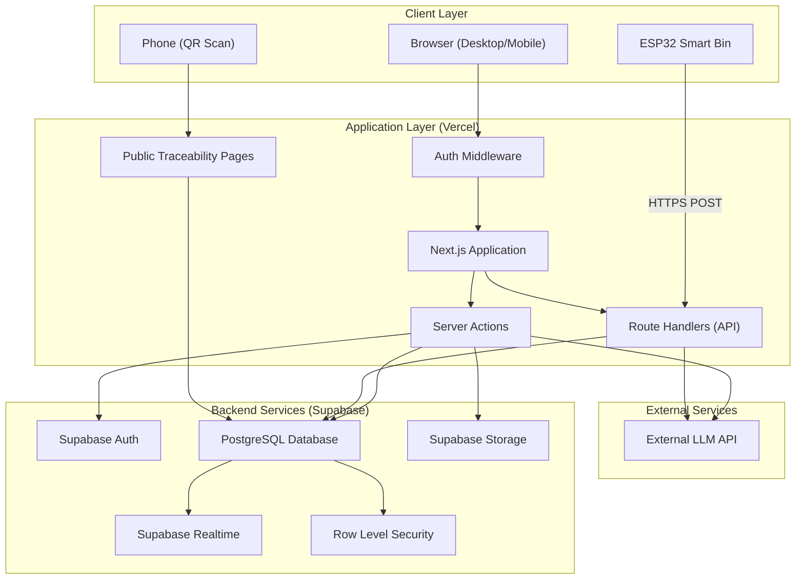
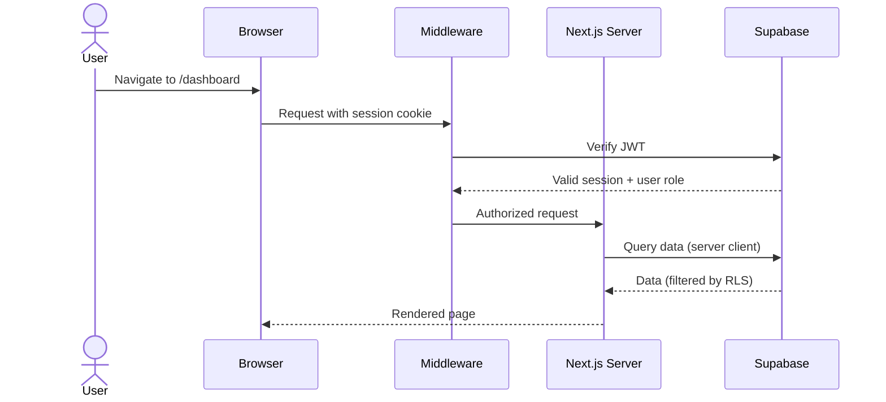
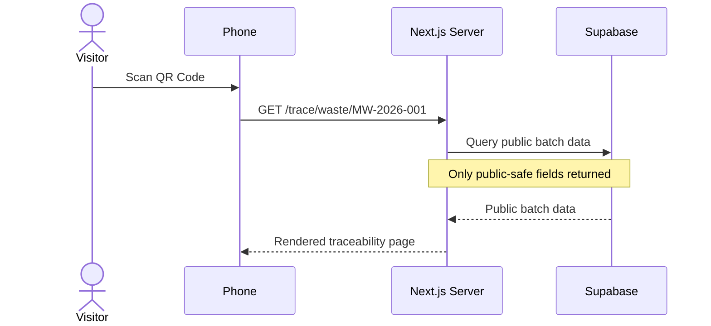
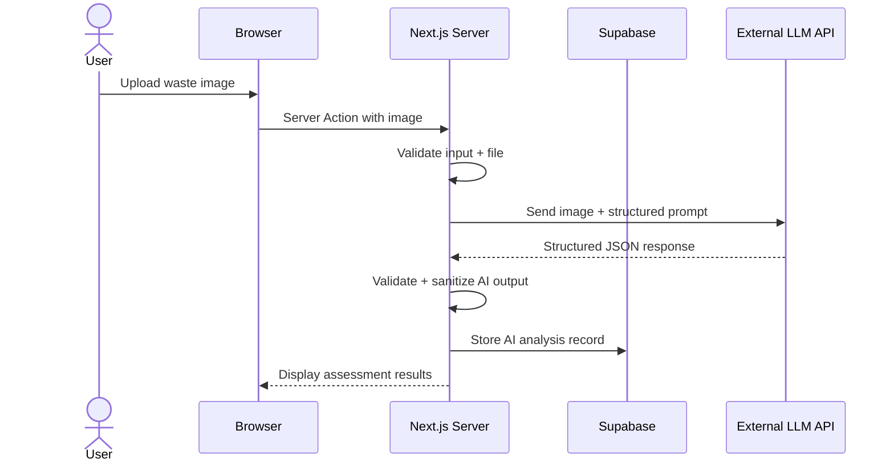
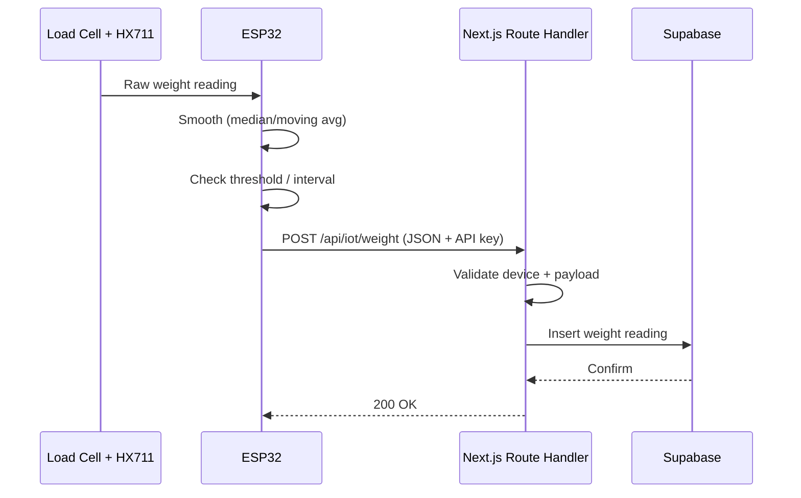
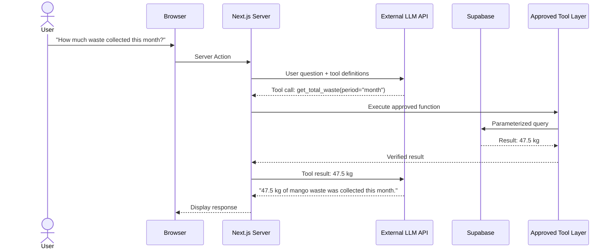
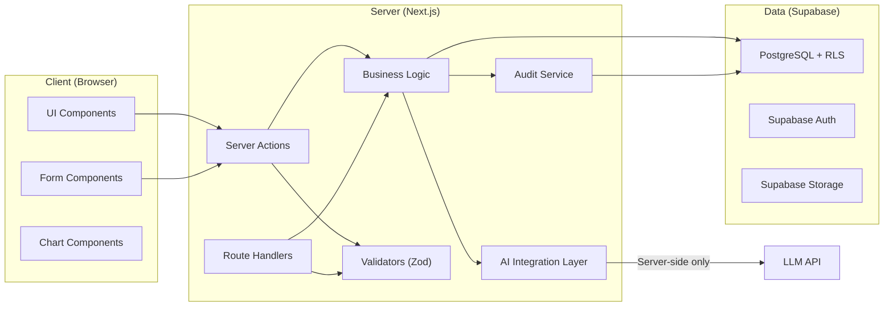
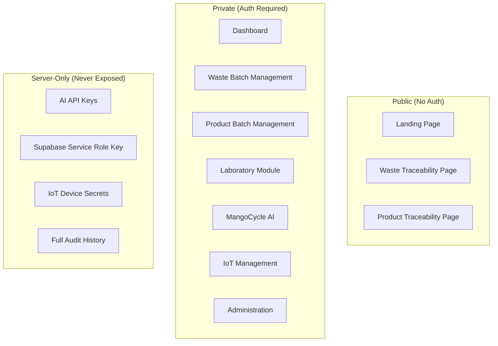

# MangoCycle Smart Platform — System Architecture

> **Document Name:** System Architecture  
> **Version:** 0.1  
> **Status:** Draft  
> **Last Updated:** 2026-08-28  
> **Owner:** MangoCycle Project Team  
> **Related Documents:** GOVERNANCE.md, 04-TECH-STACK.md, 05-DATABASE-SCHEMA.md, 08-SECURITY.md, 15-AI-ARCHITECTURE.md, 22-IOT-ARCHITECTURE.md, 30-DEPLOYMENT.md

---

## 1. Architecture Overview

The MangoCycle Smart Platform follows a **monolithic Next.js application** architecture with Supabase as the backend-as-a-service provider. This architecture is chosen for rapid development within the competition timeline while maintaining clear separation of concerns.

### High-Level Architecture Diagram



---

## 2. Architecture Layers

### 2.1 Client Layer

| Client | Purpose | Protocol |
|---|---|---|
| Browser (Desktop/Mobile) | Primary application interface for authenticated users | HTTPS |
| Phone (QR Scan) | Public traceability page viewing | HTTPS |
| ESP32 Smart Bin | IoT weight data submission | HTTPS POST |

### 2.2 Application Layer (Next.js on Vercel)

The Next.js application handles all rendering, routing, business logic, and API endpoints.

#### Server Components (Default)
- Page rendering with data fetching
- Direct database queries via Supabase server client
- No client-side data exposure of secrets

#### Client Components (Where Needed)
- Interactive forms (React Hook Form)
- Charts and visualizations
- Real-time updates
- Image upload UI

#### Server Actions
- Form submissions and mutations
- Business logic execution
- Validation (Zod)
- Audit log creation
- Database writes

#### Route Handlers (API Routes)
- IoT weight data endpoint (`POST /api/iot/weight`)
- AI endpoints (proxied through server to protect API keys)
- Public data endpoints for traceability pages
- Webhook handlers if needed

#### Middleware
- Authentication verification on protected routes
- Role-based route protection
- Public route passthrough (traceability pages, landing page)

### 2.3 External Services

| Service | Usage | Dependency Level |
|---|---|---|
| External LLM API | AI features (vision analysis, processing advice, Ask MangoCycle, insights, reports) | Optional — platform works without it |

### 2.4 Backend Services (Supabase)

| Service | Usage |
|---|---|
| **PostgreSQL** | Primary data store for all application data |
| **Supabase Auth** | User authentication, session management, JWT tokens |
| **Supabase Storage** | Laboratory file attachments, uploaded images |
| **Supabase Realtime** | Optional — live dashboard updates, IoT weight notifications |
| **Row Level Security** | Database-level access control enforcement |

---

## 3. Data Flow Architecture

### 3.1 Authenticated Application Flow



### 3.2 Public Traceability Flow



### 3.3 AI Feature Flow



### 3.4 IoT Data Flow



### 3.5 Ask MangoCycle Flow



---

## 4. Component Architecture

### 4.1 Next.js Project Structure (Conceptual)

```
src/
├── app/                          # Next.js App Router
│   ├── (auth)/                   # Auth routes (login, forgot-password)
│   ├── (dashboard)/              # Protected application routes
│   │   ├── dashboard/
│   │   ├── waste-batches/
│   │   ├── products/
│   │   ├── laboratory/
│   │   ├── ai/
│   │   ├── iot/
│   │   ├── reports/
│   │   └── admin/
│   ├── trace/                    # Public traceability pages
│   │   ├── waste/[batchCode]/
│   │   └── product/[batchCode]/
│   ├── api/                      # Route Handlers
│   │   └── iot/
│   ├── layout.tsx
│   └── page.tsx                  # Landing page
│
├── components/                   # Reusable UI components
│   ├── ui/                       # Base design system components
│   ├── forms/                    # Form components
│   ├── charts/                   # Chart components
│   ├── layout/                   # Layout components (sidebar, header)
│   └── shared/                   # Shared feature components
│
├── lib/                          # Core libraries and utilities
│   ├── supabase/                 # Supabase client configurations
│   │   ├── client.ts             # Browser client
│   │   ├── server.ts             # Server client
│   │   └── admin.ts              # Service role client
│   ├── ai/                       # AI integration layer
│   │   ├── provider.ts           # LLM API abstraction
│   │   ├── tools.ts              # Ask MangoCycle tool definitions
│   │   └── prompts/              # Structured prompts
│   ├── validators/               # Zod schemas
│   ├── utils/                    # Utility functions
│   └── constants/                # Application constants
│
├── actions/                      # Server Actions
│   ├── waste-batches.ts
│   ├── products.ts
│   ├── laboratory.ts
│   ├── ai.ts
│   ├── auth.ts
│   └── audit.ts
│
├── types/                        # TypeScript type definitions
│
└── hooks/                        # Custom React hooks
```

> [!NOTE]
> This is a conceptual structure. The implementing agent should adapt it as needed while maintaining the separation of concerns.

### 4.2 Key Architectural Boundaries



---

## 5. Security Architecture

Security is enforced at every layer. Detailed requirements are defined in [08-SECURITY.md](./08-SECURITY.md).

### 5.1 Defense in Depth

| Layer | Mechanism |
|---|---|
| **Edge** | Vercel edge network, HTTPS, rate limiting |
| **Middleware** | JWT verification, route protection, role check |
| **Application** | Zod validation, input sanitization, output escaping |
| **Server Actions** | Server-side only execution, secret protection |
| **Database** | Row Level Security, constraints, foreign keys |
| **Storage** | Bucket policies, MIME validation, size limits |

### 5.2 Authentication Flow

```
Login → Supabase Auth → JWT → Session Cookie → Middleware Verification → Access
```

### 5.3 Public vs Private Data Boundary



---

## 6. AI Integration Architecture

AI is a support layer, not a core dependency. The platform must function without AI.

### 6.1 AI Abstraction Layer

All AI calls go through a server-side abstraction layer that:

1. Manages API keys (server-only)
2. Constructs structured prompts
3. Validates and sanitizes AI output
4. Handles timeouts and errors gracefully
5. Logs AI interactions for audit

### 6.2 AI Provider Strategy

The AI integration layer abstracts the specific LLM provider, allowing the provider to be changed by updating configuration. See [15-AI-ARCHITECTURE.md](./15-AI-ARCHITECTURE.md).

### 6.3 AI Failure Handling

If the AI provider is unavailable:
- AI features show a clear "AI temporarily unavailable" message
- All non-AI features continue to work normally
- No platform functionality is blocked

---

## 7. IoT Integration Architecture

IoT is an optional, non-blocking feature. See [22-IOT-ARCHITECTURE.md](./22-IOT-ARCHITECTURE.md).

### 7.1 Integration Points

- **Inbound**: `POST /api/iot/weight` (ESP32 → Platform)
- **Display**: Dashboard Smart Bin status section
- **Management**: IoT devices admin page

### 7.2 Failure Handling

If IoT hardware is unavailable:
- Manual weight entry remains fully functional
- Dashboard hides/grays out IoT section
- No platform functionality is blocked

---

## 8. Resilience Principles

| Scenario | Platform Behavior |
|---|---|
| AI provider down | All non-AI features work; AI sections show "unavailable" |
| IoT hardware offline | Manual weight entry works; IoT section hidden/disabled |
| Supabase Realtime down | Application works with standard request/response |
| Network slow | Server-side rendering ensures basic content loads |
| Invalid AI response | Validation catches malformed output; user sees error |
| Malicious IoT payload | Validation rejects; logged for review |

---

## 9. Scalability Considerations

For the MVP prototype, scalability is not a primary concern. However, the architecture naturally supports:

- **Horizontal scaling** via Vercel's serverless deployment
- **Database scaling** via Supabase managed PostgreSQL
- **Storage scaling** via Supabase Storage (S3-backed)
- **CDN caching** for public traceability pages via Vercel edge

---

## 10. Architecture Decision Summary

Key architectural decisions are recorded in [38-DECISION-LOG.md](./38-DECISION-LOG.md). Summary:

| Decision | Rationale |
|---|---|
| Monolithic Next.js | Fastest development for competition timeline |
| Supabase BaaS | Integrated auth, DB, storage, realtime in one service |
| Server Actions over REST | Reduced boilerplate, type-safe server calls |
| Route Handlers for IoT | ESP32 needs standard HTTP endpoints |
| AI via external API | No custom model training needed for MVP |
| QR contains URL, not data | URLs allow dynamic content updates; less data in QR |
| UUID + human-readable codes | UUIDs for internal consistency, readable codes for users |

---

## Dependencies & Related Documents

| Document | Relationship |
|---|---|
| [GOVERNANCE.md](./GOVERNANCE.md) | Canonical terminology |
| [04-TECH-STACK.md](./04-TECH-STACK.md) | Technology justifications |
| [05-DATABASE-SCHEMA.md](./05-DATABASE-SCHEMA.md) | Database layer details |
| [07-AUTH-AND-RBAC.md](./07-AUTH-AND-RBAC.md) | Auth architecture details |
| [08-SECURITY.md](./08-SECURITY.md) | Security architecture details |
| [15-AI-ARCHITECTURE.md](./15-AI-ARCHITECTURE.md) | AI integration details |
| [22-IOT-ARCHITECTURE.md](./22-IOT-ARCHITECTURE.md) | IoT integration details |
| [24-API-SPECIFICATION.md](./24-API-SPECIFICATION.md) | API contracts |
| [30-DEPLOYMENT.md](./30-DEPLOYMENT.md) | Deployment architecture |
| [38-DECISION-LOG.md](./38-DECISION-LOG.md) | Architectural decisions |
