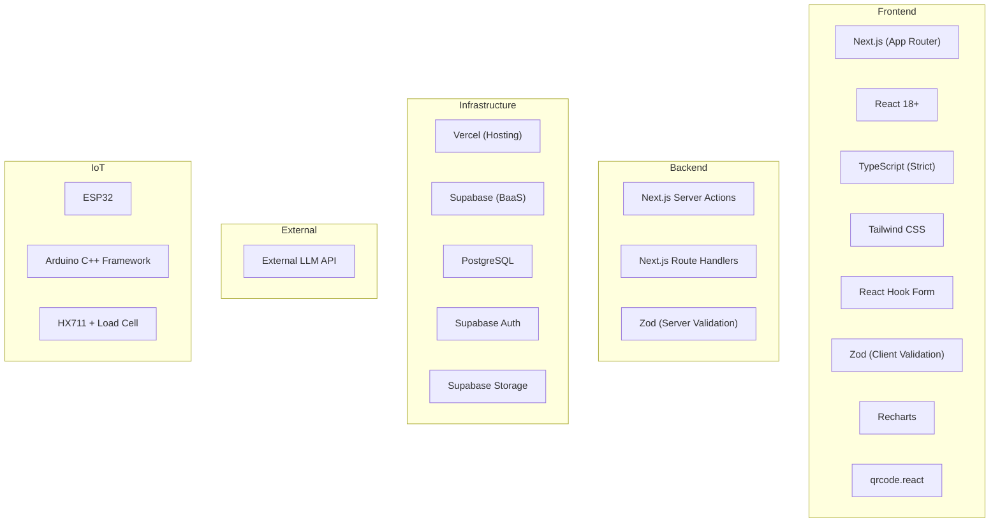

# MangoCycle Smart Platform — Tech Stack

> **Document Name:** Technology Stack  
> **Version:** 0.1  
> **Status:** Draft  
> **Last Updated:** 2026-08-28  
> **Owner:** MangoCycle Project Team  
> **Related Documents:** GOVERNANCE.md, 03-SYSTEM-ARCHITECTURE.md, 30-DEPLOYMENT.md, 38-DECISION-LOG.md

---

## 1. Purpose

This document defines the authoritative technology stack for the MangoCycle Smart Platform. Each technology selection includes its justification, the alternatives considered, and any constraints. Changes to the tech stack must follow the change management process in [GOVERNANCE.md](./GOVERNANCE.md).

---

## 2. Technology Overview

---

## 3. Frontend Stack

### 3.1 Next.js

| Attribute | Value |
|---|---|
| **Technology** | Next.js (App Router) |
| **Version** | Latest stable (14.x or 15.x) |
| **Role** | Full-stack React framework |
| **Justification** | Server-side rendering, Server Actions, file-based routing, API routes, excellent Vercel integration, TypeScript-first |
| **Alternatives Considered** | Vite + React (lacks SSR/server features), Remix (smaller ecosystem), SvelteKit (team unfamiliarity) |
| **Trade-offs** | Larger framework footprint than pure Vite; mitigated by Vercel's optimized deployment |

### 3.2 React

| Attribute | Value |
|---|---|
| **Technology** | React |
| **Version** | 18+ (Server Components support) |
| **Role** | UI component library |
| **Justification** | Industry standard, vast ecosystem, Server Components for performance, strong TypeScript support |

### 3.3 TypeScript

| Attribute | Value |
|---|---|
| **Technology** | TypeScript |
| **Mode** | Strict (`strict: true` in tsconfig) |
| **Role** | Type-safe development |
| **Justification** | Catches errors at compile time, self-documenting code, required for AI agent reliability |
| **Constraints** | Avoid `any` unless explicitly justified and documented |

### 3.4 Tailwind CSS

| Attribute | Value |
|---|---|
| **Technology** | Tailwind CSS |
| **Version** | Latest stable (v3.x or v4.x) |
| **Role** | Utility-first CSS framework |
| **Justification** | Rapid UI development, consistent design system, built-in responsive/dark mode, RTL plugin available |
| **Alternatives Considered** | Vanilla CSS (slower development), CSS Modules (less consistent), shadcn/ui (can layer on top) |

> [!TIP]
> Consider using **shadcn/ui** as a component library on top of Tailwind CSS. It provides accessible, customizable components without adding a heavy dependency. This is a recommendation, not a requirement.

### 3.5 React Hook Form

| Attribute | Value |
|---|---|
| **Technology** | React Hook Form |
| **Role** | Form state management and validation |
| **Justification** | Minimal re-renders, Zod integration via `@hookform/resolvers`, TypeScript support |
| **Usage** | Waste Batch forms, Product Batch forms, Laboratory Test forms, Admin forms |

### 3.6 Zod

| Attribute | Value |
|---|---|
| **Technology** | Zod |
| **Role** | Schema validation (client and server) |
| **Justification** | TypeScript-first, composable schemas, works with React Hook Form, shared between client/server |
| **Usage** | Form validation, API input validation, AI output validation, IoT payload validation |

### 3.7 Charting Library

| Attribute | Value |
|---|---|
| **Technology** | Recharts |
| **Role** | Dashboard charts and data visualization |
| **Justification** | React-native, declarative API, responsive, good TypeScript support, active maintenance |
| **Alternatives Considered** | Chart.js (not React-native), Nivo (heavier), Tremor (opinionated) |
| **Usage** | Dashboard KPI charts, trend lines, distribution charts |

> [!NOTE]
> If the implementing agent finds a more suitable charting library, this selection may be updated via the change management process.

### 3.8 QR Code Library

| Attribute | Value |
|---|---|
| **Technology** | `qrcode.react` |
| **Role** | QR code generation as React components |
| **Justification** | React-native, SVG/Canvas output, downloadable, maintained, lightweight |
| **Alternatives Considered** | `qrcode` (non-React), `react-qr-code` (smaller community) |
| **Usage** | Waste Batch QR codes, Product Batch QR codes |

---

## 4. Backend Stack

### 4.1 Next.js Server Actions

| Attribute | Value |
|---|---|
| **Technology** | Next.js Server Actions |
| **Role** | Server-side mutations and business logic |
| **Justification** | Type-safe, no manual API route boilerplate, progressive enhancement, built-in form support |
| **Usage** | CRUD operations, processing stage updates, audit logging, AI feature calls |

### 4.2 Next.js Route Handlers

| Attribute | Value |
|---|---|
| **Technology** | Next.js Route Handlers (API Routes) |
| **Role** | HTTP API endpoints for external clients |
| **Justification** | Standard HTTP interface needed for IoT devices and any external integrations |
| **Usage** | `POST /api/iot/weight`, any webhook endpoints |

### 4.3 Server-Side Zod Validation

All server-side inputs — form submissions, API payloads, AI responses, IoT data — must be validated using Zod schemas before processing. Validation rules are defined authoritatively in [25-VALIDATION-RULES.md](./25-VALIDATION-RULES.md).

---

## 5. Database & Infrastructure

### 5.1 Supabase

| Attribute | Value |
|---|---|
| **Technology** | Supabase |
| **Role** | Backend-as-a-Service (database, auth, storage, realtime) |
| **Justification** | Integrated PostgreSQL + Auth + Storage + Realtime, generous free tier, excellent developer experience, RLS for security, managed infrastructure |
| **Alternatives Considered** | Firebase (NoSQL not ideal for relational data), self-hosted PostgreSQL (operational overhead), PlanetScale (MySQL, not PostgreSQL) |

### 5.2 PostgreSQL

| Attribute | Value |
|---|---|
| **Technology** | PostgreSQL (via Supabase) |
| **Version** | Latest Supabase-supported (15+) |
| **Role** | Primary relational data store |
| **Justification** | Strong relational integrity, JSONB for flexible fields, UUID support, excellent constraint system, RLS |
| **Schema** | Defined authoritatively in [05-DATABASE-SCHEMA.md](./05-DATABASE-SCHEMA.md) |

### 5.3 Supabase Auth

| Attribute | Value |
|---|---|
| **Technology** | Supabase Auth |
| **Role** | User authentication and session management |
| **Justification** | Integrated with Supabase DB, JWT-based, supports email/password, managed security |
| **Usage** | Login, password reset, session verification, JWT in middleware |

### 5.4 Supabase Storage

| Attribute | Value |
|---|---|
| **Technology** | Supabase Storage |
| **Role** | File storage for laboratory attachments and uploaded images |
| **Justification** | Integrated with Supabase Auth for access control, S3-compatible, bucket policies |
| **Usage** | Laboratory test attachments, AI waste image uploads |

### 5.5 Supabase Realtime

| Attribute | Value |
|---|---|
| **Technology** | Supabase Realtime |
| **Role** | Optional real-time data subscriptions |
| **Justification** | Built into Supabase, useful for live dashboard updates and IoT weight notifications |
| **Usage** | Dashboard live updates (optional), Smart Bin weight notifications (optional) |
| **Constraint** | Platform must work without Realtime (standard request/response fallback) |

---

## 6. AI Integration

### 6.1 External LLM API

| Attribute | Value |
|---|---|
| **Technology** | External multimodal LLM API |
| **Role** | AI-assisted features (vision, text generation, tool calling) |
| **Justification** | No custom model training needed for MVP; external API provides multimodal capabilities out of the box |
| **Provider** | To be determined — architecture must abstract the provider. See [37-OPEN-QUESTIONS.md](./37-OPEN-QUESTIONS.md) |
| **Constraint** | API keys must be server-side only (`AI_API_KEY`, never `NEXT_PUBLIC_`) |

### Required LLM Capabilities

The selected provider must support:

| Capability | Used By |
|---|---|
| **Vision / Image Input** | AI Waste Visual Analyzer |
| **Structured Output / JSON Mode** | All AI features |
| **Tool Calling / Function Calling** | Ask MangoCycle |
| **Text Generation** | Processing Advisor, Sustainability Insights, Report Generator |

### Candidate Providers

| Provider | Vision | Tool Calling | Structured Output | Notes |
|---|---|---|---|---|
| OpenAI (GPT-4o) | ✅ | ✅ | ✅ | Strong all-round; widely available |
| Google (Gemini) | ✅ | ✅ | ✅ | Competitive pricing; multimodal |
| Anthropic (Claude) | ✅ | ✅ | ✅ | Strong reasoning; tool use |

> [!IMPORTANT]
> The AI provider decision is recorded as an open question in [37-OPEN-QUESTIONS.md](./37-OPEN-QUESTIONS.md). The architecture must be provider-agnostic.

---

## 7. IoT Stack

### 7.1 Hardware

| Component | Role |
|---|---|
| **ESP32** | Microcontroller with Wi-Fi for sensor data transmission |
| **HX711** | Analog-to-digital converter for load cell |
| **Load Cell** | Weight measurement sensor |

### 7.2 Firmware

| Attribute | Value |
|---|---|
| **Language** | C++ |
| **Framework** | Arduino |
| **IDE** | Arduino IDE or PlatformIO |
| **Libraries** | WiFi, HTTPClient, HX711 driver, ArduinoJson |

### 7.3 Communication

| Attribute | Value |
|---|---|
| **Protocol** | HTTPS |
| **Endpoint** | `POST /api/iot/weight` |
| **Payload** | JSON (`device_id`, `weight_kg`, `timestamp`) |
| **Authentication** | API key in header |

---

## 8. Hosting & Deployment

### 8.1 Application Hosting

| Attribute | Value |
|---|---|
| **Platform** | Vercel |
| **Justification** | Native Next.js support, serverless functions, edge network, preview deployments, free tier |
| **Alternatives** | AWS Amplify (more complex), Netlify (less Next.js optimization), self-hosted (operational overhead) |

### 8.2 Database Hosting

| Attribute | Value |
|---|---|
| **Platform** | Supabase Cloud |
| **Justification** | Managed PostgreSQL, integrated with auth/storage/realtime |

### 8.3 Domain & HTTPS

| Attribute | Value |
|---|---|
| **HTTPS** | Automatic via Vercel |
| **Domain** | Custom domain to be configured (see [37-OPEN-QUESTIONS.md](./37-OPEN-QUESTIONS.md)) |

---

## 9. Development Tools

| Tool | Purpose |
|---|---|
| **Node.js** | Runtime (LTS version) |
| **npm / pnpm** | Package manager |
| **ESLint** | Linting |
| **Prettier** | Code formatting |
| **Git** | Version control |
| **GitHub** | Repository hosting |
| **Supabase CLI** | Local development, migrations, type generation |

---

## 10. Dependency Constraints

| Constraint | Rationale |
|---|---|
| No Python in MVP | TypeScript-only stack for consistency; Python only for future custom ML |
| No ORMs (Prisma, Drizzle) | Supabase client provides typed database access; adding an ORM introduces unnecessary complexity for MVP |
| No GraphQL | REST/Server Actions sufficient for MVP; reduces complexity |
| No Docker for application | Vercel handles deployment; Docker only if needed for local Supabase |
| Minimal client-side state management | Server Components reduce need for Redux/Zustand |

> [!NOTE]
> The constraint against ORMs is an MVP decision. If the implementing agent finds strong justification for Drizzle ORM or similar, this can be revisited via the change management process in [GOVERNANCE.md](./GOVERNANCE.md).

---

## 11. Version Pinning Strategy

- Use exact versions in `package.json` for critical dependencies (Next.js, Supabase)
- Use caret (`^`) ranges for utility libraries
- Lock file (`package-lock.json` or `pnpm-lock.yaml`) must be committed
- Regularly audit for security vulnerabilities

---

## Dependencies & Related Documents

| Document | Relationship |
|---|---|
| [GOVERNANCE.md](./GOVERNANCE.md) | Change management process for stack changes |
| [03-SYSTEM-ARCHITECTURE.md](./03-SYSTEM-ARCHITECTURE.md) | Architecture that this stack implements |
| [05-DATABASE-SCHEMA.md](./05-DATABASE-SCHEMA.md) | PostgreSQL schema details |
| [15-AI-ARCHITECTURE.md](./15-AI-ARCHITECTURE.md) | AI provider integration details |
| [22-IOT-ARCHITECTURE.md](./22-IOT-ARCHITECTURE.md) | IoT hardware and firmware details |
| [23-ESP32-INTEGRATION.md](./23-ESP32-INTEGRATION.md) | ESP32 firmware specification |
| [29-ENVIRONMENT-CONFIG.md](./29-ENVIRONMENT-CONFIG.md) | Environment variables for all services |
| [30-DEPLOYMENT.md](./30-DEPLOYMENT.md) | Deployment procedures |
| [37-OPEN-QUESTIONS.md](./37-OPEN-QUESTIONS.md) | Pending decisions (AI provider, domain) |
| [38-DECISION-LOG.md](./38-DECISION-LOG.md) | Records tech stack decisions |
