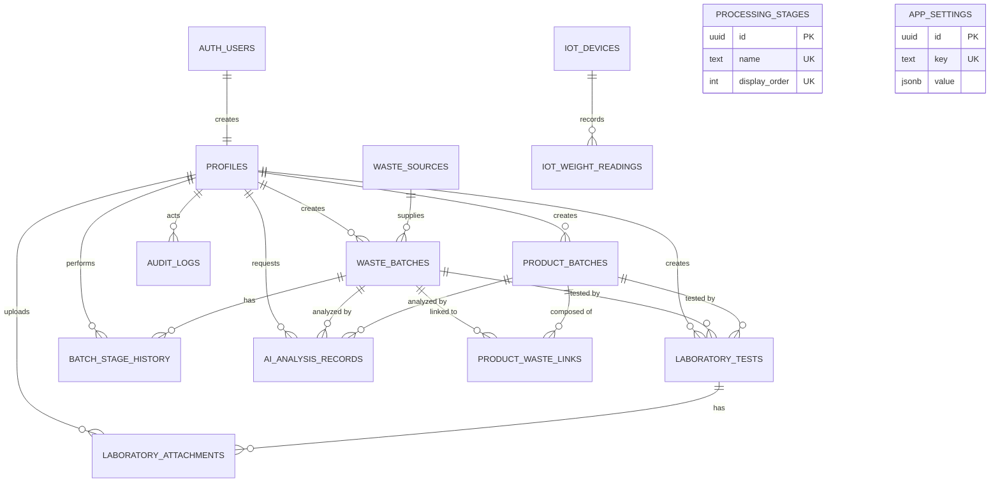
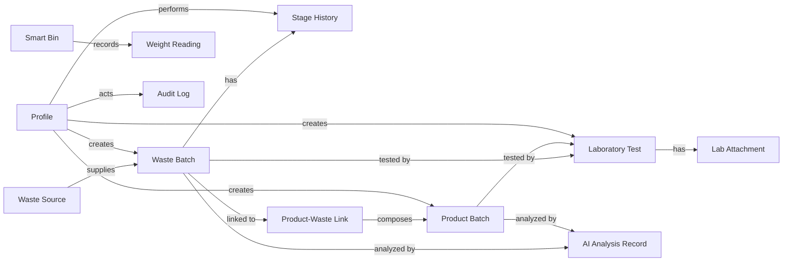

# MangoCycle Smart Platform — Database Relationships

> **Document Name:** Database Relationships  
> **Version:** 0.1  
> **Status:** Draft  
> **Last Updated:** 2026-08-28  
> **Owner:** MangoCycle Project Team  
> **Related Documents:** GOVERNANCE.md, 05-DATABASE-SCHEMA.md

---

## 1. Purpose

This document provides a visual and descriptive overview of the relationships between database tables defined in [05-DATABASE-SCHEMA.md](./05-DATABASE-SCHEMA.md). It includes the Entity-Relationship diagram and a description of each relationship including cardinality, foreign key behavior, and business rationale.

Column-level details are **not** repeated here — see [05-DATABASE-SCHEMA.md](./05-DATABASE-SCHEMA.md) for authoritative definitions.

---

## 2. Entity-Relationship Diagram



---

## 3. Relationship Descriptions

### 3.1 `auth.users` → `profiles`

| Attribute | Value |
|---|---|
| **Cardinality** | One-to-One |
| **FK Column** | `profiles.id` |
| **References** | `auth.users(id)` |
| **ON DELETE** | CASCADE |
| **Business Rule** | Every Supabase Auth user gets a corresponding profile record, created via a database trigger on `auth.users` insert. |

### 3.2 `profiles` → `waste_batches`

| Attribute | Value |
|---|---|
| **Cardinality** | One-to-Many |
| **FK Column** | `waste_batches.created_by` |
| **References** | `profiles(id)` |
| **ON DELETE** | SET NULL |
| **Business Rule** | A user can create many Waste Batches. If the user is deleted, the batch remains with `created_by` set to NULL — preserving traceability. |

### 3.3 `waste_sources` → `waste_batches`

| Attribute | Value |
|---|---|
| **Cardinality** | One-to-Many |
| **FK Column** | `waste_batches.source_id` |
| **References** | `waste_sources(id)` |
| **ON DELETE** | SET NULL |
| **Business Rule** | Each Waste Batch optionally originates from a registered waste source. If the source is deleted, the batch remains with `source_id` set to NULL. |

### 3.4 `waste_batches` → `batch_stage_history`

| Attribute | Value |
|---|---|
| **Cardinality** | One-to-Many |
| **FK Column** | `batch_stage_history.batch_id` |
| **References** | `waste_batches(id)` |
| **ON DELETE** | CASCADE |
| **Business Rule** | Each Waste Batch has an ordered history of processing stage transitions. History records are **append-only** and never updated or deleted in normal flow. |

### 3.5 `profiles` → `batch_stage_history`

| Attribute | Value |
|---|---|
| **Cardinality** | One-to-Many |
| **FK Column** | `batch_stage_history.performed_by` |
| **References** | `profiles(id)` |
| **ON DELETE** | SET NULL |
| **Business Rule** | Tracks which user performed each stage transition. User deletion preserves the history record. |

### 3.6 `waste_batches` ↔ `product_batches` (via `product_waste_links`)

| Attribute | Value |
|---|---|
| **Cardinality** | Many-to-Many |
| **Junction Table** | `product_waste_links` |
| **FK Columns** | `product_batch_id` → `product_batches(id)`, `waste_batch_id` → `waste_batches(id)` |
| **ON DELETE (product)** | CASCADE — deleting a product removes the links |
| **ON DELETE (waste)** | RESTRICT — cannot delete a waste batch linked to a product |
| **Unique Constraint** | `(product_batch_id, waste_batch_id)` — prevents duplicate links |
| **Business Rule** | Multiple Waste Batches can contribute to one Product Batch. A single Waste Batch can contribute to multiple Product Batches (e.g., if waste is split). This is the core traceability relationship. |

### 3.7 `profiles` → `product_batches`

| Attribute | Value |
|---|---|
| **Cardinality** | One-to-Many |
| **FK Column** | `product_batches.created_by` |
| **References** | `profiles(id)` |
| **ON DELETE** | SET NULL |
| **Business Rule** | Same pattern as waste batches — user deletion preserves product records. |

### 3.8 `waste_batches` → `laboratory_tests`

| Attribute | Value |
|---|---|
| **Cardinality** | One-to-Many |
| **FK Column** | `laboratory_tests.waste_batch_id` |
| **References** | `waste_batches(id)` |
| **ON DELETE** | SET NULL |
| **Business Rule** | A lab test can be associated with a Waste Batch. Optional — some tests may only be associated with a Product Batch. |

### 3.9 `product_batches` → `laboratory_tests`

| Attribute | Value |
|---|---|
| **Cardinality** | One-to-Many |
| **FK Column** | `laboratory_tests.product_batch_id` |
| **References** | `product_batches(id)` |
| **ON DELETE** | SET NULL |
| **Business Rule** | A lab test can be associated with a Product Batch. A single test may reference both a Waste Batch and a Product Batch. |

### 3.10 `laboratory_tests` → `laboratory_attachments`

| Attribute | Value |
|---|---|
| **Cardinality** | One-to-Many |
| **FK Column** | `laboratory_attachments.test_id` |
| **References** | `laboratory_tests(id)` |
| **ON DELETE** | CASCADE |
| **Business Rule** | Deleting a test deletes its attachments. Storage files should also be cleaned up (application logic). |

### 3.11 `waste_batches` / `product_batches` → `ai_analysis_records`

| Attribute | Value |
|---|---|
| **Cardinality** | One-to-Many (from each) |
| **FK Columns** | `ai_analysis_records.waste_batch_id`, `ai_analysis_records.product_batch_id` |
| **ON DELETE** | SET NULL |
| **Business Rule** | AI analysis records are preserved even if the referenced batch is deleted. Both FKs are optional — an analysis may be general (e.g., Ask MangoCycle query). |

### 3.12 `iot_devices` → `iot_weight_readings`

| Attribute | Value |
|---|---|
| **Cardinality** | One-to-Many |
| **FK Column** | `iot_weight_readings.device_id` |
| **References** | `iot_devices(id)` |
| **ON DELETE** | CASCADE |
| **Business Rule** | Each Smart Bin records many weight readings over time. Deleting a device deletes its reading history. |

### 3.13 `profiles` → `audit_logs`

| Attribute | Value |
|---|---|
| **Cardinality** | One-to-Many |
| **FK Column** | `audit_logs.actor_id` |
| **References** | `profiles(id)` |
| **ON DELETE** | SET NULL |
| **Business Rule** | Audit log records the actor. If the user is deleted, the audit record remains with `actor_id` set to NULL — preserving the audit trail. |

---

## 4. Referential Integrity Summary

### 4.1 ON DELETE Behavior

| Parent Table | Child Table | ON DELETE | Rationale |
|---|---|---|---|
| `auth.users` | `profiles` | CASCADE | Profile is extension of auth user |
| `profiles` | `waste_batches.created_by` | SET NULL | Preserve traceability |
| `profiles` | `product_batches.created_by` | SET NULL | Preserve traceability |
| `profiles` | `batch_stage_history.performed_by` | SET NULL | Preserve audit trail |
| `profiles` | `laboratory_tests.created_by` | SET NULL | Preserve records |
| `profiles` | `laboratory_attachments.uploaded_by` | SET NULL | Preserve records |
| `profiles` | `ai_analysis_records.requested_by` | SET NULL | Preserve audit trail |
| `profiles` | `audit_logs.actor_id` | SET NULL | Preserve audit trail |
| `waste_sources` | `waste_batches.source_id` | SET NULL | Preserve batches |
| `waste_batches` | `batch_stage_history` | CASCADE | History belongs to batch |
| `waste_batches` | `product_waste_links` | **RESTRICT** | **Protect traceability** |
| `waste_batches` | `laboratory_tests` | SET NULL | Preserve test records |
| `waste_batches` | `ai_analysis_records` | SET NULL | Preserve AI records |
| `product_batches` | `product_waste_links` | CASCADE | Links belong to product |
| `product_batches` | `laboratory_tests` | SET NULL | Preserve test records |
| `product_batches` | `ai_analysis_records` | SET NULL | Preserve AI records |
| `laboratory_tests` | `laboratory_attachments` | CASCADE | Files belong to test |
| `iot_devices` | `iot_weight_readings` | CASCADE | Readings belong to device |

### 4.2 Critical Constraint: Traceability Protection

The most critical referential integrity rule is the **RESTRICT** on `product_waste_links.waste_batch_id`:

```
A Waste Batch that has been linked to a Product Batch CANNOT be deleted.
```

This ensures the end-to-end traceability chain (Waste → Product) is never broken.

---

## 5. Data Flow Diagram



---

## 6. Traceability Chain

The core traceability chain that must remain intact:

```
Waste Source
    ↓ (waste_sources → waste_batches)
Waste Batch [MW-YYYY-NNN]
    ↓ (waste_batches → batch_stage_history)
Processing Stage History [Collected → ... → Completed]
    ↓ (waste_batches → product_waste_links → product_batches)
Product Batch [BF-YYYY-NNN]
    ↓ (product_batches → laboratory_tests)
Laboratory Test Results
```

This chain is what the public QR traceability pages display.

---

## Dependencies & Related Documents

| Document | Relationship |
|---|---|
| [05-DATABASE-SCHEMA.md](./05-DATABASE-SCHEMA.md) | Authoritative column/constraint definitions |
| [GOVERNANCE.md](./GOVERNANCE.md) | Canonical terminology |
| [07-AUTH-AND-RBAC.md](./07-AUTH-AND-RBAC.md) | Role-based access that RLS enforces |
| [11-WASTE-TRACEABILITY.md](./11-WASTE-TRACEABILITY.md) | Waste traceability feature using these relationships |
| [12-PRODUCT-TRACEABILITY.md](./12-PRODUCT-TRACEABILITY.md) | Product traceability feature using these relationships |
