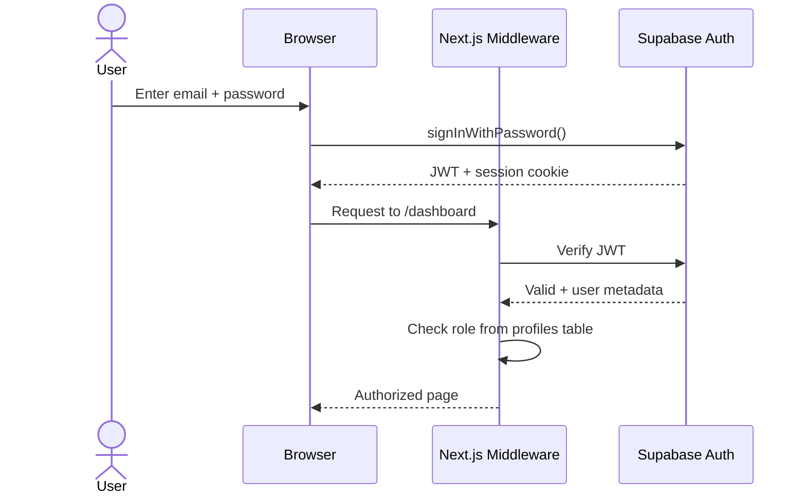

# MangoCycle Smart Platform — Authentication & RBAC

> **Document Name:** Authentication & Role-Based Access Control  
> **Version:** 0.1  
> **Status:** Draft  
> **Last Updated:** 2026-08-28  
> **Owner:** MangoCycle Project Team  
> **Related Documents:** GOVERNANCE.md, 05-DATABASE-SCHEMA.md, 08-SECURITY.md, 09-ROUTES-AND-PAGES.md

---

## 1. Purpose

This document is the **authoritative source** for all role definitions, permission assignments, and authentication requirements for the MangoCycle Smart Platform. All other documents must reference this file for role and access control details.

---

## 2. Authentication

### 2.1 Provider

Authentication is handled by **Supabase Auth** using email/password credentials.

### 2.2 Supported Flows

| Flow | Description | Priority |
|---|---|---|
| Email/Password Login | Standard authentication | P0 |
| Password Reset | Email-based reset link | P0 |
| Session Management | JWT-based via Supabase | P0 |
| User Registration | Admin-created accounts only (no public registration) | P0 |

> [!IMPORTANT]
> There is **no public user registration**. Only Super Admin or Admin users can create new accounts. This is a deliberate security decision for a university research platform.

### 2.3 Session Management

| Attribute | Value |
|---|---|
| Token Type | JWT |
| Storage | HTTP-only cookie (managed by Supabase SSR helpers) |
| Refresh | Automatic via Supabase client |
| Expiry | Default Supabase settings (1 hour access token, refresh token rotation) |

### 2.4 Authentication Flow



---

## 3. Role Definitions

### 3.1 Role Hierarchy

```
Super Admin (highest privilege)
    ↓
Admin
    ↓
Researcher
    ↓
Operator
    ↓
Viewer (lowest privilege)
```

### 3.2 Role Descriptions

| Role | Internal Value | Description | Typical User |
|---|---|---|---|
| **Super Admin** | `super_admin` | Full platform control including user management, system settings, and all operations | Project lead, system administrator |
| **Admin** | `admin` | Administrative access to most features, user management, audit logs | Faculty advisor, senior team member |
| **Researcher** | `researcher` | Full access to data entry, laboratory, AI features, and reporting | Scientific team members |
| **Operator** | `operator` | Operational access to waste/product batch management and processing | Lab assistants, field operators |
| **Viewer** | `viewer` | Read-only access to dashboards and batch data | External reviewers, observers |

### 3.3 Default Role

New user accounts are created with the `viewer` role by default. An Admin or Super Admin must explicitly assign a higher role.

---

## 4. Permission Matrix

### 4.1 Waste Batch Management

| Action | Super Admin | Admin | Researcher | Operator | Viewer |
|---|---|---|---|---|---|
| View waste batch list | ✅ | ✅ | ✅ | ✅ | ✅ |
| View waste batch detail | ✅ | ✅ | ✅ | ✅ | ✅ |
| Create waste batch | ✅ | ✅ | ✅ | ✅ | ❌ |
| Edit waste batch | ✅ | ✅ | ✅ | ✅ | ❌ |
| Delete/archive waste batch | ✅ | ✅ | ❌ | ❌ | ❌ |
| Update processing stage | ✅ | ✅ | ✅ | ✅ | ❌ |
| Generate QR code | ✅ | ✅ | ✅ | ✅ | ✅ |

### 4.2 Product Batch Management

| Action | Super Admin | Admin | Researcher | Operator | Viewer |
|---|---|---|---|---|---|
| View product batch list | ✅ | ✅ | ✅ | ✅ | ✅ |
| View product batch detail | ✅ | ✅ | ✅ | ✅ | ✅ |
| Create product batch | ✅ | ✅ | ✅ | ❌ | ❌ |
| Edit product batch | ✅ | ✅ | ✅ | ❌ | ❌ |
| Delete/archive product batch | ✅ | ✅ | ❌ | ❌ | ❌ |
| Link waste batches | ✅ | ✅ | ✅ | ❌ | ❌ |
| Generate QR code | ✅ | ✅ | ✅ | ✅ | ✅ |

### 4.3 Laboratory Module

| Action | Super Admin | Admin | Researcher | Operator | Viewer |
|---|---|---|---|---|---|
| View laboratory tests | ✅ | ✅ | ✅ | ✅ | ✅ |
| View test details | ✅ | ✅ | ✅ | ✅ | ✅ |
| Create laboratory test | ✅ | ✅ | ✅ | ❌ | ❌ |
| Edit laboratory test | ✅ | ✅ | ✅ | ❌ | ❌ |
| Delete laboratory test | ✅ | ✅ | ❌ | ❌ | ❌ |
| Upload attachments | ✅ | ✅ | ✅ | ❌ | ❌ |
| Download attachments | ✅ | ✅ | ✅ | ✅ | ❌ |

### 4.4 MangoCycle AI

| Action | Super Admin | Admin | Researcher | Operator | Viewer |
|---|---|---|---|---|---|
| Use AI Waste Visual Analyzer | ✅ | ✅ | ✅ | ✅ | ❌ |
| Use AI Processing Advisor | ✅ | ✅ | ✅ | ✅ | ❌ |
| Use Ask MangoCycle | ✅ | ✅ | ✅ | ✅ | ✅ |
| View AI Sustainability Insights | ✅ | ✅ | ✅ | ✅ | ✅ |
| Generate AI Reports | ✅ | ✅ | ✅ | ❌ | ❌ |
| View AI analysis history | ✅ | ✅ | ✅ | ❌ | ❌ |

### 4.5 Dashboard

| Action | Super Admin | Admin | Researcher | Operator | Viewer |
|---|---|---|---|---|---|
| View dashboard | ✅ | ✅ | ✅ | ✅ | ✅ |
| View all KPIs | ✅ | ✅ | ✅ | ✅ | ✅ |
| View charts | ✅ | ✅ | ✅ | ✅ | ✅ |

### 4.6 IoT Management

| Action | Super Admin | Admin | Researcher | Operator | Viewer |
|---|---|---|---|---|---|
| View IoT devices | ✅ | ✅ | ✅ | ✅ | ✅ |
| View weight history | ✅ | ✅ | ✅ | ✅ | ✅ |
| Register new device | ✅ | ✅ | ❌ | ❌ | ❌ |
| Edit device settings | ✅ | ✅ | ❌ | ❌ | ❌ |
| Deactivate device | ✅ | ✅ | ❌ | ❌ | ❌ |
| Regenerate API key | ✅ | ✅ | ❌ | ❌ | ❌ |

### 4.7 Reports

| Action | Super Admin | Admin | Researcher | Operator | Viewer |
|---|---|---|---|---|---|
| View reports | ✅ | ✅ | ✅ | ✅ | ✅ |
| Generate reports | ✅ | ✅ | ✅ | ❌ | ❌ |
| Export PDF | ✅ | ✅ | ✅ | ❌ | ❌ |

### 4.8 Administration

| Action | Super Admin | Admin | Researcher | Operator | Viewer |
|---|---|---|---|---|---|
| View users | ✅ | ✅ | ❌ | ❌ | ❌ |
| Create users | ✅ | ✅ | ❌ | ❌ | ❌ |
| Change user roles | ✅ | ✅* | ❌ | ❌ | ❌ |
| Deactivate users | ✅ | ✅* | ❌ | ❌ | ❌ |
| Manage waste sources | ✅ | ✅ | ❌ | ❌ | ❌ |
| Configure processing stages | ✅ | ✅ | ❌ | ❌ | ❌ |
| View audit logs | ✅ | ✅ | ❌ | ❌ | ❌ |
| Edit system settings | ✅ | ❌ | ❌ | ❌ | ❌ |
| Configure AI settings | ✅ | ✅ | ❌ | ❌ | ❌ |

> **\*** Admin cannot change Super Admin roles or deactivate Super Admin accounts. Only Super Admin can manage other Super Admin users.

---

## 5. Role Escalation Protection

| Rule | Description |
|---|---|
| No self-promotion | A user cannot change their own role |
| Admin ceiling | Admin can only assign roles up to `admin` (not `super_admin`) |
| Super Admin only | Only Super Admin can create/modify other Super Admin accounts |
| Audit on change | Every role change must be recorded in the audit log |

---

## 6. Route Protection

### 6.1 Middleware Strategy

Next.js middleware intercepts every request and:

1. **Public routes**: Allow through without authentication (landing page, traceability pages, `/api/iot/weight`)
2. **Auth routes**: Redirect authenticated users to dashboard (login, forgot-password)
3. **Protected routes**: Verify JWT, check session validity, allow through
4. **Role-restricted routes**: After authentication, check the user's role against the required minimum role for the route

### 6.2 Route Access Table

Route-specific access is defined in [09-ROUTES-AND-PAGES.md](./09-ROUTES-AND-PAGES.md). This section defines only the access control framework.

### 6.3 Minimum Role per Route Group

| Route Group | Minimum Role |
|---|---|
| `/dashboard` | `viewer` |
| `/waste-batches` (read) | `viewer` |
| `/waste-batches` (write) | `operator` |
| `/products` (read) | `viewer` |
| `/products` (write) | `researcher` |
| `/laboratory` (read) | `viewer` |
| `/laboratory` (write) | `researcher` |
| `/ai/*` | `viewer` (read) / `operator` (use) |
| `/iot/*` (read) | `viewer` |
| `/iot/*` (manage) | `admin` |
| `/reports` (read) | `viewer` |
| `/reports` (generate) | `researcher` |
| `/admin/*` | `admin` |
| `/admin/settings` | `super_admin` |

---

## 7. Implementation Notes

### 7.1 Role Storage

The user's role is stored in the `profiles.role` column (see [05-DATABASE-SCHEMA.md](./05-DATABASE-SCHEMA.md)). It is fetched from the database during middleware checks, not stored in the JWT payload, to ensure role changes take effect immediately.

### 7.2 Role Check Utility

```typescript
// Conceptual utility — not implementation code
type UserRole = 'super_admin' | 'admin' | 'researcher' | 'operator' | 'viewer';

const ROLE_HIERARCHY: Record<UserRole, number> = {
  super_admin: 5,
  admin: 4,
  researcher: 3,
  operator: 2,
  viewer: 1,
};

function hasMinimumRole(userRole: UserRole, requiredRole: UserRole): boolean {
  return ROLE_HIERARCHY[userRole] >= ROLE_HIERARCHY[requiredRole];
}
```

### 7.3 Server Action Protection

Every Server Action must verify:

1. The user is authenticated
2. The user's session is valid
3. The user has the required role for the action

```typescript
// Conceptual pattern — not implementation code
async function createWasteBatch(formData: FormData) {
  'use server';
  const user = await getAuthenticatedUser();
  if (!user) throw new Error('Unauthenticated');
  if (!hasMinimumRole(user.role, 'operator')) throw new Error('Unauthorized');
  // ... proceed with validation and creation
}
```

### 7.4 RLS Alignment

Database RLS policies (defined in [05-DATABASE-SCHEMA.md](./05-DATABASE-SCHEMA.md)) must align with this permission matrix. Application-level checks provide defense in depth, but RLS is the final enforcement layer.

---

## 8. Public Access (No Authentication)

The following are accessible without authentication:

| Resource | Access | Constraint |
|---|---|---|
| Landing Page (`/`) | Full | — |
| Waste Traceability Page (`/trace/waste/{code}`) | Read-only | Public-safe data only |
| Product Traceability Page (`/trace/product/{code}`) | Read-only | Public-safe data only |
| IoT Weight Endpoint (`POST /api/iot/weight`) | Write | API key authentication (not user JWT) |

> [!WARNING]
> Public pages must **never** expose private data. See [08-SECURITY.md](./08-SECURITY.md) for the public/private data boundary definition.

---

## Dependencies & Related Documents

| Document | Relationship |
|---|---|
| [GOVERNANCE.md](./GOVERNANCE.md) | Canonical terminology |
| [05-DATABASE-SCHEMA.md](./05-DATABASE-SCHEMA.md) | `profiles.role` column definition, RLS policies |
| [08-SECURITY.md](./08-SECURITY.md) | Security requirements, public/private data boundary |
| [09-ROUTES-AND-PAGES.md](./09-ROUTES-AND-PAGES.md) | Route-level access control assignments |
| [24-API-SPECIFICATION.md](./24-API-SPECIFICATION.md) | API-level authentication requirements |
| [27-AUDIT-LOGGING.md](./27-AUDIT-LOGGING.md) | Audit events for role changes |
