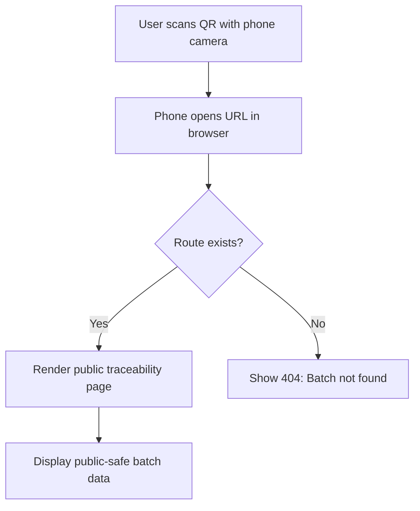

# MangoCycle Smart Platform — QR System

> **Document Name:** QR Code System  
> **Version:** 0.1  
> **Status:** Draft  
> **Last Updated:** 2026-08-28  
> **Owner:** MangoCycle Project Team  
> **Related Documents:** GOVERNANCE.md, 09-ROUTES-AND-PAGES.md, 11-WASTE-TRACEABILITY.md, 12-PRODUCT-TRACEABILITY.md

---

## 1. Purpose

This document specifies the QR code generation, encoding, and scanning architecture for the MangoCycle Smart Platform.

---

## 2. Design Principle

QR codes encode a **URL** pointing to a public traceability page. They do **not** embed raw batch data.

| Approach | ✅ Used | ❌ Rejected |
|---|---|---|
| URL-based QR | Points to live page with current data | — |
| Data-embedded QR | — | Static, outdated if batch updates |

**Rationale:** URL-based QR codes always display the latest batch information. If a batch's status or stage changes, the QR code doesn't need to be regenerated.

---

## 3. QR Code Specifications

### 3.1 Waste Batch QR

| Attribute | Value |
|---|---|
| Content | `{APP_URL}/trace/waste/{batch_code}` |
| Example | `https://mangocycle.app/trace/waste/MW-2026-001` |
| Error Correction | Level M (15% recovery) |
| Size (display) | 200×200 px |
| Size (download) | 1024×1024 px |
| Format (render) | SVG (via `qrcode.react`) |
| Format (download) | PNG and SVG |

### 3.2 Product Batch QR

| Attribute | Value |
|---|---|
| Content | `{APP_URL}/trace/product/{batch_code}` |
| Example | `https://mangocycle.app/trace/product/BF-2026-001` |
| Error Correction | Level M |
| Size, format | Same as waste batch QR |

### 3.3 URL Construction

The base URL (`APP_URL`) must come from the `APP_URL` environment variable (see [29-ENVIRONMENT-CONFIG.md](./29-ENVIRONMENT-CONFIG.md)), not be hard-coded.

```typescript
// Conceptual
const qrUrl = `${process.env.NEXT_PUBLIC_APP_URL}/trace/waste/${batchCode}`;
```

> [!NOTE]
> `APP_URL` should be a `NEXT_PUBLIC_` variable since it's used in the client-rendered QR component. It contains no secrets — it's just the public application URL.

---

## 4. QR Code Generation

### 4.1 Library

`qrcode.react` — renders QR codes as React components (SVG or Canvas).

### 4.2 Component Usage

The QR code component appears on:

| Page | Triggered By | Priority |
|---|---|---|
| Waste Batch Details | "Generate QR" button or automatic display | P0 |
| Product Batch Details | "Generate QR" button or automatic display | P1 |

### 4.3 QR Code Actions

| Action | Description |
|---|---|
| **Display** | Show QR code in a card/modal on the batch detail page |
| **Download PNG** | Download high-resolution PNG (1024×1024) |
| **Download SVG** | Download SVG for print-quality output |
| **Print** | Open browser print dialog with QR code and batch info |

### 4.4 Download Implementation

```
1. Render QR as SVG using qrcode.react
2. For PNG: Convert SVG to Canvas, export as PNG blob, trigger download
3. For SVG: Serialize SVG element, create blob, trigger download
4. Include batch code as filename: "QR-MW-2026-001.png"
```

### 4.5 Print Layout

When printing, include alongside the QR code:
- Batch code (large text)
- Waste type or product name
- Date
- MangoCycle branding

---

## 5. QR Code Scanning Flow



### 5.1 Mobile Experience

- The traceability page must be fully mobile-responsive
- No login required
- Fast load time (target: < 2 seconds)
- Clean, readable layout on small screens
- No horizontal scrolling

---

## 6. QR in Demo Context

During the competition demo (see [32-DEMO-PLAN.md](./32-DEMO-PLAN.md)):

1. Create Waste Batch `MW-2026-001`
2. Generate QR code on the detail page
3. Display QR on the presentation screen
4. Judge/presenter scans with phone camera
5. Phone opens `/trace/waste/MW-2026-001`
6. Shows batch info, processing timeline, sustainability data
7. Later: scan Product QR to see `BF-2026-001` with linked waste batches

> [!TIP]
> For the demo, ensure `APP_URL` points to a publicly accessible deployment (Vercel). If local-only, use a tunneling service or have the demo phone on the same network.

---

## Dependencies & Related Documents

| Document | Relationship |
|---|---|
| [GOVERNANCE.md](./GOVERNANCE.md) | Canonical identifier formats |
| [09-ROUTES-AND-PAGES.md](./09-ROUTES-AND-PAGES.md) | Public traceability page routes |
| [11-WASTE-TRACEABILITY.md](./11-WASTE-TRACEABILITY.md) | Waste public page content |
| [12-PRODUCT-TRACEABILITY.md](./12-PRODUCT-TRACEABILITY.md) | Product public page content |
| [08-SECURITY.md](./08-SECURITY.md) | Public data boundary |
| [29-ENVIRONMENT-CONFIG.md](./29-ENVIRONMENT-CONFIG.md) | `APP_URL` environment variable |
| [32-DEMO-PLAN.md](./32-DEMO-PLAN.md) | Demo scenario using QR codes |
| [04-TECH-STACK.md](./04-TECH-STACK.md) | `qrcode.react` library selection |
