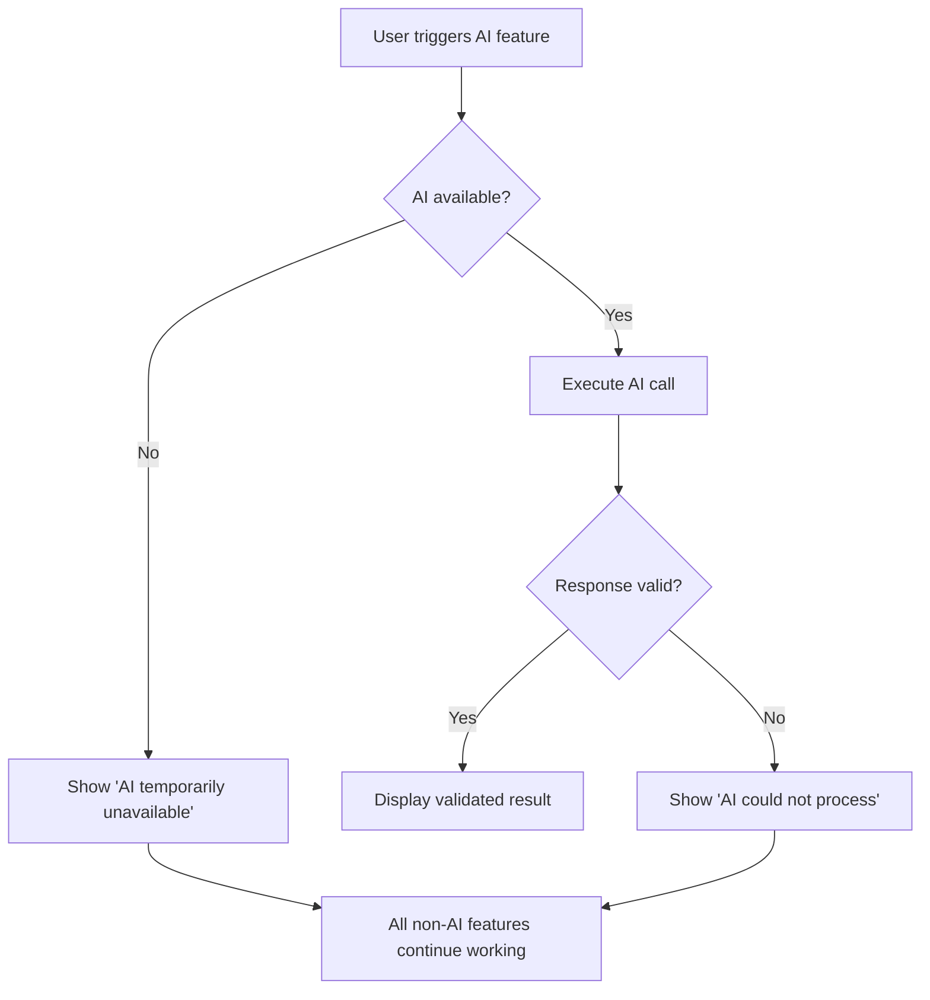

# MangoCycle Smart Platform — AI Architecture

> **Document Name:** AI Architecture  
> **Version:** 0.1  
> **Status:** Draft  
> **Last Updated:** 2026-08-28  
> **Owner:** MangoCycle Project Team  
> **Related Documents:** GOVERNANCE.md, 03-SYSTEM-ARCHITECTURE.md, 04-TECH-STACK.md, 08-SECURITY.md, 16-AI-WASTE-ANALYZER.md, 17-AI-PROCESSING-ADVISOR.md, 18-ASK-MANGOCYCLE.md, 19-AI-SUSTAINABILITY-INSIGHTS.md

---

## 1. Purpose

This document defines the overarching AI architecture for the MangoCycle Smart Platform, including the abstraction layer, provider strategy, safety framework, output validation, and the relationship between AI features. Individual AI feature specifications are in separate documents (16–19).

---

## 2. AI Design Principles

1. **AI as Support** — AI assists human decision-making; it never replaces scientific judgment
2. **Graceful Degradation** — The platform works fully without AI
3. **Server-Side Only** — AI API keys and calls are server-side; never client-side
4. **Validated Output** — AI responses are validated with Zod before use
5. **No Data Fabrication** — AI never fabricates database values or metrics
6. **Transparent Limitations** — All AI features display appropriate disclaimers
7. **Audited** — All AI interactions are logged in `ai_analysis_records`
8. **Deterministic First** — Calculations done by code/database, then LLM interprets results

---

## 3. AI Feature Map

| Feature | Document | Priority | Capabilities Used |
|---|---|---|---|
| AI Waste Visual Analyzer | [16-AI-WASTE-ANALYZER.md](./16-AI-WASTE-ANALYZER.md) | P2 | Vision, Structured Output |
| AI Processing Advisor | [17-AI-PROCESSING-ADVISOR.md](./17-AI-PROCESSING-ADVISOR.md) | P2 | Text Generation, Structured Output |
| Ask MangoCycle | [18-ASK-MANGOCYCLE.md](./18-ASK-MANGOCYCLE.md) | P2 | Tool Calling, Text Generation |
| AI Sustainability Insights | [19-AI-SUSTAINABILITY-INSIGHTS.md](./19-AI-SUSTAINABILITY-INSIGHTS.md) | P2 | Text Generation |
| AI Report Generator | [20-REPORTING.md](./20-REPORTING.md) | P3 | Text Generation |

---

## 4. AI Abstraction Layer

### 4.1 Provider Abstraction

All AI calls go through a single abstraction layer that can swap providers without changing feature code.

```
┌────────────────────────┐
│    AI Feature Code      │  (Waste Analyzer, Ask MangoCycle, etc.)
├────────────────────────┤
│   AI Provider Layer     │  (Abstraction)
│   - createCompletion()  │
│   - createVision()      │
│   - createWithTools()   │
├────────────────────────┤
│   Provider Adapter      │  (OpenAI / Gemini / Anthropic)
└────────────────────────┘
```

### 4.2 Provider Interface (Conceptual)

```typescript
interface AIProvider {
  // Text completion with structured output
  createCompletion(params: {
    systemPrompt: string;
    userMessage: string;
    responseSchema?: ZodSchema;
    temperature?: number;
  }): Promise<AIResponse>;

  // Vision analysis (image + text)
  createVision(params: {
    systemPrompt: string;
    userMessage: string;
    imageData: Buffer | string;  // base64 or URL
    responseSchema?: ZodSchema;
  }): Promise<AIResponse>;

  // Tool calling / function calling
  createWithTools(params: {
    systemPrompt: string;
    userMessage: string;
    tools: ToolDefinition[];
    maxIterations?: number;
  }): Promise<AIToolResponse>;
}

interface AIResponse {
  content: string;
  parsed?: unknown;       // Parsed structured output
  model: string;
  usage?: { promptTokens: number; completionTokens: number };
}
```

### 4.3 Provider Configuration

```typescript
// Determined by environment variable
const AI_PROVIDER = process.env.AI_PROVIDER || 'openai';

// Provider-specific configuration
const config = {
  openai: { model: 'gpt-4o', apiKey: process.env.AI_API_KEY },
  gemini: { model: 'gemini-pro', apiKey: process.env.AI_API_KEY },
  anthropic: { model: 'claude-sonnet', apiKey: process.env.AI_API_KEY },
};
```

---

## 5. Output Validation Framework

Every AI response is validated before use.

### 5.1 Validation Pipeline

```
AI Provider Response
    ↓
1. Check HTTP status (handle errors/timeouts)
    ↓
2. Parse response body
    ↓
3. Extract structured content
    ↓
4. Validate with Zod schema
    ↓
5. Sanitize text content (XSS prevention)
    ↓
6. Return validated result
    ↓
7. Store in ai_analysis_records
```

### 5.2 Error Handling

| Scenario | Behavior |
|---|---|
| Provider timeout (30s) | Return error: "AI temporarily unavailable" |
| Provider error (5xx) | Return error: "AI service error, try again later" |
| Rate limit exceeded | Return error: "Too many AI requests, please wait" |
| Malformed response | Log error, return: "AI returned unexpected format" |
| Schema validation fails | Log details, return: "AI response could not be verified" |
| Partial response | Attempt to use valid fields; flag incomplete |

### 5.3 Zod Validation Example

```typescript
// Conceptual: Waste Analyzer output schema
const WasteAnalysisSchema = z.object({
  waste_type: z.enum(['mango_peel', 'mango_seed', 'mixed_mango_waste', 'unknown']),
  visual_condition: z.enum(['good', 'moderate', 'poor', 'unknown']),
  visible_findings: z.array(z.string()).max(10),
  manual_review_recommended: z.boolean(),
  confidence_note: z.string(),
});
```

---

## 6. Prompt Management

### 6.1 Structure

Prompts are stored as TypeScript template functions in a `prompts/` directory:

```
lib/ai/prompts/
├── waste-analyzer.ts
├── processing-advisor.ts
├── ask-mangocycle.ts
├── sustainability-insights.ts
└── report-generator.ts
```

### 6.2 Prompt Versioning

Each prompt includes a version identifier stored with the `ai_analysis_records` entry:

```typescript
export const WASTE_ANALYZER_PROMPT = {
  version: 'v1.0',
  system: `You are an AI assistant for the MangoCycle Smart Platform...`,
  // ...
};
```

### 6.3 System Prompt Guidelines

All system prompts must:
- Clearly state the AI's role and boundaries
- Instruct the AI to never fabricate data
- Instruct the AI to communicate uncertainty
- Request structured JSON output where applicable
- Include the disclaimer framework

---

## 7. Disclaimer Framework

Every AI feature UI must display appropriate disclaimers.

### 7.1 Standard Disclaimers

| Feature | Disclaimer Text |
|---|---|
| Waste Analyzer | "AI-Assisted Visual Assessment — This analysis is based on visual features only and is not a substitute for laboratory testing." |
| Processing Advisor | "AI-Assisted Decision Support — Recommendations are based on available data and configurable rules. Scientific validation is required." |
| Ask MangoCycle | "Responses are generated from verified platform data. Always verify critical information." |
| Sustainability Insights | "AI-generated narrative based on calculated metrics. Verify underlying data for accuracy." |
| Report Generator | "AI-assisted report from verified platform data. Review before distribution." |

### 7.2 Display Pattern

Disclaimers appear:
- Above AI output in a subtle info banner
- In printed/exported reports as a footer note
- With an info icon (ℹ️) that expands to show the full disclaimer

---

## 8. AI Analysis Record Storage

All AI interactions are stored in the `ai_analysis_records` table (see [05-DATABASE-SCHEMA.md](./05-DATABASE-SCHEMA.md) §3.10).

| Field | Purpose |
|---|---|
| `analysis_type` | Which AI feature was used |
| `waste_batch_id` / `product_batch_id` | Context reference |
| `input_reference` | Description of input (e.g., "Image upload: waste_photo.jpg") |
| `prompt_version` | Version of the prompt template used |
| `model` | LLM model identifier |
| `input_data` | JSONB of the input sent (excluding raw image bytes) |
| `output_data` | JSONB of the validated AI output |
| `status` | completed / failed / error |
| `human_reviewed` | Whether a human has reviewed the output |
| `requested_by` | User who initiated the request |

---

## 9. Cost and Rate Management

### 9.1 Rate Limits

Per [08-SECURITY.md](./08-SECURITY.md) §8.2:

| Limit | Value |
|---|---|
| AI requests per user per minute | 10 |
| Vision requests per user per minute | 5 (images are expensive) |

### 9.2 Token Budget (Advisory)

For MVP, no hard token budget enforcement. Monitor usage via provider dashboard. Consider implementing token tracking in future.

---

## 10. AI Availability Handling



---

## Dependencies & Related Documents

| Document | Relationship |
|---|---|
| [GOVERNANCE.md](./GOVERNANCE.md) | Scientific language constraints |
| [03-SYSTEM-ARCHITECTURE.md](./03-SYSTEM-ARCHITECTURE.md) | AI data flow diagrams |
| [04-TECH-STACK.md](./04-TECH-STACK.md) | AI provider selection |
| [05-DATABASE-SCHEMA.md](./05-DATABASE-SCHEMA.md) | `ai_analysis_records` table |
| [08-SECURITY.md](./08-SECURITY.md) | AI security requirements, rate limits |
| [16-AI-WASTE-ANALYZER.md](./16-AI-WASTE-ANALYZER.md) | Waste analyzer feature spec |
| [17-AI-PROCESSING-ADVISOR.md](./17-AI-PROCESSING-ADVISOR.md) | Processing advisor feature spec |
| [18-ASK-MANGOCYCLE.md](./18-ASK-MANGOCYCLE.md) | Ask MangoCycle feature spec |
| [19-AI-SUSTAINABILITY-INSIGHTS.md](./19-AI-SUSTAINABILITY-INSIGHTS.md) | Sustainability insights feature spec |
| [20-REPORTING.md](./20-REPORTING.md) | AI Report Generator |
| [34-FUTURE-AI-ROADMAP.md](./34-FUTURE-AI-ROADMAP.md) | Future AI features |
| [37-OPEN-QUESTIONS.md](./37-OPEN-QUESTIONS.md) | AI provider decision |
