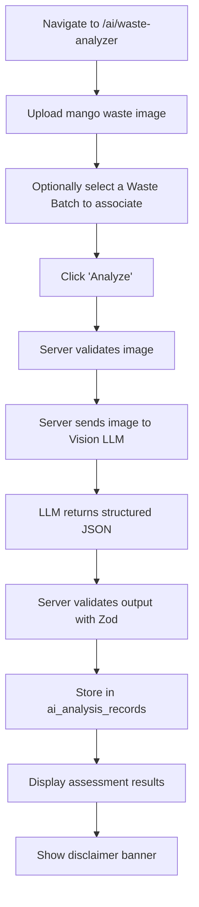

# MangoCycle Smart Platform — AI Waste Visual Analyzer

> **Document Name:** AI Waste Visual Analyzer  
> **Version:** 0.1  
> **Status:** Draft  
> **Last Updated:** 2026-08-28  
> **Owner:** MangoCycle Project Team  
> **Related Documents:** GOVERNANCE.md, 15-AI-ARCHITECTURE.md, 05-DATABASE-SCHEMA.md, 08-SECURITY.md

---

## 1. Purpose

This document specifies the AI Waste Visual Analyzer feature — an AI-assisted tool that allows users to upload an image of mango waste and receive a visual assessment using a multimodal Vision LLM.

---

## 2. Feature Summary

| Attribute | Value |
|---|---|
| Feature Name | AI Waste Visual Analyzer |
| Label | "AI-Assisted Visual Assessment" |
| Priority | P2 |
| Route | `/ai/waste-analyzer` |
| Min Role | `operator` |
| AI Capability | Vision / Image Input + Structured Output |
| Custom Model | No — uses pre-trained multimodal LLM |
| Custom Dataset | Not required for MVP |

---

## 3. User Flow



---

## 4. Input

| Field | Required | Detail |
|---|---|---|
| Image file | Yes | JPEG, PNG, or WebP; max 5 MB |
| Associated Waste Batch | Optional | Select from existing Waste Batches |

Image validation (see [08-SECURITY.md](./08-SECURITY.md) §7.2):
- Check file size ≤ 5 MB
- Validate MIME type (magic bytes, not just extension)
- Upload to Supabase Storage (`ai-uploads` bucket)

---

## 5. Output Schema

The LLM must return structured JSON matching this Zod schema:

```typescript
const WasteVisualAnalysisSchema = z.object({
  waste_type: z.enum(['mango_peel', 'mango_seed', 'mixed_mango_waste', 'unknown']),
  visual_condition: z.enum(['good', 'moderate', 'poor', 'unknown']),
  visible_discoloration: z.enum(['none', 'minor', 'moderate', 'severe', 'unknown']),
  visible_surface_irregularities: z.enum(['none', 'minor', 'moderate', 'severe', 'unknown']),
  visible_findings: z.array(z.string()).max(10),
  manual_review_recommended: z.boolean(),
  confidence_note: z.string().max(500),
});
```

### 5.1 Example Output

```json
{
  "waste_type": "mango_peel",
  "visual_condition": "moderate",
  "visible_discoloration": "moderate",
  "visible_surface_irregularities": "minor",
  "visible_findings": [
    "Dark spots visible on surface",
    "Uneven coloring observed",
    "No visible mold or fungal growth"
  ],
  "manual_review_recommended": true,
  "confidence_note": "Visual assessment only — based on image features. Not a substitute for laboratory analysis."
}
```

---

## 6. System Prompt

```
You are an AI visual assessment assistant for the MangoCycle Smart Platform,
a mango waste management and biotechnology research platform.

Analyze the provided image of mango waste and provide a structured visual assessment.

IMPORTANT CONSTRAINTS:
- You MUST respond with valid JSON matching the specified schema.
- You are performing VISUAL ASSESSMENT ONLY.
- You MUST NOT claim to determine:
  - Exact moisture percentage
  - Exact chemical composition
  - Exact fungal species
  - Exact contamination level
  - Exact disease diagnosis
  - Laboratory-confirmed quality grade
- Describe only what is VISUALLY observable.
- If uncertain, set fields to "unknown" and recommend manual review.
- Always include a confidence_note emphasizing this is visual assessment only.
```

**Prompt Version:** `waste-analyzer-v1.0`

---

## 7. Scientific Constraints

> [!CAUTION]
> The AI Waste Visual Analyzer must **NEVER** claim:
> - Exact moisture percentage
> - Exact chemical composition
> - Exact fungal species identification
> - Exact contamination levels
> - Exact disease diagnosis
> - Laboratory-confirmed quality grade
>
> Unless a validated custom model is developed in the future.

The feature must always be labeled: **"AI-Assisted Visual Assessment"**

---

## 8. UI Display

### 8.1 Results Card

```
┌──────────────────────────────────────────┐
│ ℹ️ AI-Assisted Visual Assessment          │
│ This analysis is based on visual          │
│ features only and is not a substitute     │
│ for laboratory testing.                   │
├──────────────────────────────────────────┤
│                                          │
│  [Uploaded Image Thumbnail]              │
│                                          │
│  Likely Waste Type:    Mango Peel        │
│  Visual Condition:     Moderate          │
│  Discoloration:        Moderate          │
│  Surface Irregularity: Minor             │
│                                          │
│  Visible Findings:                       │
│  • Dark spots visible on surface         │
│  • Uneven coloring observed              │
│  • No visible mold or fungal growth      │
│                                          │
│  ⚠️ Manual Review Recommended            │
│                                          │
│  Confidence: Visual assessment only      │
│                                          │
├──────────────────────────────────────────┤
│  Analyzed: 2026-01-15 14:30             │
│  Model: gpt-4o                           │
└──────────────────────────────────────────┘
```

### 8.2 Error States

| Scenario | Display |
|---|---|
| AI unavailable | "AI Visual Analyzer is temporarily unavailable. Please try again later." |
| Invalid image | "Please upload a valid image (JPEG, PNG, or WebP, max 5 MB)." |
| Analysis failed | "The image could not be analyzed. Please try again or submit for manual review." |

---

## 9. Storage

- Image stored in Supabase Storage: `ai-uploads/{analysis_id}/{filename}`
- Analysis result stored in `ai_analysis_records` with `analysis_type = 'visual_assessment'`

---

## Dependencies & Related Documents

| Document | Relationship |
|---|---|
| [GOVERNANCE.md](./GOVERNANCE.md) | Scientific language constraints |
| [15-AI-ARCHITECTURE.md](./15-AI-ARCHITECTURE.md) | AI abstraction layer, validation pipeline |
| [05-DATABASE-SCHEMA.md](./05-DATABASE-SCHEMA.md) | `ai_analysis_records` table |
| [08-SECURITY.md](./08-SECURITY.md) | Image upload security, AI security |
| [09-ROUTES-AND-PAGES.md](./09-ROUTES-AND-PAGES.md) | Route: `/ai/waste-analyzer` |
