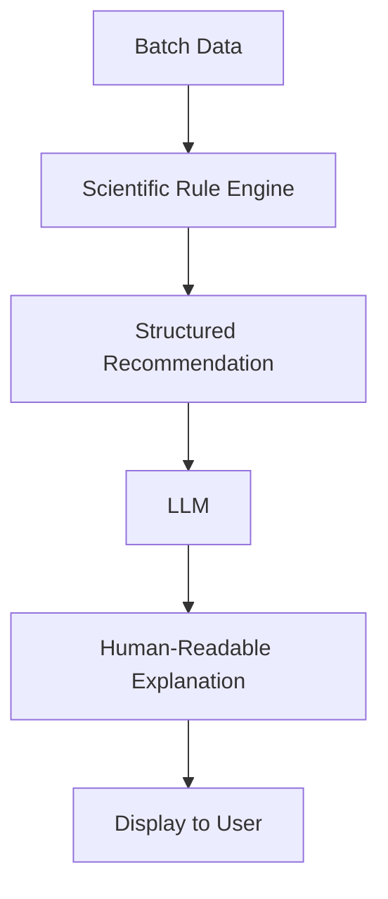
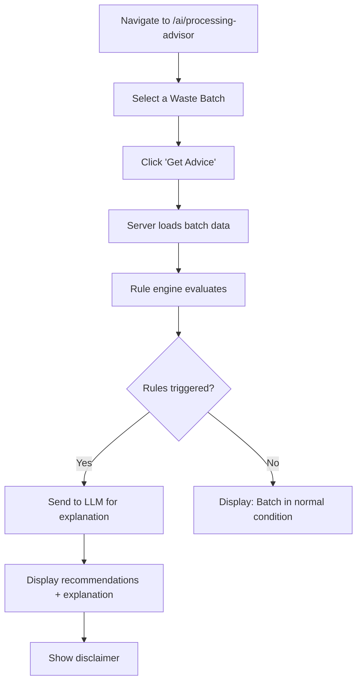

# MangoCycle Smart Platform — AI Processing Advisor

> **Document Name:** AI Processing Advisor  
> **Version:** 0.1  
> **Status:** Draft  
> **Last Updated:** 2026-08-28  
> **Owner:** MangoCycle Project Team  
> **Related Documents:** GOVERNANCE.md, 15-AI-ARCHITECTURE.md, 05-DATABASE-SCHEMA.md

---

## 1. Purpose

This document specifies the AI Processing Advisor — a hybrid rule-engine + LLM feature that recommends processing actions based on Waste Batch data.

---

## 2. Feature Summary

| Attribute | Value |
|---|---|
| Feature Name | AI Processing Advisor |
| Label | "AI-Assisted Decision Support" |
| Priority | P2 |
| Route | `/ai/processing-advisor` |
| Min Role | `operator` |
| Architecture | Scientific Rule Engine → Structured Recommendation → LLM Explanation |

---

## 3. Architecture

This feature is **not** pure LLM decision-making. It uses a two-step architecture:



### 3.1 Why This Architecture

| Pure LLM ❌ | Rule Engine + LLM ✅ |
|---|---|
| Unpredictable decisions | Deterministic, auditable rules |
| Cannot be scientifically validated | Rules defined/validated by scientific team |
| May hallucinate thresholds | Thresholds explicitly configured |
| Not explainable | Rules provide clear rationale |

---

## 4. Rule Engine

### 4.1 Rule Structure

```typescript
interface ProcessingRule {
  id: string;
  name: string;
  condition: RuleCondition;
  recommendation: string;
  priority: 'high' | 'medium' | 'low';
  requiresScientificValidation: boolean;
}

interface RuleCondition {
  field: string;
  operator: 'equals' | 'gt' | 'lt' | 'gte' | 'lte' | 'in';
  value: string | number | string[];
}
```

### 4.2 Prototype Rules

> [!WARNING]
> The rules below are **prototype values**. All thresholds marked "TBD" must be defined and validated by the scientific team. See [37-OPEN-QUESTIONS.md](./37-OPEN-QUESTIONS.md).

| Rule ID | Condition | Recommendation | Priority |
|---|---|---|---|
| R001 | `moisture_status = 'high'` | Prioritize drying stage before further processing | High |
| R002 | `storage_duration_days > TBD` | Manual review required — extended storage may affect quality | High |
| R003 | `visual_condition = 'poor'` | Inspection recommended before processing | High |
| R004 | `current_status = 'collected'` AND `collection_date > TBD days ago` | Begin sorting soon to prevent degradation | Medium |
| R005 | `waste_type = 'mango_seed'` AND `current_status = 'dried'` | Proceed to grinding — seeds require thorough grinding | Medium |
| R006 | `current_status = 'ground'` | Ready for extraction stage | Low |
| R007 | `current_status = 'production'` | Schedule laboratory testing | Low |

### 4.3 Rule Evaluation

```
Input: Waste Batch data
    ↓
Evaluate all active rules against batch fields
    ↓
Collect triggered rules
    ↓
Sort by priority (high → low)
    ↓
Output: Structured recommendations list
```

### 4.4 Configurable Thresholds

Thresholds should be stored in `app_settings` to allow adjustment without code changes:

```json
{
  "processing_advisor_rules": {
    "max_storage_days": 7,
    "max_days_before_sorting": 3
  }
}
```

> **Status:** Thresholds are "to be defined by scientific team."

---

## 5. LLM Explanation Layer

After the rule engine produces structured recommendations, the LLM generates a human-readable explanation.

### 5.1 Input to LLM

```json
{
  "batch_code": "MW-2026-001",
  "waste_type": "mango_peel",
  "current_status": "collected",
  "moisture_status": "high",
  "storage_duration_days": 5,
  "visual_condition": "moderate",
  "triggered_rules": [
    {
      "id": "R001",
      "recommendation": "Prioritize drying stage before further processing",
      "priority": "high"
    }
  ]
}
```

### 5.2 System Prompt

```
You are a processing advisor for the MangoCycle Smart Platform.

You have received batch data and a set of recommendations from a rule-based system.

Your task is to explain these recommendations in clear, helpful language.

IMPORTANT:
- Do NOT add new recommendations beyond what the rule engine provided.
- Do NOT invent scientific thresholds or values.
- Explain WHY each recommendation matters in the context of mango waste processing.
- Use professional but accessible language.
- If no rules triggered, explain that the batch appears to be in normal processing condition.
- Always note that final decisions should involve the scientific team.
```

### 5.3 Output

Plain text explanation displayed to the user alongside the structured recommendations.

---

## 6. User Flow



---

## 7. UI Display

```
┌──────────────────────────────────────────┐
│ ℹ️ AI-Assisted Decision Support           │
│ Recommendations based on configurable     │
│ rules. Final decisions require            │
│ scientific team validation.               │
├──────────────────────────────────────────┤
│                                          │
│  Batch: MW-2026-001                      │
│  Status: Collected | Moisture: High      │
│                                          │
│  ⚠️ HIGH: Prioritize Drying              │
│  The moisture status is recorded as high.│
│  Drying should be prioritized before     │
│  further processing to prevent quality   │
│  degradation.                            │
│                                          │
│  ℹ️ MEDIUM: Begin Sorting Soon           │
│  Batch has been in collected status for  │
│  5 days. Begin sorting to maintain waste │
│  quality.                                │
│                                          │
│  📝 All thresholds are prototype values  │
│  pending scientific validation.          │
│                                          │
└──────────────────────────────────────────┘
```

---

## 8. AI Failure Handling

If the LLM is unavailable, the rule engine recommendations are still displayed — just without the narrative explanation. The feature degrades gracefully.

---

## Dependencies & Related Documents

| Document | Relationship |
|---|---|
| [GOVERNANCE.md](./GOVERNANCE.md) | Scientific language constraints |
| [15-AI-ARCHITECTURE.md](./15-AI-ARCHITECTURE.md) | AI abstraction layer |
| [05-DATABASE-SCHEMA.md](./05-DATABASE-SCHEMA.md) | `waste_batches` fields, `ai_analysis_records`, `app_settings` |
| [08-SECURITY.md](./08-SECURITY.md) | AI security requirements |
| [09-ROUTES-AND-PAGES.md](./09-ROUTES-AND-PAGES.md) | Route: `/ai/processing-advisor` |
| [37-OPEN-QUESTIONS.md](./37-OPEN-QUESTIONS.md) | Scientific thresholds pending definition |
