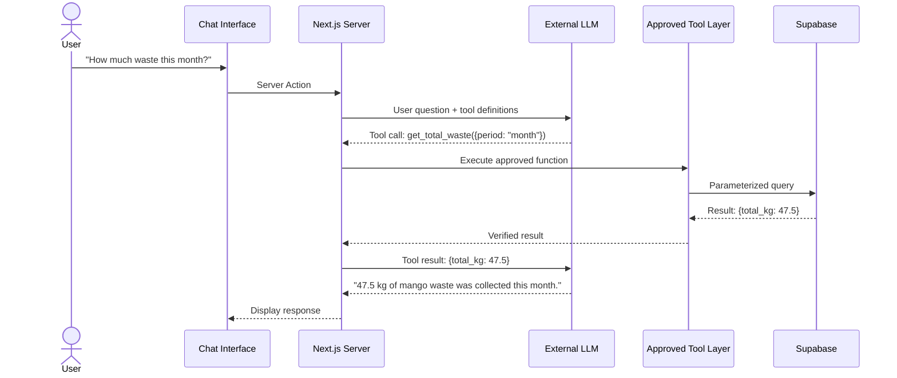

# MangoCycle Smart Platform — Ask MangoCycle

> **Document Name:** Ask MangoCycle  
> **Version:** 0.1  
> **Status:** Draft  
> **Last Updated:** 2026-08-28  
> **Owner:** MangoCycle Project Team  
> **Related Documents:** GOVERNANCE.md, 15-AI-ARCHITECTURE.md, 05-DATABASE-SCHEMA.md, 08-SECURITY.md

---

## 1. Purpose

This document specifies the Ask MangoCycle feature — a natural-language interface that allows users to query platform data using approved backend tool functions via LLM Tool Calling.

---

## 2. Feature Summary

| Attribute | Value |
|---|---|
| Feature Name | Ask MangoCycle |
| Priority | P2 |
| Route | `/ai/ask` |
| Min Role | `viewer` (read-only data access) |
| AI Capability | Tool Calling / Function Calling |
| Data Access | Read-only via approved tool functions |

---

## 3. Architecture



### 3.1 Safety Architecture

```
User Question
    ↓
LLM receives: System Prompt + Tool Definitions + User Question
    ↓
LLM selects an APPROVED tool with validated parameters
    ↓
Server executes ONLY the approved function
    ↓
Function runs a PARAMETERIZED query (no raw SQL)
    ↓
Result returned to LLM for natural language formatting
    ↓
Response validated and displayed
```

> [!CAUTION]
> The LLM must **NEVER**:
> - Generate or execute arbitrary SQL
> - Access tables or columns outside tool definitions
> - Modify any data (all tools are read-only)
> - Return raw UUIDs, API keys, or internal identifiers
> - Fabricate data not returned by tools

---

## 4. Approved Tool Functions

Each tool is a server-side function that executes a specific, parameterized database query.

### 4.1 Tool Definitions

| Tool | Description | Parameters |
|---|---|---|
| `get_total_waste` | Total weight of waste collected | `period?: 'week' \| 'month' \| 'year' \| 'all'` |
| `get_batches_by_status` | Count or list of batches by status | `status: string, limit?: number` |
| `get_batch_details` | Details of a specific Waste Batch | `batch_code: string` |
| `get_waste_by_source` | Waste weight grouped by source | `period?: string` |
| `get_waste_by_type` | Waste weight grouped by type | `period?: string` |
| `get_product_batch_details` | Details of a specific Product Batch | `batch_code: string` |
| `get_product_batches_summary` | Summary of product batches | `status?: string` |
| `get_dashboard_metrics` | All dashboard KPI values | `period?: string` |
| `get_recent_lab_results` | Recent laboratory test summaries | `limit?: number` |
| `get_batch_count` | Count of batches matching criteria | `status?: string, waste_type?: string` |

### 4.2 Tool Definition Format (for LLM)

```typescript
const tools = [
  {
    name: 'get_total_waste',
    description: 'Get the total weight of mango waste collected in the platform',
    parameters: {
      type: 'object',
      properties: {
        period: {
          type: 'string',
          enum: ['week', 'month', 'year', 'all'],
          description: 'Time period to filter by. Defaults to all.',
        },
      },
    },
  },
  {
    name: 'get_batch_details',
    description: 'Get detailed information about a specific waste batch by its code',
    parameters: {
      type: 'object',
      properties: {
        batch_code: {
          type: 'string',
          description: 'The waste batch code, e.g., MW-2026-001',
        },
      },
      required: ['batch_code'],
    },
  },
  // ... other tools
];
```

### 4.3 Tool Implementation Pattern

```typescript
// Conceptual — not implementation code
async function get_total_waste(params: { period?: string }) {
  const query = supabase
    .from('waste_batches')
    .select('weight_kg');

  if (params.period === 'month') {
    const startOfMonth = /* calculate */;
    query.gte('collection_date', startOfMonth);
  }

  const { data, error } = await query;
  if (error) throw new Error('Failed to query waste data');

  const total = data.reduce((sum, row) => sum + Number(row.weight_kg), 0);
  return { total_kg: Number(total.toFixed(3)), count: data.length };
}
```

### 4.4 Parameter Validation

Every tool validates its parameters with Zod before executing:

```typescript
const GetTotalWasteParams = z.object({
  period: z.enum(['week', 'month', 'year', 'all']).optional().default('all'),
});
```

---

## 5. System Prompt

```
You are Ask MangoCycle, a helpful data assistant for the MangoCycle Smart Platform.

You help users find information about mango waste batches, product batches,
laboratory tests, and platform metrics.

You have access to a set of tools that query the platform database.
Use these tools to answer user questions accurately.

IMPORTANT RULES:
1. ALWAYS use the provided tools to get data. NEVER make up numbers or data.
2. If a tool returns no results, say so honestly.
3. If the user asks something you cannot answer with the available tools, explain
   what information you can provide instead.
4. Format responses clearly. Use bullet points or short paragraphs.
5. When showing batch codes, use the public format (e.g., MW-2026-001).
6. Do NOT expose internal UUIDs, user emails, or system identifiers.
7. Do NOT generate SQL or attempt to access data outside the provided tools.
8. If asked to modify data, explain that you are a read-only assistant.
9. Keep responses concise and relevant.
```

---

## 6. Example Interactions

| User Question | Expected Tool Call | Expected Response Type |
|---|---|---|
| "How much waste was collected this month?" | `get_total_waste({period: "month"})` | "X kg of mango waste was collected this month from Y batches." |
| "Which batches are in the drying stage?" | `get_batches_by_status({status: "dried"})` | List of batch codes currently in dried stage |
| "Show me batch MW-2026-001" | `get_batch_details({batch_code: "MW-2026-001"})` | Formatted batch details |
| "Which source supplied the most waste?" | `get_waste_by_source({})` | Ranked list of sources by weight |
| "How many completed batches?" | `get_batch_count({status: "completed"})` | "There are X completed batches." |
| "Delete batch MW-2026-001" | None — refuse | "I'm a read-only assistant. Please use the Waste Batches page to manage batches." |
| "What's the weather?" | None — out of scope | "I can help with MangoCycle platform data. For example, try asking about waste batches or dashboard metrics." |

---

## 7. UI Design

### 7.1 Chat Interface

```
┌──────────────────────────────────────────┐
│  🤖 Ask MangoCycle                        │
│  Ask questions about your platform data   │
├──────────────────────────────────────────┤
│                                          │
│  User: How much waste this month?        │
│                                          │
│  MangoCycle: 47.5 kg of mango waste was  │
│  collected this month across 12 batches. │
│                                          │
│  User: Which source supplied the most?   │
│                                          │
│  MangoCycle:                             │
│  1. Mango Processing Factory A — 22.3 kg│
│  2. University Agriculture Lab — 15.0 kg │
│  3. Juice Factory B — 10.2 kg            │
│                                          │
├──────────────────────────────────────────┤
│  [Type your question...        ] [Send]  │
│                                          │
│  Suggested: "How many active batches?"   │
│  "Show dashboard metrics"                │
│  "Batches in drying stage"               │
└──────────────────────────────────────────┘
```

### 7.2 Suggested Questions

Display 3–5 suggested questions when the chat is empty to guide first-time users.

### 7.3 Conversation Scope

For MVP, each question is independent — no conversation memory across questions. This simplifies implementation and avoids context-window management.

---

## 8. Multi-Tool Iteration

The LLM may need to call multiple tools to answer a question (e.g., "Compare waste from Factory A and Factory B"). The system supports up to **3 tool call iterations** per question to prevent runaway loops.

---

## Dependencies & Related Documents

| Document | Relationship |
|---|---|
| [GOVERNANCE.md](./GOVERNANCE.md) | Canonical terminology |
| [15-AI-ARCHITECTURE.md](./15-AI-ARCHITECTURE.md) | AI abstraction layer, safety framework |
| [05-DATABASE-SCHEMA.md](./05-DATABASE-SCHEMA.md) | Tables queried by tools |
| [08-SECURITY.md](./08-SECURITY.md) | No raw SQL, rate limiting, data boundary |
| [09-ROUTES-AND-PAGES.md](./09-ROUTES-AND-PAGES.md) | Route: `/ai/ask` |
| [24-API-SPECIFICATION.md](./24-API-SPECIFICATION.md) | Tool function API contracts |
