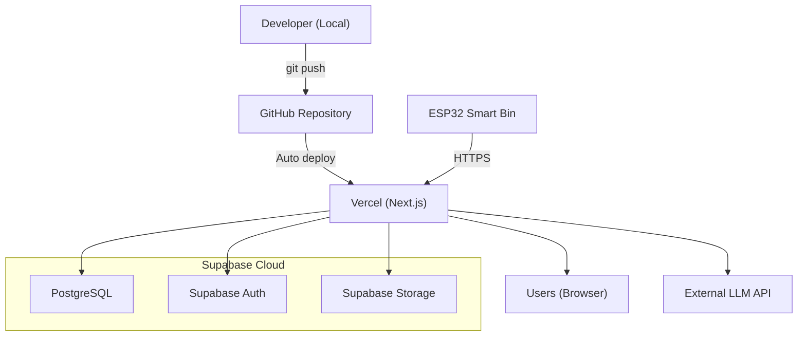

# MangoCycle Smart Platform — Deployment

> **Document Name:** Deployment  
> **Version:** 0.1  
> **Status:** Draft  
> **Last Updated:** 2026-08-28  
> **Owner:** MangoCycle Project Team  
> **Related Documents:** GOVERNANCE.md, 04-TECH-STACK.md, 29-ENVIRONMENT-CONFIG.md

---

## 1. Purpose

This document defines the deployment architecture, procedures, and environment management.

---

## 2. Deployment Architecture



---

## 3. Environments

| Environment | Purpose | Hosting |
|---|---|---|
| **Development** | Local development | `localhost:3000` + Supabase local or cloud dev project |
| **Preview** | PR preview deployments | Vercel preview URLs + dev Supabase project |
| **Production** | Live competition deployment | Vercel custom domain + production Supabase project |

### 3.1 Local Development

```bash
# Clone repository
git clone <repo-url>
cd mangocycle

# Install dependencies
npm install

# Set up environment
cp .env.example .env.local
# Fill in Supabase and AI credentials

# Run Supabase locally (optional)
npx supabase start

# Run migrations
npx supabase db push

# Start dev server
npm run dev
```

---

## 4. Database Migrations

| Tool | Command |
|---|---|
| Create migration | `npx supabase migration new <name>` |
| Apply to local | `npx supabase db push` |
| Apply to production | `npx supabase db push --linked` |
| Generate types | `npx supabase gen types typescript --linked > src/types/database.ts` |

### 4.1 Migration Rules

- Migrations must be deterministic and idempotent
- Use `IF NOT EXISTS` for creation statements
- Test migrations locally before applying to production
- Never modify existing migrations — create new ones
- Back up production database before major schema changes

---

## 5. Vercel Deployment

### 5.1 Configuration

| Setting | Value |
|---|---|
| Framework | Next.js (auto-detected) |
| Build command | `npm run build` |
| Output directory | `.next` |
| Install command | `npm install` |
| Node.js version | LTS (20.x or 22.x) |

### 5.2 Environment Variables

Set via Vercel dashboard → Settings → Environment Variables. Per-environment (Preview, Production).

### 5.3 Domain Setup

1. Add custom domain in Vercel dashboard
2. Configure DNS CNAME record
3. HTTPS is automatic

---

## 6. Rollback Strategy

| Layer | Rollback Method |
|---|---|
| Application | Vercel instant rollback to previous deployment |
| Database | Supabase point-in-time recovery (paid plans) or manual restore |
| Configuration | Git revert + redeploy |

---

## 7. Backup Considerations

| Component | Backup |
|---|---|
| Code | Git (GitHub) |
| Database | Supabase managed backups (daily on paid plans) |
| Storage files | Supabase Storage (backed by S3) |
| Environment variables | Documented in `.env.example`; actual values in Vercel dashboard |

---

## 8. Pre-Deployment Checklist

- [ ] All TypeScript checks pass (`npm run type-check`)
- [ ] Lint passes (`npm run lint`)
- [ ] Tests pass (`npm test`)
- [ ] Environment variables set in Vercel
- [ ] Database migrations applied
- [ ] No secrets in client-side code
- [ ] Public traceability pages tested
- [ ] QR codes point to correct domain

---

## Dependencies & Related Documents

| Document | Relationship |
|---|---|
| [04-TECH-STACK.md](./04-TECH-STACK.md) | Hosting technology choices |
| [29-ENVIRONMENT-CONFIG.md](./29-ENVIRONMENT-CONFIG.md) | Environment variable setup |
| [05-DATABASE-SCHEMA.md](./05-DATABASE-SCHEMA.md) | Migration procedures |
| [08-SECURITY.md](./08-SECURITY.md) | Deployment security |
